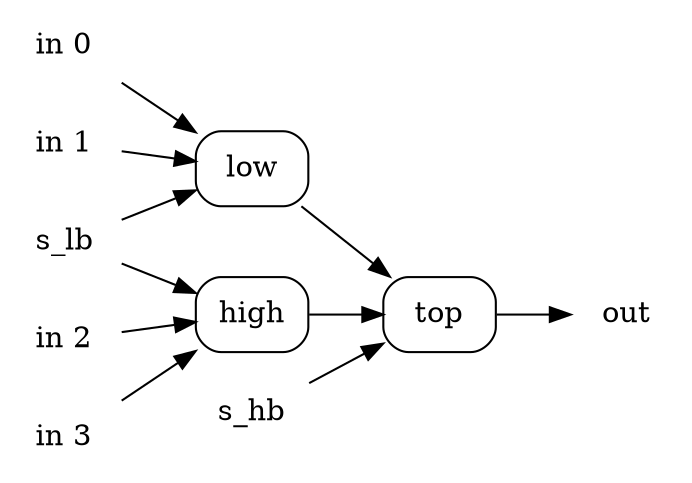
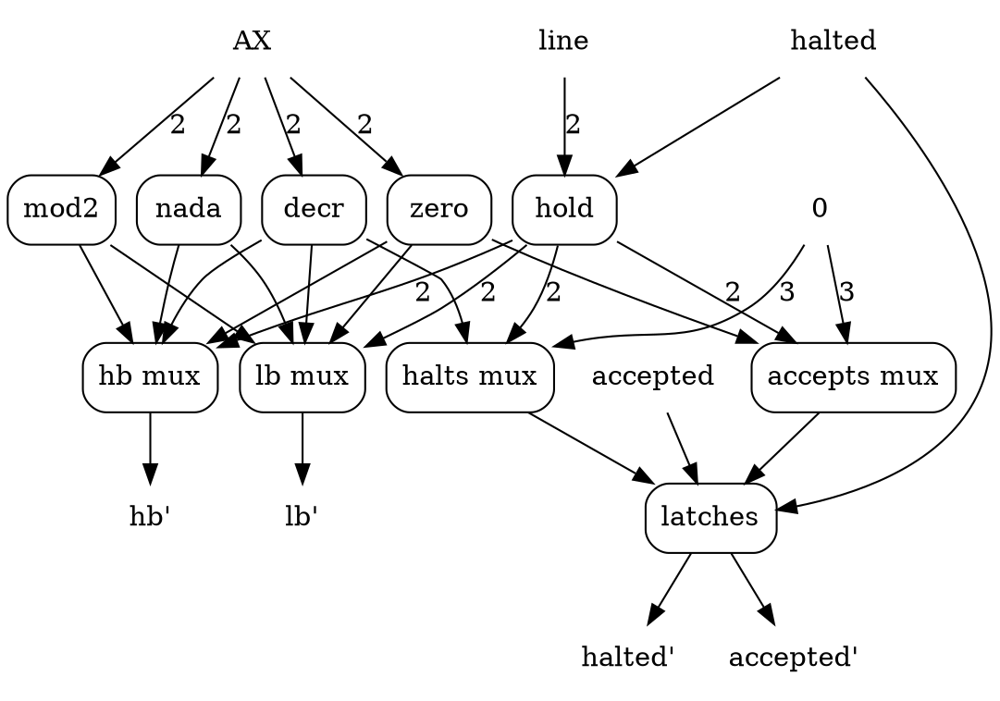
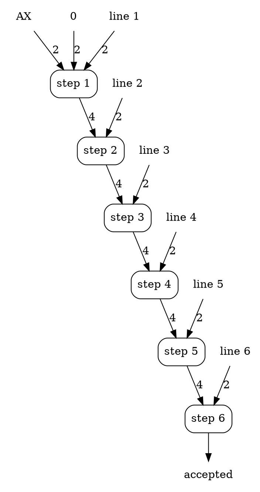
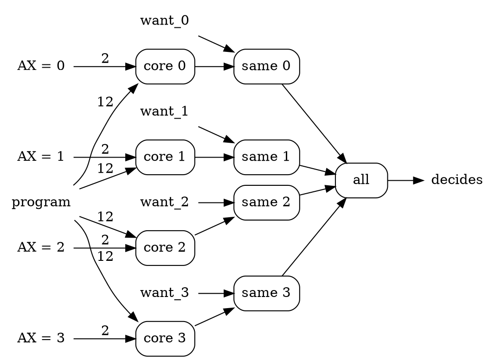
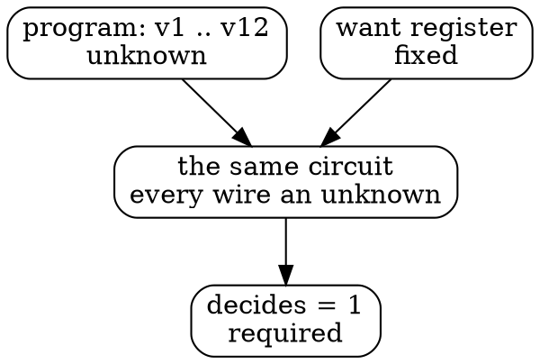
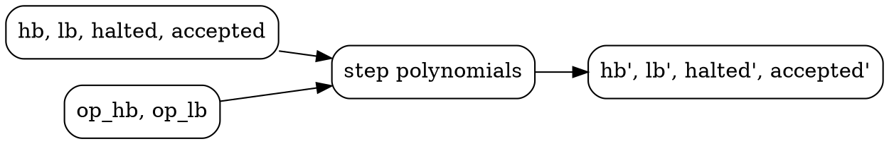
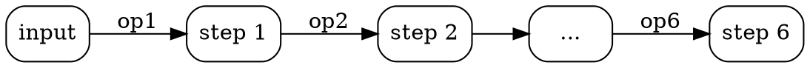
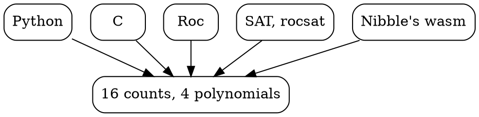

# A riff on Cook-Levin

A small book about [cook-levin-riff](https://github.com/showell/cook-levin-riff): a toy machine whose every program is a polynomial and a Boolean formula, the six-step composition that took three years to arrive, and five independent ways of computing the same answers that all agree.

The book is meant to be skimmed. Each chapter opens with a guidepost, in bold. It starts with the chapter's frame, the way it looks at the machine: ordinary computation, circuit design, mathematics, complexity theory or SAT solving. Where a chapter changes frame partway through, a line in italics says so. Then comes the chapter's kind, one of six, and the earlier chapter it needs, so you can jump in anywhere:

- **Start here**: the pitch and the machine, the two chapters to read first.
- **A review**: well-known ideas, retold beside the toy; skip one you know.
- **New results**: theorems, counts and answers worked out for this book, each checked by a run.
- **The machine in a new form**: the same machine seen as something new, and the guidepost names what: the machine as a puzzle, as gates, as a grid, as clauses or as polynomials, with program 1689 shown in each.
- **Big output to skim**: a monstrosity, printed whole because its size is the point.
- **Tools and history**: the languages, the solver, the cross-checks, the story, and what is still open.

This list is the whole book in one line a chapter, the kind in italics:

- {{chapter Introduction}}: what the book is for, its thesis, and its guide, program 1689. *Start here.*

**Part I, the toy:**

- {{chapter The machine}}: Steve's whole machine in one page. *Start here.*
- {{chapter Deciding in plain Python}}: every answer as a one-line Python lookup. *Tools and history.*
- {{chapter The languages in this book}}: the languages studied, from Nibble to polynomials, and the languages used, Roc above all. *Tools and history.*
- {{chapter Formal languages and machines}}: formal languages and Turing's machine in six rules. *A review.*
- {{chapter Programs as formal languages}}: all 4,096 programs run, and the problem with one answer. *New results.*
- {{chapter Which instructions are needed}}: one instruction is dead weight. *New results.*
- {{chapter Nibble, the puzzle page}}: sixteen puzzles to play in the browser. *The machine as a puzzle.*

**Part II, P, NP and Cook-Levin:**

- {{chapter P and NP}}: the two classes, defined. *A review.*
- {{chapter Nibble, sized}}: the toy grown until P and NP apply. *New results.*
- {{chapter P, NP and Cook-Levin}}: the theorem itself, and what it means for the toy. *A review.*

**Part III, Cook-Levin on the toy:**

- {{chapter The Boolean view}}: the toy as a chip sees it. *The machine as gates.*
- {{chapter The problems, seen from outside}}: the 16 puzzles are the 16 two-input gates. *New results.*
- {{chapter One formula for the whole machine}}: the whole machine as one formula of 14 bits. *The machine as one formula.*
- {{chapter The SAT solver}}: rocsat and the two questions we ask it. *Tools and history.*
- {{chapter Checking a claim}}: a claim about a program, checked by a solver. *The machine as clauses.*
- {{chapter Parts for a small computer}}: each instruction drawn as a circuit. *The machine as parts you could buy.*
- {{chapter The machine as a circuit}}: one step of the machine as 59 gates. *The machine's step as a circuit.*
- {{chapter The circuit, in full}}: the whole machine, and one wire that says "solved". *The machine as one chip.*
- {{chapter The circuit as equations}}: all 1,439 gates, to skim. *Big output to skim.*
- {{chapter From equations to CNF}}: why naming gates beats multiplying them out. *New results.*
- {{chapter The Cook-Levin machine}}: the circuit run backwards. *The machine run backwards.*
- {{chapter The tableau, filled in}}: Cook's grid, printed twice. *The machine as a grid.*
- {{chapter Cook-Levin as SAT}}: every puzzle as one formula. *New results.*
- {{chapter Solved by hand}}: a formula solved on paper. *The machine as clauses, worked on paper.*
- {{chapter The solver's work, in full}}: one puzzle's whole formula and answer, and all 15 proofs checked. *Big output to skim.*

**Part IV, the polynomials:**

- {{chapter The program left unknown}}: the machine as a formula of its program's bits, and two roads forward. *The machine as a formula of its program.*
- {{chapter Arithmetization}}: logic turned into arithmetic, kept small by one identity, x² = x. *The machine as polynomials.*
- {{chapter Six steps composed}}: four polynomials that are the machine. *New results.*
- {{chapter The delightful monstrosity}}: the machine as one polynomial, in full view, then evaluated by hand. *Big output to skim.*

**Part V, Nibble++, a bigger machine:**

- {{chapter Nibble++}}: a bigger machine, and why we built it. *New results.*
- {{chapter Two theorems about Nibble++}}: Fibonacci numbers, off by one where the inputs end. *New results.*
- {{chapter Shortest programs with mod2 and half}}: every shortest length, explained by one recursion. *New results.*
- {{chapter Nibble++ meets rocsat}}: a 17 MB proof, replayed. *New results.*
- {{chapter is_not_14 needs 28 lines}}: a public question, answered twice. *New results.*
- {{chapter Guided search}}: a search that asks about a few inputs at a time. *New results.*

**Part VI, the cross-checks, and the history:**

- {{chapter The oracles}}: five ways to the same answers. *Tools and history.*
- {{chapter The Roc port}}: the mathematics as Roc writes it. *Tools and history.*
- {{chapter How it got here}}: the toy in four days of 2023, and its polynomials composed in 2026. *Tools and history.*
- {{chapter What the toy taught us}}: Cook-Levin as it looks from inside the toy, in one page. *A review.*
- {{chapter What comes next}}: the steps still open. *Tools and history.*
- {{chapter Appendix: the step's encodings}}: every version of the step, side by side, a reference table. *The machine in every form at once.*
- {{chapter Appendix: two DRAT proofs}}: two of those proofs, printed lemma by lemma. *Big output to skim.*

**The monstrosities.** Here they all are, each shown because its size is the point:

- Monstrosity 1: the decider as 1,448 lines of equations, in {{chapter The circuit as equations}}.
- Monstrosity 2: the proof that five lines are too few for {0, 2, 3}, in {{chapter Appendix: two DRAT proofs}}.
- Monstrosity 3: the largest of the 15 proofs, in {{chapter Appendix: two DRAT proofs}}.
- Monstrosity 4: one puzzle as 1,216 clauses, in {{chapter The solver's work, in full}}.
- Monstrosity 5: the machine as one polynomial, in {{chapter The delightful monstrosity}}.
- Monstrosity 6: a 17 MB proof that 27 lines are too few, in {{chapter is_not_14 needs 28 lines}}.

## Introduction

**Every frame. Start here; it stands alone.** Some problems are easy to check and hard to solve: an answer can be confirmed in moments, but finding one can mean a search that doubles with every step. That gap is what makes computation feel intractable, and it is the question at the heart of P versus NP. This book doesn't answer that question. It makes the gap visible on a machine small enough to hold in your head, a toy designed by Steve Howell, and along the way it tries a few ways around it, which sometimes help and sometimes only show how wide the gap is. Its thesis, checked at every step: the toy and its Cook-Levin translation, as gates, clauses or polynomials, answer every question the same way.

**The thesis.** The Cook-Levin theorem turns any fast checker into one Boolean formula, so that a question about the checker becomes a question about the formula. This book does that to a toy machine, all the way through, and checks every step. **Its thesis: the machine and its Cook-Levin translation answer every question the same way**, whether the machine runs as a program, is wired as gates, is written as clauses for a SAT solver or is composed into polynomials. The method is a developer's: brute force first, since the toy is small enough to run everything, and refinement after, once the brute force has shown what is there. Steve's 2023 Python first checked that agreement on a handful of programs; this repository checks it on all of them, and finishes the composition he stopped short of ({{chapter Six steps composed}}).

**The machine is called Nibble.** Steve Howell invented it in March 2023: one two-bit register, `AX`, four instructions, `nada`, `zero`, `decr` and `mod2`, and programs exactly six lines long. Nibble is also the name of its assembly language and of the puzzle page where you can play it. A program accepts some of the inputs 0 to 3 and rejects the rest, so it decides one of 16 problems, and there are only 4,096 programs, so every claim about the machine can be checked by running all of them. Its bigger sibling, Nibble++, has a four-bit `AX` and programs of any length: 65,536 problems, and far too many programs to list, which is where brute force starts to strain. {{chapter The machine}} gives the rules in one page.

**A fair objection, answered early.** A fixed, finite machine answers every question by a table lookup, in constant time, so where does asymptotic theory get a grip? {{chapter Nibble, sized}} answers it: it gives the machine two sizes, a register of n bits and a program of k lines, and lets them grow, so that P and NP have something to measure.

**Program 1689 is your guide.** It is `zero, decr, decr, zero, decr, zero`, the one program that decides {0, 2, 3}. In base 4, 1689 is 122121, one digit a line, with `zero` as 1 and `decr` as 2: the number is the program. Each chapter that shows the machine in a new form shows 1689 in it too, in a box headed "1689, here", so a reader who follows the boxes alone sees the whole reduction, from a run to a satisfying assignment. The Nibble++ chapters follow is_not_14's 28-line program the same way, in boxes headed "is_not_14, here".

**The monstrosities.** This machine fits on an index card: one two-bit register, four instructions, six lines. Yet it keeps producing monsters, and we have numbered them proudly, like theorems. The question "does this program accept this input?", composed through six steps, becomes one polynomial of 510,387 characters (Monstrosity 5). Wiring the same machine as gates takes 1,439 equations (Monstrosity 1). Ask whether the 4-bit Nibble++ can decide is_not_14 in 27 lines, and the answer, that every 27-line program fails, comes backed by a proof of 17,192,870 bytes that our own checker replays line by line (Monstrosity 6), while the answer at 28 lines is a program of 56 bits that you check by running it. That gap is NP's in miniature: a yes has a short certificate, and the best known evidence the other way can be enormous. Skim the monsters, marvel, and move on: each one is the hidden complexity in simple things, and the front page lists all six.

Steve wrote the first version by hand in Python, in [virtual-machine](https://github.com/showell/virtual-machine): the machine (`virtual_machine.py`), a general polynomial library (`poly.py`) and a stepper that writes one step of the machine as polynomials (`stepper.py`). The machine is Steve's invention; the code in this repository, written by AI coding agents (Claude) with human supervision, departs from the 2023 Python wherever a cleaner choice turned up, and its choices are this book's own. Each language has one role, which {{chapter The languages in this book}} sets out.

### Why the name fits

The Cook-Levin theorem says that satisfiability of Boolean formulas is NP-complete: any problem whose answers a machine can check in polynomial time reduces to it. The proof unrolls the checking machine, step by step, into one formula. This repository does that unrolling on a toy instrument. It makes no claim about NP, and it reduces one machine's questions, never an arbitrary verifier's. It also goes one step past the formula, into arithmetic: the whole program becomes four polynomials with integer coefficients. "A riff" is the honest word for that.

### Where the numbers come from

Each number here comes from the repository, a commit, a golden file or a program run, named where it is used. Code is quoted as it stands when the book is built. Under each theorem a "Run it" box gives the command that checks it, from the repository's root once `shale build.shale` has built the tests, and the line it prints; the book's build holds each line to its test file.

So every claim in this book comes with a run that checks it, on a machine small enough to hold in your head.

## The machine

**Ordinary computation. Start here; it stands alone.** Here you get Steve's whole machine in one page: four instructions, a two-bit register and a spec of 26 lines. Every later chapter is this machine seen from another side.

The machine holds one register, `AX`, of 2 bits, so `AX` is 0, 1, 2 or 3. A run starts with `AX` set to the input. Its program is six instructions, each one of four opcodes, and the machine's programming language, an assembly language, is called Nibble.

### Steve's spec

The toy's plain-English spec is the docstring at the top of Steve's `virtual_machine.py` ([lines 10 to 35](https://github.com/showell/virtual-machine/blob/94c3d31/virtual_machine.py#L10-L35), at commit [94c3d31](https://github.com/showell/virtual-machine/commit/94c3d31)), quoted as it stands:

```text
    Every program is a sequence of these opcodes (aka instructions):

        00 (nada):
            (do nothing)

        01 (zero):
            AX = 3 -> ignore and continue
            AX = 2 -> ignore and continue
            AX = 1 -> ignore and continue
            AX = 0 -> halt and accept input

        10 (decr):
            AX = 3 -> AX = 2 and continue
            AX = 2 -> AX = 1 and continue
            AX = 1 -> AX = 0 and continue
            AX = 0 -> halt and reject input

        11 (mod2):
            AX = 3 -> AX = 1
            AX = 2 -> AX = 0
            AX = 1 -> AX = 1
            AX = 0 -> AX = 0

    Every program must include exactly six instructions.  If at the end
    of that program you have not accepted the input, then the input is
    implicitly rejected.
```

Every behaviour of the machine is in those 26 lines. The rest of this part only runs them.

### Four opcodes

`src/vm.c` holds the rule, as `run_progam` and its one-step helper:

{{lines src/vm.c from "Machine vm_step(Machine m, Op op) {" to "m.ax = m.ax % 2;"}}

- **`nada`** leaves the state as it is.
- **`zero`** accepts when `AX` is 0, and the run ends; at any other value the run goes on.
- **`decr`** takes 1 from `AX`, and rejects when `AX` is already 0.
- **`mod2`** takes 2 from `AX` when it is 2 or 3, leaving its last bit.

A run that reaches the end of its six instructions rejects. So a program accepts some of the four inputs and rejects the rest, and the set it accepts is the problem it decides. Complexity theory calls such a set a *formal language* or a *decision problem*; this book calls each of the 16 subsets of {0, 1, 2, 3} a *problem*.

### One program, input by input

Here is a program that decides {3}, the problem the puzzle page calls `is_huge`. In an ordinary programming language it is `n == 3`. In Nibble it is program 2704:

```text
decr
decr
decr
zero
nada
nada
```

Read it once for each input:

- **From 0**, line 1's `decr` rejects.
- **From 1**, line 1 takes `AX` to 0, and line 2 rejects.
- **From 2**, lines 1 and 2 take `AX` to 0, and line 3 rejects.
- **From 3**, three `decr`s take `AX` to 0, and line 4's `zero` accepts.

So the program accepts {3} and rejects the rest. Every input's run ends by line 4, so lines 5 and 6 could hold any opcodes. That is one reason most problems have many programs.

Steve's own view of `nada` and of the design, in his words: "nada is kinda not a real instruction under my machine. It just makes it so that every program is exactly 12 bits. It's also worth saying that the language was designed to have some complexity. It's using an imperfect machine to solve the problem somewhat by design." {{chapter Which instructions are needed}} makes both points exact: `nada` is redundant (Theorem 6), and two instructions of another design would decide every problem in four lines (Theorem 7).

### Counting

Each instruction is one of 4 opcodes, so there are 4^6 = 4,096 programs. Each problem is a subset of {0, 1, 2, 3}, so there are 2^4 = 16 problems. Each program is a 12-bit number, two bits an instruction, and `assemble` and `disassemble` in `src/vm.c` convert between the two forms.

### Program numbers

This book names a program by its number. Read the six lines as the digits of a base-4 number, line 1 first, with `nada` 0, `zero` 1, `decr` 2 and `mod2` 3: the number is op₁·4⁵ + op₂·4⁴ + op₃·4³ + op₄·4² + op₅·4 + op₆. So program 0 (`nada, nada, nada, nada, nada, nada`) is the first, program 4095 (`mod2, mod2, mod2, mod2, mod2, mod2`) is the last, and the number's twelve bits, line 1's two first, are the program's machine code as the puzzle page shows it. A program of fewer than six lines ends in `nada`, so its number ends in base-4 zeros. Steve's Python, and the C that matches it byte for byte, count through the programs in the other order, line 1 as the lowest digit. That order only decides which program the search finds first; the numbers in this book are all of the kind defined here, and the build checks each against the program it names.

Type 1689 into the [sandbox](https://roc.lynrummy.com/nibble/sandbox.html), and its trace shows this run, a row a line and a column an input.

```text 1689, here: the program, and its run from each input
program 1689: base-4 digits 1 2 2 1 2 1, machine code 01 10 10 01 10 01
line   op    from 0  from 1  from 2  from 3
start        AX=0    AX=1    AX=2    AX=3
1      zero  accept  AX=1    AX=2    AX=3
2      decr  ·       AX=0    AX=1    AX=2
3      decr  ·       reject  AX=0    AX=1
4      zero  ·       ·       accept  AX=1
5      decr  ·       ·       ·       AX=0
6      zero  ·       ·       ·       accept
decides {0, 2, 3}
```

That's the whole machine. Every chapter after this is the same six lines, seen from somewhere new.

## Deciding in plain Python

**Ordinary computation. Tools and history; it stands alone.** You will see that every question the toy answers is a one-line lookup in Python, and that is exactly why the machine is worth taking apart.

A problem is four answers, one per input, so deciding one takes a line of ordinary code. The code here is `python/decides.py`, which `build.shale` runs on every build: it holds its two versions to each other on all 16 problems and all four inputs, and each one-line test below to its problem.

### Two versions of `decides`

A problem's *want* code has bit n set when input n is in it, so {0, 2, 3} is 1 + 4 + 8 = 13; {{chapter Programs as formal languages}} tables all 16 codes. The plain version lists the members and looks n up among them:

{{lines python/decides.py from "def decides(want, n):" to "    return n in members"}}

The golfed version reads bit n of `want` directly:

{{lines python/decides.py from "decides_golfed =" to "decides_golfed ="}}

### Some problems as one test

Many of the 16 problems have a natural test of n, or of its two bits, `hb` and `lb` (n is 2·`hb` + `lb`):

{{lines python/decides.py from "ONE_LINERS = {" to "hb XOR lb"}}

{{chapter The problems, seen from outside}} lists all 16 this way, as Boolean expressions of the two bits.

### What the machine adds

The want code already says everything about a problem. The Nibble machine takes up to six lines to say the same thing, and for {0, 2, 3} it takes all six, in its one program. The composed polynomial of {{chapter Six steps composed}}, which runs every program on every input at once, takes 10,324 terms. The machine is there to be the thing analysed, a small checker that Cook and Levin's construction can turn into a formula; the question it answers is a lookup.

## The languages in this book

**Ordinary computation. Tools and history; it needs {{chapter The machine}}.** Here are the languages this book studies and the languages it is written in, with the job each one does.

In this book you will see code from languages like Roc, Python, C, and JS. But these are the tools, not the subject, of this book. The subject is a different set of languages: the toy's own, the formal languages its programs decide, and the notations the machine is rewritten into, from formulas to polynomials.

### The languages studied

Nibble and Nibble++ are Steve's toy languages. They are specifically designed to be small in scope. Nibble fits in your hand. Nibble++ pushes just past brute force. Both come to life in playgrounds that accompany the book, and the machine you click there is the same Roc code this book quotes, compiled to run in your browser. Try [Nibble's puzzles](https://roc.lynrummy.com/nibble/) and the [Nibble++ playground](https://roc.lynrummy.com/nibble/plus.html).

Each program decides a *formal language*, the set of inputs it accepts, and that is the sense in which a program "is" a formal language ({{chapter Formal languages and machines}}). Nibble's programs decide the 16 subsets of {0, 1, 2, 3}; Nibble++'s decide the 65,536 subsets of 0 to 15.

Chapter by chapter, the machine is rewritten into four more languages:

| language | what it says about the machine | where |
|---|---|---|
| Boolean formulas | every run as AND, OR and NOT of the program's and the input's bits | {{chapter One formula for the whole machine}} |
| CNF clauses, in the DIMACS files rocsat reads | a puzzle as clauses whose solutions are exactly its programs | {{chapter Cook-Levin as SAT}} |
| DRAT proofs | that every program of a given length fails a puzzle, lemma by lemma | {{chapter The solver's work, in full}} |
| polynomials | the whole machine as integer arithmetic, 10,324 terms for `accepted` | {{chapter Arithmetization}} |

### The languages used

Roc is our lingua franca in this book. This is not a book about type systems, but Roc's clear type annotations help us express mathematical concepts. It's also simply a good working language. It has the horsepower for computation and versatility to live in the browser.

Python is the programming language that inspired the book. We use Python mostly as a historical relic, but it remains an oracle to Roc and occasionally shines as a mainstream programming language whose syntax most programmers understand.

C is our utility infielder. We use it for its raw speed and easy linkability. And when rocsat says no program exists, it's a small C program that checks the proof, so the book never has to take Roc's word for Roc's answers.

Finally, JS does what JS does best. JS runs the skin of our toys. It also serves as a final oracle: the same machine, written in plain JavaScript, gives the same answers in the book's last chapter, and runs there on a compiler we happen to have written ourselves (in Roc!).

## Formal languages and machines

**Complexity theory. A review; skip it if you know Turing machines.** We explain the one word complexity theory runs on, the formal language, and show a Turing machine deciding one with six rules.

In computer science a *formal language* is a set of strings. The book spends two words on it because it also has a *programming language*, Nibble, the notation its programs are written in, and the two are different things: a Nibble program decides a formal language. Pick an alphabet, say the digits 0 to 9, and any set of strings over it is a formal language: the decimal numerals of the primes, the palindromes, the strings that are valid Roc programs. A formal language is the cleanest way to state a decision question. "Is 91 prime?" becomes "is the string `91` in the formal language of primes?"

### Machines that decide

A machine *decides* a formal language when, given any string, it halts, accepting the strings in the language and rejecting the rest. A program that decides the primes is a primality test; a compiler's parser decides the formal language of well-formed programs, and rejects the rest with an error.

### Turing's machine

In 1936 Alan Turing described a machine with a finite set of states and an unbounded tape, in "On Computable Numbers, with an Application to the Entscheidungsproblem" (*Proceedings of the London Mathematical Society*, series 2, volume 42; a [free scan](https://www.cs.virginia.edu/~robins/Turing_Paper_1936.pdf)). It reads and writes the tape one cell at a time, and every algorithm anyone has written since can be carried out by such a machine; that claim is the Church-Turing thesis. Turing also showed that some formal languages are undecidable: whatever machine one builds for them, some string defeats it. The best known is the halting problem, the formal language of programs that halt on their input. A machine can *recognize* it, accepting every member by running it, but for some strings outside the language it runs forever, still waiting to answer.

### A simple example

Take the alphabet {a, b} and the formal language of strings with an even count of a's: `aba` and `bb` are in it, `ab` and `aaab` are out. A Turing machine decides it with two working states, `even` and `odd`, and a head that reads the tape left to right. The input is written on the tape, with blank cells after it, and the machine starts in `even` on the first symbol.

| state | reads | writes | moves | next state |
|---|---|---|---|---|
| `even` | a | a | right | `odd` |
| `even` | b | b | right | `even` |
| `even` | blank | blank | stays | accept |
| `odd` | a | a | right | `even` |
| `odd` | b | b | right | `odd` |
| `odd` | blank | blank | stays | reject |

Each row is one rule: in this state, reading this symbol, write this, move, and go to that state. The state remembers the one fact that matters, whether the a's seen so far are even, and the blank after the input is where the machine answers.

A run on `aba`:

| step | state | reading | tape, head in brackets |
|---|---|---|---|
| 1 | `even` | a | [a] b a _ |
| 2 | `odd` | b | a [b] a _ |
| 3 | `odd` | a | a b [a] _ |
| 4 | `even` | blank | a b a [_] |
|   | accept | | |

And on `ab`: `even` reads a and moves to `odd`, `odd` reads b and stays `odd`, `odd` reads the blank and rejects. Every run takes one step per symbol and then halts, so the machine decides the formal language: it accepts exactly the strings with an even count of a's.

This machine only reads and moves right, so it is also a finite automaton; Turing's machines earn their tape on harder formal languages, such as the strings of a's followed by the same number of b's, where the machine writes marks on the tape to pair each a with a b. The idea carries over unchanged: states, a rule table, a run that ends in accept or reject, and a formal language made of the strings accepted.

*The frame switches here from Turing's machines to this book's.*

### This book's machine

The machine here is Turing's idea at its smallest. Its tape is one 2-bit register, its inputs are the four strings 0, 1, 2 and 3, and every run halts within six steps, so every question about it is decidable by trying everything. Its formal languages are the 16 subsets of {0, 1, 2, 3}, the problems of {{chapter The machine}}, which a program, a circuit and a SAT formula each decide alike. A program decides exactly one of them, the set of inputs it accepts.

Which program decides which of them is the next question, and running all 4,096 programs settles it.

## Programs as formal languages

**Ordinary computation. New results; it needs {{chapter The machine}}.** We settle which problems the toy decides by running all 4,096 programs, and we find the one problem that exactly one program solves.

Steve settled which programs decide which problems twice in Python: first by construction, then by running everything.

### The analytical solution, 2023

The first, `find_solutions_analytically`, came on the machine's first day, 2023-03-11, in [d6bb78f](https://github.com/showell/virtual-machine/commit/d6bb78f) ("Add analytical solution."), stamped 13:02, and the stepper followed at 15:47 ([ba9388a](https://github.com/showell/virtual-machine/commit/ba9388a)). The machine was smaller then. That commit has two opcodes, `check` (today's `zero`) and `decr`, programs of up to 8 instructions, and a brute-force search over the program numbers 0 to 255. Its `solve` ([virtual_machine.py, lines 185 to 195](https://github.com/showell/virtual-machine/blob/d6bb78f/virtual_machine.py#L185-L195)) builds a problem's program directly: `decr` down to the least member, `check`, and the same for the rest.

```python
    def solve(lang):
        if not lang:
            # The program can terminate to reject all further numbers
            return []

        program = []
        while lang[0] > 0:
            program.append("decr")
            lang = [i-1 for i in lang]

        return program + ["check"] + solve(lang[1:])
```

For each of the 16 problems it asserted the program shorter than 8 and ran it on all four inputs (`assert f(x) == y`). Later commits removed it; it is absent at [94c3d31](https://github.com/showell/virtual-machine/commit/94c3d31).

### The complete calculation

Today's `find_solutions` ([virtual_machine.py, lines 148 to 180](https://github.com/showell/virtual-machine/blob/94c3d31/virtual_machine.py#L148-L180)) runs every program on every input and groups the programs by the problem each decides. The runs are `run_progam`'s ([lines 76 to 105](https://github.com/showell/virtual-machine/blob/94c3d31/virtual_machine.py#L76-L105)), the plain interpreter: a loop over the six instructions, an `if`/`elif` on each opcode and on `AX`, the spec above as code. That is the complete calculation, 4,096 programs on 4 inputs, 16,384 runs. It also re-runs each problem's first program, 16 programs on 4 inputs, through the step polynomials of {{chapter Arithmetization}} (lines 178 to 180); the theorems here rest on the interpreter alone.

### The theorems

**Theorem 1.** Every one of the 16 problems is decided by some six-instruction program.

*Proof by construction.* On today's machine `solve` builds a program of six lines or fewer for 15 problems, and each decides its problem. For {0, 1, 2, 3} it builds seven, `zero, decr, zero, decr, zero, decr, zero`, one past the limit, and Python's report gives `mod2, zero, decr, zero` for it. A test runs the construction on every problem.

*Proof by exhaustion.* `find_solutions` runs all 4,096 programs on `run_progam` and asserts `len(solutions[y]) > 0` for every problem `y` (lines 159 to 160).

```text Run it
$ out/tcc/test_theorems
tests/test_theorems.c: 9 tests passed
the test: the_analytical_solution_decides_every_language
```

**Theorem 2.** With `nada`, `zero` and `decr` alone, exactly 15 of the 16 problems are decided by a six-instruction program; {0, 1, 2, 3} needs `mod2`.

*Proof.* Run the 3^6 = 729 programs over `nada`, `zero` and `decr`: they decide 15 problems, {0, 1, 2, 3} the one missing.

```text Run it
$ out/tcc/test_theorems
tests/test_theorems.c: 9 tests passed
the test: without_mod2_fifteen_languages_are_decided
```

**Theorem 3.** The number of programs deciding each problem is the table's programs column, and the 16 counts sum to 4,096.

*Proof.* Each program is filed under the one problem it decides, so the counts partition the 4,096 programs. Python's report gives each count, and the C prints that report byte for byte.

```text Run it
$ out/tcc/test_golden
tests/test_golden.c: 1 tests passed
the test: find_solutions_prints_pythons_output_byte_for_byte
```

In the table, a problem's code is its inputs as bits: input i accepted sets bit i. A program's length is its instructions before its trailing `nada`s, and the shortest column is the least length among a problem's programs.

| code | problem | programs | shortest |
|---|---|---|---|
| 0 | { } | 844 | 0 |
| 1 | {0} | 681 | 1 |
| 2 | {1} | 303 | 2 |
| 3 | {0, 1} | 172 | 3 |
| 4 | {2} | 248 | 3 |
| 5 | {0, 2} | 883 | 2 |
| 6 | {1, 2} | 74 | 4 |
| 7 | {0, 1, 2} | 13 | 5 |
| 8 | {3} | 63 | 4 |
| 9 | {0, 3} | 12 | 5 |
| 10 | {1, 3} | 520 | 3 |
| 11 | {0, 1, 3} | 150 | 4 |
| 12 | {2, 3} | 13 | 5 |
| 13 | {0, 2, 3} | 1 | 6 |
| 14 | {1, 2, 3} | 15 | 5 |
| 15 | {0, 1, 2, 3} | 104 | 4 |

**Theorem 4.** Each problem's shortest program has the length in the table's shortest column.

*Proof.* Measure the length of all 4,096 programs and take each problem's least: the 16 are the table's. {{chapter Cook-Levin as SAT}} proves it again a different way: a SAT solver shows each length one line shorter impossible, with a proof a checker replays ({{chapter The solver's work, in full}}).

```text Run it
$ out/tcc/test_theorems
tests/test_theorems.c: 9 tests passed
the test: each_language_has_the_shortest_length_the_book_states
```

### The rare one

**Theorem 5.** {0, 2, 3} is decided by exactly one program, and that program uses all six lines. It is program 1689:

```text
zero
decr
decr
zero
decr
zero
```

*Proof.* Python's report gives {0, 2, 3} a count of 1 and this program as its example, and Theorem 3's search is exhaustive. `solve` builds the same program.

```text Run it
$ out/tcc/test_golden
tests/test_golden.c: 1 tests passed
the test: find_solutions_prints_pythons_output_byte_for_byte
```

**1689, here**, in Steve's Python's report:

{{lines tests/golden/find_solutions.txt from "[0, 2, 3] is solved by 1 possible program" to "it accepts [0, 2, 3]"}}

Input 0 is accepted on line 1. Input 1 drops to 0 on line 2 and is rejected by the `decr` on line 3. Input 2 reaches 0 on line 3 and is accepted on line 4. Input 3 reaches 0 on line 5 and is accepted on line 6. The problem skips 1, and the only way past it is to count down past it.

### The common ones

The empty problem, { }, has 844 programs, since any program that rejects every input will do, and {0, 2} has 883: `mod2` then `zero` is two lines, and many longer programs reach the same verdicts.

A problem may have 883 programs or only one, and the lone one, program 1689, guides the rest of the book.

## Which instructions are needed

**Ordinary computation. New results; it needs {{chapter Programs as formal languages}}.** We prove that one of the four instructions is dead weight, and that two instructions of another design would decide everything in four lines.

{{chapter Programs as formal languages}} counted what the four opcodes decide together. This chapter takes them apart: which of the four are needed, and what instructions of other designs could do.

### The four opcodes

**Theorem 6.** The six-line programs over `zero`, `decr` and `mod2` decide all 16 problems, and each of the three is needed: dropping `zero` leaves only { } decided, dropping `decr` leaves 3 problems, and dropping `mod2` leaves 15 (Theorem 2). `nada` is redundant: the programs over the other three decide all 16. And every shortest program is made of `zero`, `decr` and `mod2` alone.

*Proof.* Run the 4,096 programs, keep those whose every instruction is in a given set, and count the problems they decide, for all four opcodes and for each set of three. Only `zero` accepts, so dropping it leaves every input rejected. Dropping `decr` leaves { }, {0} and {0, 2}: `mod2` brings 2 to 0, and 1 and 3 to 1, where they stay. For the last part, take a `nada` out of a program and close the gap: every input meets the same lines in the same order, so the shorter program decides the same problem. So every line of a shortest program is `zero`, `decr` or `mod2`, and a test checks each one.

```text Run it
$ out/tcc/test_theorems
tests/test_theorems.c: 9 tests passed
the test: zero_decr_and_mod2_are_each_needed_and_together_suffice
the test: no_shortest_program_uses_nada
```

### What it means for a player

The last part of Theorem 6 is a lemma a player can use. A puzzle with three open lines offers 4^3 = 64 programs to try, but once `nada` is set aside it offers 3^3 = 27. A player who clicks through those 27, knowing only the buttons, will find the answer. That is the toy's version of the question {{chapter P, NP and Cook-Levin}} asks: whether finding an answer can ever be easier than trying the possibilities.

### Instructions of any kind

The four opcodes are one choice among many. An instruction of any kind says, for each value of `AX`, what happens there: a new value, or accept, or reject. That makes 6^4 = 1,296 instructions, and the toy's four are among them.

**Theorem 7.** Two instructions of that kind decide all 16 problems in four lines: `decr`, and its twin that accepts at 0 and otherwise takes 1 from `AX`. One instruction, repeated, decides at most 5 problems at any length.

*Proof.* For a problem L, line i + 1 is the twin when i is in L and `decr` otherwise, for i from 0 to 3. Input n reaches 0 on line n + 1, and that line's verdict is L's. A test builds the 16 programs and runs them. For one instruction it runs all 1,296, each repeated from 0 to 1,296 times on all four inputs, and finds at most 5 problems for each, and 5 for some. Five is also the bound by argument: an accept is for good, so each length's problem contains the one before it, and a chain of subsets of four inputs has at most five members.

```text Run it
$ out/tcc/test_theorems
tests/test_theorems.c: 9 tests passed
the test: decr_and_its_accepting_twin_decide_every_language_in_four_lines
the test: one_instruction_decides_at_most_five_languages_at_any_length
```

So the toy carries one instruction more than it needs, and a different design would settle every problem in four lines.

## Nibble, the puzzle page

**Ordinary computation, in the browser. The machine as a puzzle; it stands alone.** This is where you play the machine yourself: sixteen puzzles, one for each problem, ramped so that a newcomer gets through all of them.

[Nibble](https://roc.lynrummy.com/nibble/) is a puzzle page with one puzzle for each of the 16 problems: pick instructions until the program accepts exactly the puzzle's inputs and rejects the rest. The search of {{chapter Programs as formal languages}} says every puzzle has an answer, and how many programs are answers.

### What runs in the page

The page runs the Roc port's machine. `roc/NibbleWasm.roc` exports three functions built on `roc/Machine.roc`, compiled to an 8.3 KB wasm module by the pinned Roc with a small C host (`web/platform/host.c`), and the puzzle table is printed by the C's `web/puzzles.c`, which files every program under the problem it decides and finds each puzzle's shortest program (`README.md`, "Playground"). The JavaScript in the page draws; the machine's verdicts are Roc's. The page's check, `web/page_check.mjs`, holds the Roc wasm to the C on all 4,096 programs and all four inputs, so every build of the page is also a cross-check of the two ports, then plays every puzzle in headless Chromium by clicks.

### Playing a puzzle

Every pick runs the program at once on all four inputs, so the trace always shows the program as it stands. A trace shows each input's `AX` after every step, then how each run ended, what the puzzle wants, and a row marking each input correct or wrong. A wrong program's verdict names every way it is wrong, as in "Your program falsely accepts 0. It falsely rejects 1 and 3." When the program is right, the page says so above the program, folds the instruction buttons away so the whole trace shows, and says how many of the 4,096 programs solve the puzzle. Beside the buttons, the program's machine code shows its twelve bits, two a line, and its number. Each opcode button's tip says what it does to each `AX`: `decr` is "0->R, 1->0, 2->1, 3->2". A reload starts fresh at puzzle 1.

### The lessons

The first four puzzles are lessons, one opcode each:

- **`is_tiny`** ({0}): one line, `zero`.
- **`is_one`** ({1}): line 1 is given as `decr`, and the player picks line 2.
- **`is_even`** ({0, 2}): line 1 is given as `mod2`, and the player picks line 2.
- **`grumpy`** ({ }), "Reject all inputs": one line that opens as `zero`. Any of `nada`, `decr` or `mod2` solves it, since only `zero` ever accepts.

A given line is drawn locked, in light blue, and the hint names it: "Line 1 is already fixed as decr. Your job: fix line 2."

### The ramp

The other twelve ramp by effort: the length of the shortest program, with each `mod2` in it counted as one line more, since `mod2` takes more thought. A tie goes to the puzzle free of `mod2`, then to fewer `zero`s, then to more solutions. The table that `web/puzzles.c` prints puts them in this order:

| # | puzzle | problem | shortest | programs |
|---|---|---|---|---|
| 5 | `is_two` | {2} | 3 | 248 |
| 6 | `is_small` | {0, 1} | 3 | 172 |
| 7 | `is_huge` | {3} | 4 | 63 |
| 8 | `is_middling` | {1, 2} | 4 | 74 |
| 9 | `is_odd` | {1, 3} | 3 | 520 |
| 10 | `is_big` | {2, 3} | 5 | 13 |
| 11 | `is_extreme` | {0, 3} | 5 | 12 |
| 12 | `is_not_huge` | {0, 1, 2} | 5 | 13 |
| 13 | `is_not_two` | {0, 1, 3} | 4 | 150 |
| 14 | `always_true` | {0, 1, 2, 3} | 4 | 104 |
| 15 | `is_not_one` | {0, 2, 3} | 6 | 1 |
| 16 | `is_not_tiny` | {1, 2, 3} | 5 | 15 |

Each puzzle says how short its best program is, and the lines past that are locked to `nada`. Past the lessons, every puzzle's last open line is fixed as `zero`, by this theorem:

**Theorem 8.** Every shortest program of a line or more ends in `zero`.

*Proof.* An instruction after a program's last `zero` can only reject, as running off the end does, so a program whose last instruction is `decr` or `mod2` decides the same problem with that instruction cut, in fewer lines. A test checks it on all 4,096 programs: every shortest program of a line or more ends in `zero`, and longer programs that end otherwise exist.

```text Run it
$ out/tcc/test_theorems
tests/test_theorems.c: 9 tests passed
the test: every_shortest_program_ends_in_zero
```

The last puzzle, `is_not_tiny`, also gives its `mod2` on line 2, the line where the solution folds 2 onto 0; the player still picks the `decr` on line 1.

### Help for a newcomer

The page's intro, behind a Help link after puzzle 1, says what a formal language is here (the page's word for a problem), how the machine runs a program four times to find the language it recognizes, and works `decr, zero` through to {1}.

### The sandbox

A second page, the [sandbox](https://roc.lynrummy.com/nibble/sandbox.html), drops the puzzles. All six lines are open, each starting as `nada`, and the page shows the trace on the four inputs and the problem the program decides, by its set and its name. A program can also be typed in by its number, from 0 to 4095. It runs on the same machine as the puzzles.

```text 1689, here: the sandbox, with 1689 typed in
01 10 10 01 10 01  (#1689) | is_not_one {0, 2, 3}
accept | reject | accept | accept
```

Play a few puzzles before reading on: the next part asks how hard they really are.

## P and NP

**Complexity theory. A review; skip it if you know P and NP.** We give you the two classes the rest of the book leans on, at the level of their definitions, with the toy close at hand.

The toy's every question was settled by trying everything: 4,096 programs on four inputs. That works because the toy is finite. Complexity theory is about formal languages with inputs of every length, where trying everything grows with the input, and it sorts them by how fast the work grows. This chapter gives the two classes the rest of the book leans on, P and NP, at the level of their definitions.

### Problems, formal languages and algorithms

People say "the traveling salesman problem is in NP", and this chapter makes that kind of sentence precise. Under it sit three layers:

- **A problem**, as people say it: "is this formula satisfiable?"
- **A formal language**, the set of strings that encode the problem's yes-instances. SAT is the set of DIMACS files, the format of {{chapter The SAT solver}}, that encode a satisfiable formula.
- **An algorithm**, a machine or program that decides the set. rocsat is one algorithm that decides SAT, and a different thing from SAT.

So "in P" is a property of the formal language: some machine decides it in polynomial time. The primes show it. For centuries every known primality test was slow in the number of digits, and in 2002 Manindra Agrawal, Neeraj Kayal and Nitin Saxena proved that PRIMES is in P. The set stayed the same, and the known machines improved. Trial division looks cheap at about √n steps, but n in binary has about log₂ n digits, so √n is exponential in the input's length; {{chapter Nibble, sized}} writes a count in unary for this reason.

A question about two things is one string too. (P, x) names the single string that encodes the pair: the first part's bits, then the second's. For Nibble, (P, x) is P's 2k bits followed by x's n bits.

### Time as a function of length

An input is a string, and its length n is the measure of its size. A machine's running time is the most steps it takes on any input of length n, a function of n. A running time is *polynomial* when it is at most c·n^k for some fixed c and k: n, n², n³ and so on. The contrast is exponential time, such as 2^n, the cost of trying every assignment of n bits:

| n | n² | 2^n |
|---|---|---|
| 10 | 100 | 1,024 |
| 20 | 400 | 1,048,576 |
| 50 | 2,500 | 1,125,899,906,842,624 |

Polynomial is the dividing line because it is robust: a polynomial-time machine that calls another as a step is still polynomial, and every reasonable model of a machine simulates the others with a polynomial slowdown.

### P, deciding fast

**P** is the class of formal languages that some machine decides in polynomial time: on every input, it halts within c·n^k steps with its verdict, accept or reject. Whether a list of numbers is sorted is in P: one pass compares each pair of neighbours. So is whether a number written in binary is even, and, by the 2002 algorithm, whether it is prime.

### NP, checking fast

**NP** is the class of formal languages whose yes answers can be checked fast. A formal language L is in NP when there is a machine V, the *verifier*, that runs in polynomial time on a pair (x, c), with two properties:

- **Every yes has evidence.** If x is in L, some string c, a *certificate*, makes V(x, c) accept, and c is short: its length is at most polynomial in the length of x.
- **Every non-member resists all evidence.** If x is outside L, V(x, c) rejects for every c whatsoever.

The certificate is the answer's evidence, and the verifier is a skeptic that only checks. Finding the certificate is someone else's job.

Two examples:

- **SAT**, the satisfiable Boolean formulas. The certificate is an assignment, and the verifier evaluates the formula at it: `rocsat check`, in {{chapter The SAT solver}}, is such a verifier.
- **Composite numbers.** The certificate is a factor d with 1 < d < x, and the verifier divides.

In each, checking is quick and finding looks hard: the obvious way to find a certificate tries them all, and there are exponentially many.

The second property matters as much as the first. A verifier that accepted every certificate would make every formal language look like a member. {{chapter The SAT solver}}'s unhappy paths hold rocsat's checker to it on small cases: a false assignment is refused, and the clause it breaks is named.

### What is known

Every formal language in P is in NP: its verifier ignores the certificate and decides x directly. Whether every formal language in NP is in P, whether finding is always about as easy as checking, is the P versus NP question, open since the early 1970s and one of the Clay Mathematics Institute's Millennium Prize Problems.

The definition is lopsided. A certificate shows membership, and NP asks for evidence of membership alone. For an unsatisfiable formula, short evidence of its unsatisfiability is, as far as anyone knows, out of reach in general. The DRAT proofs of {{chapter The solver's work, in full}} are evidence of exactly that kind, and they are short here because the toy is small; for some formulas, every proof of the kind a solver like rocsat writes is exponentially long.

The N stands for *nondeterministic*: NP was first defined by machines that guess, the guess being the certificate.

NP, then, is a promise about checking; how hard finding is stays the open question.

## Nibble, sized

**Complexity theory. New results; it needs {{chapter P and NP}}.** We grow the toy until complexity theory has something to say about it, and turn three questions about it into formal languages, two in P and one in NP.

P and NP sort formal languages by how their cost grows with the input's length. The toy's formal languages are finite, and every finite one is in P for an empty reason: a machine can keep all its answers in a table and look each one up in a fixed number of steps. To ask the question precisely, the machine has to grow. Below, three questions about it become formal languages, each with members and non-members at the toy's size.

### The machine, with a size

Keep the four opcodes and give the machine two sizes. `AX` holds n bits, so the inputs are 0 to 2^n − 1, and a program has k lines, two bits a line. Each opcode does what it does now: `nada` leaves everything as it is, `decr` takes 1 from `AX` and halts at 0, `mod2` keeps `AX`'s low bit and clears the rest, and `zero` accepts when `AX` is 0. The toy is the case n = 2, k = 6.

### Questions as sets of pairs

A formal language is one set of strings, and its decision problem asks one question of one string: is it in the set? The questions worth asking about the machine take two things, such as a program and an input. So each pair is written as one string, with the encoding of {{chapter P and NP}}: the first part's bits, then the second's. "Does P accept x?" becomes "is the string for (P, x) in the set?" At the toy's size the program `mod2, zero` is the twelve bits `11 01 00 00 00 00`, its four lines of `nada` included.

### Two formal languages in P

**ACCEPTS** is the set of pairs (P, x) where program P accepts input x. The pair is 2k + n bits long. Running P takes k steps, and each step is a decrement or a test of n bits, about k·n bit operations in all, so a machine decides ACCEPTS in time linear in the input's length. ACCEPTS is in P. At the toy's size, one pair is in and one is out:

| P | x | (P, x) as one string | The run | In ACCEPTS |
|---|---:|---|---|---|
| `mod2, zero` | 2 | `11 01 00 00 00 00 10` | `zero` accepts it at line 2 | in |
| `mod2, zero` | 1 | `11 01 00 00 00 00 01` | runs past line 6, rejected | out |

**DECIDES** is the set of pairs (P, W) where P decides the set W, W written as its 2^n want bits, input 0's first, as {{chapter The Boolean view}} writes them. The machine runs P on every input and compares each verdict with its want bit: 2^n runs of about k·n bit operations each. The input is 2k + 2^n bits long, since W alone has 2^n bits, so that cost is polynomial in the input's length. DECIDES is in P.

| P | W | (P, W) as one string | What P decides | In DECIDES |
|---|---|---|---|---|
| `mod2, zero` | {0, 2} | `11 01 00 00 00 00 1010` | {0, 2} | in |
| `mod2, zero` | {0} | `11 01 00 00 00 00 1000` | {0, 2} | out |

### A formal language in NP

**SOLVABLE** is the set of pairs (W, k) for which some program of k lines decides W. It is in NP. The certificate is the program, 2k bits, and the verifier is the machine that decides DECIDES: it accepts (W, k, P) when P has k lines and decides W. Every member has such a P, and for a non-member every P of k lines fails the check.

The pair writes k in unary, as k ones, because polynomial time is measured against the input's length. Written in binary, k takes about log₂ k bits, and a certificate of 2k bits would be exponentially long beside them, as trial division's steps are beside a number's digits in {{chapter P and NP}}. Written as k ones, the input is at least k long, and the certificate is short beside it. With n fixed, the first 2^n bits are W, and the ones after them are k.

| W | k | (W, k) as one string | Evidence | In SOLVABLE |
|---|---:|---|---|---|
| {0, 2} | 2 | `1010 11` | `mod2, zero`, and `sat/proofs/5-len2.model` | in |
| {0, 2} | 1 | `1010 1` | the shortest has 2 lines, and `sat/proofs/5-len1.drat` | out |
| {0, 2, 3} | 6 | `1011 111111` | `zero, decr, decr, zero, decr, zero`, and `sat/proofs/13-len6.model` | in |
| {0, 2, 3} | 5 | `1011 11111` | the shortest has 6 lines, and `sat/proofs/13-len5.drat` | out |

A member's evidence is a program, and the SAT answer beside it is rocsat's own program for the same question. A non-member's evidence is of another kind. The search of all 4,096 programs gives each set's shortest length, and the DRAT file is rocsat's proof that every program of k lines fails, the kind of evidence {{chapter P and NP}} calls out of reach in general.

```text 1689, here: the certificate that ({0, 2, 3}, 6) is in SOLVABLE
(W, k) as one string:  1011 111111
the certificate P:     01 10 10 01 10 01
(P, W) as one string:  01 10 10 01 10 01 1011
the verifier runs P on 0 to 3: it decides {0, 2, 3}, so (P, W) is in DECIDES: yes
a false certificate, 10 10 10 01 00 00 (program 2704): it decides {3}, so the verifier refuses it
```

Finding the program is the costly part. Trying every program tries 4^k of them, exponential in k. For a fixed n, though, SOLVABLE is in P, trivially: the machine has finitely many states, so one search of them, as {{chapter Nibble++}}'s census does, gives every W its shortest length, and a table answers each (W, k). The open question is about n growing: whether SOLVABLE over every n is in P is a question this book leaves open.

Given two sizes that grow, the toy has a formal language in NP whose certificate is a program, and complexity theory has something to measure.

## P, NP and Cook-Levin

**Complexity theory. A review; it needs {{chapter P and NP}}, and you can skip it if you know Cook-Levin.** We state the theorem this whole book riffs on, and say exactly what it means for a machine with a two-bit register.

{{chapter P and NP}} defines the two classes, and {{chapter Nibble, sized}} places the toy among them. This chapter states the theorem that ties NP to one formal language, SAT, and says what it means for the toy.

### SAT, as hard as all of NP

A *reduction* from a formal language A to a formal language B is a polynomial-time translation of A's inputs into B's that keeps every answer: x is in A exactly when its translation is in B. A machine for B then answers A too. A formal language is *NP-complete* when it is in NP and every language in NP reduces to it. In 1971 Stephen Cook, in "The Complexity of Theorem-Proving Procedures", and independently Leonid Levin, published in 1973, showed that SAT is as hard as anything in NP. Their proof takes the checking machine, which runs for a polynomial number of steps, and writes each step of its run as clauses: the whole run becomes one formula, satisfiable exactly when a certificate exists.

### Guessing, and the computation history

Michael Sipser's MIT lecture on the theorem ([lecture 16](https://learn.mit.edu/video/7036/lecture-16-cook-levin-theorem?playlist=7021)) frames NP with a nondeterministic machine. At each choice it forks and follows every branch at once, and it accepts if any branch accepts. Such a machine forks for free and follows every branch, which is different from guessing at random. For the toy, the choices are the program's twelve bits. A nondeterministic machine guesses them two at a time, then runs the guessed program on the four inputs. A player clicking through a puzzle's buttons, knowing only the buttons, is that machine run one branch at a time, as {{chapter Which instructions are needed}} counts.

Sipser calls the record of one branch's run, every state from the start to the verdict, its *computation history*. Cook and Levin write a formula that is satisfiable exactly when some branch has an accepting computation history. For the toy, a history is the tableau of {{chapter The Cook-Levin machine}}: seven rows by four cores.

### The toy as a checker

The toy is such a checker. Given a problem and a program, it runs the program on four inputs and says whether the program decides the problem; the program is the certificate. The rest of the book takes that checker apart two ways: Cook and Levin's route, from gates to a tableau to clauses for a SAT solver ({{chapter The Boolean view}} on), and the riff's own, its step as polynomials composed six times ({{chapter The program left unknown}} on).

Either way, the checker is the whole of it: twelve bits of certificate, four inputs and one verdict.

## The Boolean view

**Circuit design. The machine as gates; it needs {{chapter The machine}}.** We show you the toy the way a chip sees it: one fixed bank of AND, OR and NOT gates, ticking once a line, that sees only bits.

Everything so far ran the machine as a program, an interpreter reading its lines. This chapter runs the same machine as a computer's hardware does: a clock, and at each tick, one step of the machine, a fixed bank of Boolean gates, AND, OR and the complement, that takes bits in and puts bits out. The gates are the same at every tick, for every program and every input. They read the line's two opcode bits and the four state bits, and they write four state bits. They see bits and only bits: what a program means, which of the 16 problems it decides, even that problems exist, all lies outside them.

What the gates add is uniformity: one bank serves every program and every input, so the machine becomes a function of bits, the form a formula, a solver or a polynomial can take in.

Part III builds the machine from gates twice, for two jobs: this chapter's track writes one run, input and program both free, as a single formula f of 174 gates, about 35 a line ({{chapter One formula for the whole machine}}), while the hardware track, from {{chapter Parts for a small computer}} on, builds a chip of 59-gate steppers, six to a core of 354 gates, with four cores, one an input, and their comparators making the 1,439-gate decider.

### One step, four functions

A step reads six bits: the line's opcode, `op_hb` and `op_lb`, and the machine's state, the two bits of `AX`, `hb` and `lb`, and the flags `halted` and `accepted`. It writes the four state bits again, and each new bit is a Boolean function of its own of those six. The gates know bits, and the machine is defined by its opcodes, so a step first decodes: the line's two bits name one of the four opcodes, and `AX`'s two bits name its value. Here it is in Python (`python/steps.py`), where `~`, `&` and `|` are the complement, AND and OR:

{{lines python/steps.py from "def opcodes(op_hb, op_lb):" to "    return ax_is_0, ax_is_2, ax_is_3"}}

Each `is_` wire is 1 for exactly one opcode, and each `ax_is_` wire for exactly one value. Then each new bit says, opcode by opcode, what happens to it:

{{lines python/steps.py from "def next_hb(" to "    return accepted | (~halted & (is_zero & ax_is_0))"}}

These are the machine's rules, one bit at a time. `nada` and `zero` leave `AX` alone. `decr` takes 3 to 2, 2 to 1 and 1 to 0, so the new high bit is 1 only when it starts at 3, and the new low bit only when it starts at 2; at 0 it halts. `mod2` keeps the low bit and clears the high one. `zero` at 0 accepts. A halted machine keeps every bit as it is, and once a flag is on it stays on.

### Six steps, everything fixed

Now fix the input and the program. With `AX` = 2 and program 2916 (`decr, mod2, zero, decr, zero, nada`), each of the six bits a step reads is a known 0 or 1, and so is each bit it writes. Composing the six steps is running the machine, one row a step:

```text
                hb lb halted accepted
start            1  0     0        0
step 1  decr 10   0  1     0        0
step 2  mod2 11   0  1     0        0
step 3  zero 01   0  1     0        0
step 4  decr 10   0  0     0        0
step 5  zero 01   0  0     0        1
step 6  nada 00   0  0     0        1
```

The last row's `accepted` is 1: the program accepts 2. `python/steps.py` runs each of the 4,096 programs on all four inputs this way and holds every answer to an ordinary interpreter written beside it.

```text 1689, here: one bank of gates, ticked six times from AX = 3
                hb lb halted accepted
start            1  1      0        0
step 1  zero 01  1  1      0        0
step 2  decr 10  1  0      0        0
step 3  decr 10  0  1      0        0
step 4  zero 01  0  1      0        0
step 5  decr 10  0  0      0        0
step 6  zero 01  0  0      0        1
```

### Four inputs, one verdict

Whether a program decides a problem is more gates of the same kind. Run the six ticks once for each input, four copies side by side, and each copy leaves one `accepted` bit. The problem enters only here, as four more bits, the *want* bits: input n's bit is 1 when n is in the problem. Each `accepted` bit is compared with its want bit, a gate that gives 1 when the two agree, and one AND of the four comparisons is the verdict. For the program above and the problem {1, 2, 3}, the four `accepted` bits are 0, 1, 1, 1, the want bits are 0, 1, 1, 1, and the verdict is 1. The gates matched bits; what {1, 2, 3} is stayed outside them.

Seen from outside the gates, though, each problem turns out to be a two-input gate of its own.

## The problems, seen from outside

**Mathematics. New results; it needs {{chapter The Boolean view}}.** We prove that the 16 puzzles are, in disguise, the 16 logic gates of two inputs, XOR among them.

{{chapter The Boolean view}} ran the machine as gates that see only bits. We can see more than the gates do. The gates showed how the machine computes; read from outside, the same bits show what it computes, each problem as a formula of two bits. Read an input n as its two bits, n = 2·`hb` + `lb`, and each problem is itself a Boolean function of them: {3} is `hb AND lb`, {1, 2, 3} is `hb OR lb`, {1, 2} is `hb XOR lb`, and {0, 2, 3} is `hb OR NOT lb`. That is a fact about the problems, found by looking at all 16 at once. The machine reaches each answer the long way instead, six ticks of the same gates.

**Theorem 9.** The 16 problems are exactly the 16 Boolean functions of two bits: each problem is one function of `hb` and `lb`, and each function is one problem.

*Proof.* A function of two bits is its four values, one per input, and a problem is the same four answers, so the two are counted alike, 2^4 = 16. A test evaluates the 16 expressions below at all four inputs, finds each one true at its problem's members alone and the 16 truth tables all different, and finds each problem decided by some program.

```text Run it
$ out/tcc/test_theorems
tests/test_theorems.c: 9 tests passed
the test: the_16_languages_are_the_16_boolean_functions_of_two_bits
```

| code | problem | as hb and lb |
|---|---|---|
| 0 | { } | `0` |
| 1 | {0} | `NOT (hb OR lb)` |
| 2 | {1} | `NOT hb AND lb` |
| 3 | {0, 1} | `NOT hb` |
| 4 | {2} | `hb AND NOT lb` |
| 5 | {0, 2} | `NOT lb` |
| 6 | {1, 2} | `hb XOR lb` |
| 7 | {0, 1, 2} | `NOT (hb AND lb)` |
| 8 | {3} | `hb AND lb` |
| 9 | {0, 3} | `NOT (hb XOR lb)` |
| 10 | {1, 3} | `lb` |
| 11 | {0, 1, 3} | `NOT hb OR lb` |
| 12 | {2, 3} | `hb` |
| 13 | {0, 2, 3} | `hb OR NOT lb` |
| 14 | {1, 2, 3} | `hb OR lb` |
| 15 | {0, 1, 2, 3} | `1` |

So the 16 problems, the 16 puzzles of Nibble, are the 16 two-input connectives.

## One formula for the whole machine

**Mathematics. The machine as one formula; it needs {{chapter The Boolean view}}.** We write the entire machine, every program on every input, as one formula of 14 bits: 174 gates as a graph, which written out as text would run past half a million characters, so we show its first two lines and count the rest.

{{chapter The Boolean view}} ran the machine as gates on known bits. Its four step functions never ask what their bits are, so they can be handed something else: formulas. The machine is then one function of 14 bits, f, the input's two and the program's twelve, true where the program accepts the input, and running the step functions on formulas writes f down. What is new is that one object holds every run at once, all 4,096 programs on all four inputs, for a tool to ask about together. The Roc port states f directly, in `roc/Fourteen.roc`:

{{function roc/Fourteen.roc f}}

### Formulas as values

`python/steps.py` keeps a formula as a graph of nodes, each a variable, a constant, or a complement, AND or OR of nodes before it. Its operators are the step functions' `~`, `&` and `|`. They fold the plain cases away (a constant, a doubled complement, x AND x, and x OR (¬x AND y), which is x OR y), and a node already built is reused, so equal parts of a formula are one node:

{{lines python/steps.py from "class F:" to "            return self | other.args[1]"}}

### Six steps, every bit unknown

Name the 14 bits v1 to v14: v1 to v12 the program's, two a line, line 1 first, so that v1 to v12 read as the program's number. Start from the input's two unknowns with both flags 0, and run the six steps, each on its line's two unknowns (`python/fourteen_cnf.py`):

{{lines python/fourteen_cnf.py from "def formula():" to "    return state[3]"}}

What comes back is f. After line 1 the four state bits are short enough to read:

```text
hb'       = ((NOT v1 AND NOT v2 AND v13) OR (NOT v1 AND v2 AND v13) OR (v1 AND NOT v2 AND v13 AND v14))
lb'       = ((NOT v1 AND NOT v2 AND v14) OR (NOT v1 AND v2 AND v14) OR (v1 AND v2 AND v14) OR (v1 AND NOT v2 AND v13 AND NOT v14))
halted'   = (v1 AND NOT v2 AND NOT v13 AND NOT v14)
accepted' = (NOT v1 AND v2 AND NOT v13 AND NOT v14)
```

`accepted'` is line 1 being `zero` (`NOT v1 AND v2`) on an `AX` of 0 (`NOT v13 AND NOT v14`). `hb'` is the high bit kept by `nada`, kept by `zero`, or kept by a `decr` from 3; `mod2` clears it. After line 2, `accepted` has the line-1 bits pasted in wherever it uses them:

```text
((NOT v1 AND v2 AND NOT v13 AND NOT v14) OR (NOT (v1 AND NOT v2 AND NOT v13 AND NOT v14) AND NOT v3 AND v4 AND NOT ((NOT v1 AND NOT v2 AND v13) OR (NOT v1 AND v2 AND v13) OR (v1 AND NOT v2 AND v13 AND v14)) AND NOT ((NOT v1 AND NOT v2 AND v14) OR (NOT v1 AND v2 AND v14) OR (v1 AND v2 AND v14) OR (v1 AND NOT v2 AND v13 AND NOT v14))))
```

It reads: line 1 accepted, or line 1 left the machine running, line 2 is `zero`, and `AX` after line 1 is 0.

### Graph and tree

Written out as text, each line's formula repeats the last line's state bits wherever it uses them, and the text grows about six-fold a line. Kept as a graph, the same formula grows by about 35 gates a line:

| after line | gates in the graph | written out, characters |
|---|---|---|
| 1 | 6 | 39 |
| 2 | 34 | 335 |
| 3 | 69 | 2,213 |
| 4 | 104 | 14,115 |
| 5 | 139 | 89,478 |
| 6 | 174 | 566,784 |

The last row is f: 174 gates, or 566,784 characters written out, for a machine whose register holds 2 bits. The two excerpts above are all of the text this book prints; the count is the point. {{chapter Checking a claim}} works with the graph, and {{chapter Appendix: the step's encodings}} says why its CNF names 146 of the 174.

```text 1689, here: f at its four points
v1 .. v12          v13 v14  f
01 10 10 01 10 01   0   0  1
01 10 10 01 10 01   0   1  0
01 10 10 01 10 01   1   0  1
01 10 10 01 10 01   1   1  1
```

Half a million characters for a two-bit machine, as Boolean text. The polynomial `accepted` of {{chapter The delightful monstrosity}} also runs past half a million characters, 510,387, and it is a different object: a sum of 10,324 terms with integer coefficients, like terms already summed. Keep that number in mind when the formula goes to a solver.

## The SAT solver

**SAT solving. Tools and history; it stands alone.** We introduce rocsat, the outside oracle this book trusts least and checks most, and the only two questions we ever ask it.

Several chapters from here on hand a formula to a SAT solver, [rocsat](https://github.com/mpizenberg/rocsat), written in Roc by Matthieu Pizenberg. It is his project, and its README is the place to read about it: a CDCL solver, the kind that learns a new clause from each contradiction it meets, with a model checker and DRAT proofs beside it. This book uses it as an outside oracle. Clauses are the first form of the machine that someone else's program can read and answer. Its code is separate from the machine's, so when it agrees with the machine, two separate programs agree. This chapter says once what the book asks it, so that each later chapter needs only to name its question.

### CNF, the solvers' format

A *literal* is a variable or its complement: v3, or ¬v3. A *clause* is an OR of literals, and it holds when at least one of its literals is true. A formula in *conjunctive normal form*, CNF, is a list of clauses that must all hold: an AND of ORs. For example,

```text
(v1 ∨ ¬v2) ∧ (v2 ∨ v3) ∧ (¬v1 ∨ ¬v3)
```

holds at v1 = 1, v2 = 1, v3 = 0, among other settings. In DIMACS, the text format SAT tools read, it is three lines, each clause's literals as signed numbers ending in 0: `1 -2 0`, `2 3 0`, `-1 -3 0`.

Solvers want CNF because its pieces can be reasoned about one at a time. A clause whose literals are all false but one forces that one to be true, and a contradiction a solver runs into can be kept as one more clause. Any formula can be written in CNF, but writing it out directly can multiply its size, the way writing out f's text did.

### Two questions

The book asks rocsat one of two questions.

- **`rocsat check F A`: does the assignment A satisfy the formula F?** A gives every variable a value, and rocsat tests the clauses one by one. That is evaluation alone: rocsat is an outside calculator. It exits 0 and says `c model ok`, or exits 1 and names the first clause A breaks, counting from 0.
- **`rocsat solve F`: does any assignment satisfy F?** This is the solver's full power, a search over every assignment. It exits 10 and says `s SATISFIABLE`, with an assignment it found, or exits 20 and says `s UNSATISFIABLE`: every assignment breaks some clause of F. Given a second path, it writes a DRAT proof of that answer, which this repository's own checker replays ({{chapter The solver's work, in full}}).

UNSATISFIABLE is often the answer the book wants. To show that every program of five lines decides some problem other than {0, 2, 3}, say, the book writes a formula whose satisfying assignments would be five-line programs that decide it, and expects UNSATISFIABLE. Each chapter says which answer it expects.

### The happy path

`sat/intro.shale` writes the CNF above as `example.cnf`:

```text
p cnf 3 3
1 -2 0
2 3 0
-1 -3 0
```

Our claim is that v1 = 1, v2 = 1, v3 = 0 satisfies it, the assignment `v 1 2 -3 0` in `ours.v`. rocsat agrees:

```text
rocsat check example.cnf ours.v: exit 0, c model ok
rocsat solve example.cnf: exit 10, s SATISFIABLE, v -1 -2 3 0
rocsat check example.cnf found.v: exit 0, c model ok
```

`check` confirms our assignment. `solve` finds one of its own, v3 alone true: a solver promises some satisfying assignment, whichever it reaches first. The script writes it to `found.v`, and `check` confirms that one too.

### The unhappy paths

An oracle that said yes to everything would pass the happy path. So the script also hands rocsat two false claims. The assignment `v 1 2 3 0`, in `wrong.v`, breaks the third clause, ¬v1 ∨ ¬v3. And `forced.cnf` is `example.cnf` with two unit clauses added, `1 0` and `3 0`, asking for v1 and v3 both true, which the third clause forbids, so the answer expected is UNSATISFIABLE:

```text
rocsat check example.cnf wrong.v: exit 1, c model falsifies clause 2
rocsat solve forced.cnf: exit 20, s UNSATISFIABLE
```

The script stops at the first answer other than the one it expects. Each script in this repository that runs rocsat holds it both ways: a claim that should hold must be confirmed, and a claim that should fail must be refused, at the clause or with the verdict the script names. The book's build holds each rocsat answer it shows to the file its script wrote, so the book builds from the committed files alone.

### Where the book asks

| chapter | the question | the expected refusal |
|---|---|---|
| {{chapter Checking a claim}} | `check`: does program 1689's run on input n satisfy f's CNF with f = 1? | input 1 breaks the clause f = 1 |
| {{chapter From equations to CNF}} | `solve`, with every input fixed, so the search only evaluates the circuit | program 1689 deciding {0, 2}: UNSATISFIABLE |
| {{chapter Cook-Levin as SAT}} | `solve`, with the program's bits free: find the programs | UNSATISFIABLE once every program is found, and one line below each shortest length |
| {{chapter Solved by hand}}, {{chapter The solver's work, in full}} | `solve`, with a DRAT proof | the proofs behind those UNSATISFIABLE answers |

Every claim the solver confirms here comes paired with its opposite, refused.

## Checking a claim

**SAT solving. The machine as clauses; it needs {{chapter One formula for the whole machine}} and {{chapter The SAT solver}}.** We turn a sentence like "program 1689 accepts input 2" into clauses, and a solver that knows only clauses confirms it or refutes it.

What CNF adds to f's graph is a format any solver reads: a claim such as "program 1689 accepts input 2" becomes an assignment, and a tool that knows only clauses checks it. This chapter turns f's graph into CNF and asks `rocsat check` about the claim ({{chapter The SAT solver}}).

### Naming each gate

Expanding f into CNF would start from its half-million characters. Tseitin's encoding names instead: each AND and OR node gets a variable of its own, and three clauses say that variable equals its gate. A complement is a literal's minus sign.

| gate | its three clauses | what they say |
|---|---|---|
| g = a AND b | (¬g ∨ a), (¬g ∨ b), (g ∨ ¬a ∨ ¬b) | g gives a, g gives b, a and b give g |
| g = a OR b | (g ∨ ¬a), (g ∨ ¬b), (¬g ∨ a ∨ b) | a gives g, b gives g, g gives a or b |

{{lines python/fourteen_cnf.py from "def clauses_of(out):" to "    return lit, gates, clauses"}}

The gates are numbered from v15 up, inputs before the gates that use them. The last clause holds f's own literal alone: it states f = 1. Its head, in DIMACS, the format the tools read:

```text
c f : {0,1}^14 -> {0,1}, the Nibble machine as one function
c v1 .. v12: the program's bits, line 1 first; v13 v14: the input's
c v15 .. v160: AND and OR gates; the last clause: f = 1
p cnf 160 439
-15 -1 0
-15 2 0
15 1 -2 0
-16 -13 0
-16 -14 0
16 13 14 0
-17 15 0
-17 16 0
17 -15 -16 0
-18 1 0
-18 -2 0
18 -1 2 0
-19 18 0
-19 16 0
19 -18 -16 0
```

Each group of three is one gate: v15 is `NOT v1 AND v2`, line 1 is `zero`; v16 is `NOT v13 AND NOT v14`, `AX` starts at 0; v17 is v15 AND v16, line 1 accepts; v18 is `v1 AND NOT v2`, line 1 is `decr`; v19 is v18 AND v16, line 1 halts. The formula has 160 variables and 439 clauses, three for each of the 146 gates and one for f = 1. It ends:

```text
160 -130 0
160 -159 0
-160 130 159 0
160 0
```

v160 is f, the OR of v130, accepted by line 5, and v159, line 6 accepting.

### A claim is an assignment

A claim gives every variable a value. The 14 bits come from the claim; each gate's value comes from running the gates on them:

{{lines python/fourteen_cnf.py from "def values_at(gates, n, program):" to "    return [env[i] for i in range(1, 15)] + [g.value(env, memo) for g in gates]"}}

For input 2 (`10`) and program 1689 (`01 10 10 01 10 01`), the 160 values, in the solvers' `v` format, a minus sign for false:

```text
v -1 2 3 -4 5 -6 -7 8 9 -10 -11 12 13 -14 15 -16 -17 -18 -19 -20 -21 -22 23 24 -25 -26 27 -28 -29 -30 -31 -32 -33 34 -35 -36 -37 -38 -39 -40 41 -42 -43 -44 -45 -46 -47 -48 -49 -50 -51 -52 -53 -54 -55 -56 -57 -58 -59 -60 -61 62 63 64 65 66 -67 -68 -69 -70 71 -72 -73 74 -75 -76 -77 -78 -79 -80 -81 -82 -83 -84 -85 -86 -87 -88 -89 -90 -91 -92 -93 -94 -95 -96 97 98 99 100 -101 -102 -103 -104 -105 -106 -107 -108 -109 -110 -111 -112 -113 -114 -115 -116 -117 -118 -119 -120 -121 -122 -123 -124 -125 -126 127 -128 -129 130 131 132 133 134 -135 -136 -137 -138 -139 -140 -141 -142 -143 -144 -145 -146 -147 -148 -149 -150 -151 -152 -153 -154 -155 -156 157 158 -159 160 0
```

### rocsat checks it

The question is `rocsat check`'s: does this assignment satisfy the CNF? `sat/fourteen.shale` asks it for each of the four inputs, with program 1689. For inputs 0, 2 and 3, which the program accepts, the answer expected is yes; for input 1, which it rejects, the expected answer is that the assignment breaks the last clause, f = 1, and the script fails on any other answer:

```text 1689, here: rocsat checks the claim on each input
input 0, program 1689: exit 0: c model ok
input 2, program 1689: exit 0: c model ok
input 3, program 1689: exit 0: c model ok
input 1, program 1689: exit 1: c model falsifies clause 438
```

Clause 438, counted from 0, is the last of the 439, `160 0`: f = 1. So program 1689 accepts 0, 2 and 3 and rejects 1, the problem {0, 2, 3}, as Theorem 5 says.

The one complaint is a proof. The first 438 clauses say only that each gate equals its gate's AND or OR, so once the 14 bits are fixed, exactly one assignment satisfies them, the one the gates compute. At input 1 that assignment has v160 false, so every assignment that keeps the gates' clauses breaks f = 1. `python/fourteen_cnf.py`, run by `build.shale`, checks the same at all 16,384 points: the computed assignment keeps every gate's clauses, and it keeps f = 1 exactly where the machine accepts. The book's build holds the blocks here to its output, and rocsat's lines to `sat/fourteen/verdicts.txt`, which `sat/fourteen.shale` writes.

Every bit here was given, so the check only computes: a tool that knows clauses alone read the machine's verdict on all four inputs.

## Parts for a small computer

**Circuit design. The machine as parts you could buy; it stands alone.** Here we help you visualize Steve's toy as an actual physical machine, built from gates you could buy, starting with each instruction drawn as a circuit.

This chapter and the two after it build the machine as hardware, a plain digital circuit, from the bottom up. The Boolean view's gates were Python operators; here each one is a part you could buy and solder, so the machine becomes a thing of wires. Each part is drawn once with all its gates, and from then on it is a box with named wires in and out. {{chapter The machine as a circuit}} wires the boxes into a stepper, and {{chapter The circuit, in full}} chains the steppers into the whole machine.

### Gates and wires

Three kinds of gate are allowed, AND, OR and NOT, and every part is made of them alone. The drawings use the standard symbols: AND is a D, OR a shield, NOT a triangle with a bubble. An OR followed by a NOT is drawn as one shield with a bubble, a NOR; it still counts as two gates. A dot marks a place where a wire branches, and a `0` is a wire tied to 0.

`AX` travels as its two bits, `hb` and `lb`. Each part is a literal transcription of one rule of the machine. The parts are functions in `src/circuit.c`, which records every gate in a netlist; `src/circuit_main.c` draws each schematic from that netlist and fills each table by running the netlist's simulator on every input. The book's build draws the schematics and holds the tables to its output, byte for byte, and `tests/test_circuit.c` checks the same answers.

### The four instructions

Each opcode is a small circuit from (`hb`, `lb`) to (`hb'`, `lb'`), plus a flag for `zero` and `decr`.

```schematic nada
`nada`: both bits pass, no gates
```

```schematic mod2
`mod2`: `hb'` tied to 0, `lb` passes, no gates
```

`mod2` takes 2 from `AX` when it is 2 or 3, which is the same as clearing the high bit.

```schematic zero
`zero`: `AX` passes, and a NOR accepts at 0
```

`zero` accepts exactly when both bits are 0. A circuit runs every step, so after an accept the machine keeps stepping, and the accepted latch holds the verdict.

```schematic decr
`decr`: the two-bit decrementer, and a NOR that halts at 0
```

`decr` is the textbook decrementer: the low bit always flips, and the high bit survives only when the low bit pays for the subtraction, 3 to 2. At 0 it halts; its bits then read 0 1, and the halt keeps the machine from going on.

Each cell is `hb'` and `lb'`, with the flag when it is on:

| AX | hb lb | `nada` | `zero` | `decr` | `mod2` |
|---|---|---|---|---|---|
| 0 | 0 0 | 0 0 | 0 0, accepts | 0 1, halts | 0 0 |
| 1 | 0 1 | 0 1 | 0 1 | 0 0 | 0 1 |
| 2 | 1 0 | 1 0 | 1 0 | 0 1 | 0 0 |
| 3 | 1 1 | 1 1 | 1 1 | 1 0 | 0 1 |

### The multiplexer

A 2-way multiplexer, a *mux2*, passes one of two inputs: `in 0` when its select `s` is 0, `in 1` when it is 1. It is (`in 0` AND NOT `s`) OR (`in 1` AND `s`), four gates.

```schematic mux2
A mux2: four gates
```

| s | in 0 | in 1 | out |
|---|---|---|---|
| 0 | 0 | 0 | 0 |
| 0 | 0 | 1 | 0 |
| 0 | 1 | 0 | 1 |
| 0 | 1 | 1 | 1 |
| 1 | 0 | 0 | 0 |
| 1 | 0 | 1 | 1 |
| 1 | 1 | 0 | 0 |
| 1 | 1 | 1 | 1 |

From here on a mux2 is a box. Three of them make a 4-way multiplexer, a *mux4*: two choose within the pairs by the low select bit, and the third chooses between those by the high one. It passes input `k` when the select bits spell `k`, and it is 12 gates.

A mux4, three mux2 boxes


### The hold

A halted machine stays as it is. The hold ANDs each of the line's two bits with NOT `halted`, so a halted machine selects 00, `nada`: its bits pass and its flags are 0. That costs three gates and reuses `nada`.

```schematic hold
The hold: three gates
```

| halted | op_hb op_lb | sel_hb sel_lb |
|---|---|---|
| 0 | 0 0 | 0 0 |
| 0 | 0 1 | 0 1 |
| 0 | 1 0 | 1 0 |
| 0 | 1 1 | 1 1 |
| 1 | 0 0 | 0 0 |
| 1 | 0 1 | 0 0 |
| 1 | 1 0 | 0 0 |
| 1 | 1 1 | 0 0 |

### The latches

A flag, once on, stays on: `accepted'` is `accepted` OR `accepts`, and `halted'` is `halted` OR `halts`.

```schematic latches
The latches: two ORs
```

| accepted | accepts | accepted' |
|---|---|---|
| 0 | 0 | 0 |
| 0 | 1 | 1 |
| 1 | 0 | 1 |
| 1 | 1 | 1 |

Those are all the parts. Next we wire them into one step of the machine.

## The machine as a circuit

**Circuit design. The machine's step as a circuit; it needs {{chapter Parts for a small computer}}.** We wire the parts into one step of the machine, a 59-gate stepper you can trace with a finger, and print every one of its gates.

{{chapter Parts for a small computer}} drew every part with its gates. From here on each part is a box, known by its name and its wires, and this chapter wires the boxes into a *stepper*: one step of the machine. Drawn apart, the parts showed what each instruction does; wired together, they show how a chip picks one instruction a step and keeps the others' outputs from counting. The circuit is combinational: the whole run is laid out in space, and every wire settles at once. {{chapter The Cook-Levin machine}} turns the same circuit around.

### The parts as boxes

A stepper has ten boxes: the four instructions, the hold, one mux4 for each of `hb'`, `lb'`, `accepts` and `halts`, and the latches. The table counts each box's wires from the netlist, with the gates inside:

| box | wires in | wires out | gates |
|---|---|---|---|
| nada | 2 | 2 | 0 |
| zero | 2 | 3 | 2 |
| decr | 2 | 3 | 4 |
| mod2 | 2 | 2 | 0 |
| hold | 3 | 2 | 3 |
| hb mux | 6 | 1 | 12 |
| lb mux | 6 | 1 | 12 |
| accepts mux | 6 | 1 | 12 |
| halts mux | 6 | 1 | 12 |
| latches | 4 | 2 | 2 |

### A stepper, from its boxes

A stepper has six wires in, `AX`'s two bits, the flags `halted` and `accepted`, and the line's two bits, and four wires out, the same state for the next step. All four instructions work on `AX` at once. The hold turns the line into the select bits, and each mux4 passes the chosen instruction's wire; the accepts mux takes `zero`'s flag and a 0 for each other instruction, and the halts mux takes `decr`'s flag and a 0 for the others, so only the chosen instruction's flag counts. The latches keep the flags. A number on a line is how many wires it carries.

A stepper, ten boxes


`tests/test_circuit.c` holds the stepper to `sat_step` on all 64 settings of its six inputs. The flags agree on every setting, and `AX` on every setting but `decr` at 0, where the decrementer reads 1 and `sat_step` keeps 0; the machine has halted there, and its verdict is settled. Its gates, box by box:

| part | NOT | AND | OR | gates |
|---|---|---|---|---|
| nada | 0 | 0 | 0 | 0 |
| zero | 1 | 0 | 1 | 2 |
| decr | 2 | 1 | 1 | 4 |
| mod2 | 0 | 0 | 0 | 0 |
| hold | 1 | 2 | 0 | 3 |
| hb mux | 3 | 6 | 3 | 12 |
| lb mux | 3 | 6 | 3 | 12 |
| accepts mux | 3 | 6 | 3 | 12 |
| halts mux | 3 | 6 | 3 | 12 |
| latches | 0 | 0 | 2 | 2 |
| **the stepper** | 16 | 27 | 16 | 59 |
| **a core**, six steppers | 96 | 162 | 96 | 354 |
| **the decider**, four cores and the comparators | 392 | 659 | 388 | 1,439 |

### Another stepper

The SAT chapters build the same step another way, `sat_step` in `src/sat.c`, in 34 AND and OR gates where this one spends 43 (its 59 less its 16 complements). {{chapter Appendix: the step's encodings}} sets the two side by side and says where each gate goes.

### A stepper as equations

Each gate is one equation: its output named on the left, its gate and inputs on the right, in the order the simulator evaluates them, so each name is defined before it is read. A wire is named for the outermost box that hands it out (`hb'` is the stepper's own output, `decr.hb'` the decrementer's), else for its gate inside its box (`hb_mux.low.pick0`). Here are a stepper's 59, as `circuit_main` prints them. One step of a machine that only counts down and checks for zero already takes a page of gates; skim it and feel the weight, since the next chapter copies it 24 times.

```text
inputs: hb lb halted accepted op_hb op_lb
zero.hb_or_lb = hb OR lb
zero.accepts = NOT zero.hb_or_lb
decr.hb' = hb AND lb
decr.lb' = NOT lb
decr.hb_or_lb = hb OR lb
decr.halts = NOT decr.hb_or_lb
hold.running = NOT halted
hold.sel_hb = op_hb AND hold.running
hold.sel_lb = op_lb AND hold.running
hb_mux.low.not_s = NOT hold.sel_lb
hb_mux.low.pick0 = hb AND hb_mux.low.not_s
hb_mux.low.pick1 = hb AND hold.sel_lb
hb_mux.low.out = hb_mux.low.pick0 OR hb_mux.low.pick1
hb_mux.high.not_s = NOT hold.sel_lb
hb_mux.high.pick0 = decr.hb' AND hb_mux.high.not_s
hb_mux.high.pick1 = 0 AND hold.sel_lb
hb_mux.high.out = hb_mux.high.pick0 OR hb_mux.high.pick1
hb_mux.top.not_s = NOT hold.sel_hb
hb_mux.top.pick0 = hb_mux.low.out AND hb_mux.top.not_s
hb_mux.top.pick1 = hb_mux.high.out AND hold.sel_hb
hb' = hb_mux.top.pick0 OR hb_mux.top.pick1
lb_mux.low.not_s = NOT hold.sel_lb
lb_mux.low.pick0 = lb AND lb_mux.low.not_s
lb_mux.low.pick1 = lb AND hold.sel_lb
lb_mux.low.out = lb_mux.low.pick0 OR lb_mux.low.pick1
lb_mux.high.not_s = NOT hold.sel_lb
lb_mux.high.pick0 = decr.lb' AND lb_mux.high.not_s
lb_mux.high.pick1 = lb AND hold.sel_lb
lb_mux.high.out = lb_mux.high.pick0 OR lb_mux.high.pick1
lb_mux.top.not_s = NOT hold.sel_hb
lb_mux.top.pick0 = lb_mux.low.out AND lb_mux.top.not_s
lb_mux.top.pick1 = lb_mux.high.out AND hold.sel_hb
lb' = lb_mux.top.pick0 OR lb_mux.top.pick1
accepts_mux.low.not_s = NOT hold.sel_lb
accepts_mux.low.pick0 = 0 AND accepts_mux.low.not_s
accepts_mux.low.pick1 = zero.accepts AND hold.sel_lb
accepts_mux.low.out = accepts_mux.low.pick0 OR accepts_mux.low.pick1
accepts_mux.high.not_s = NOT hold.sel_lb
accepts_mux.high.pick0 = 0 AND accepts_mux.high.not_s
accepts_mux.high.pick1 = 0 AND hold.sel_lb
accepts_mux.high.out = accepts_mux.high.pick0 OR accepts_mux.high.pick1
accepts_mux.top.not_s = NOT hold.sel_hb
accepts_mux.top.pick0 = accepts_mux.low.out AND accepts_mux.top.not_s
accepts_mux.top.pick1 = accepts_mux.high.out AND hold.sel_hb
accepts_mux.out = accepts_mux.top.pick0 OR accepts_mux.top.pick1
halts_mux.low.not_s = NOT hold.sel_lb
halts_mux.low.pick0 = 0 AND halts_mux.low.not_s
halts_mux.low.pick1 = 0 AND hold.sel_lb
halts_mux.low.out = halts_mux.low.pick0 OR halts_mux.low.pick1
halts_mux.high.not_s = NOT hold.sel_lb
halts_mux.high.pick0 = decr.halts AND halts_mux.high.not_s
halts_mux.high.pick1 = 0 AND hold.sel_lb
halts_mux.high.out = halts_mux.high.pick0 OR halts_mux.high.pick1
halts_mux.top.not_s = NOT hold.sel_hb
halts_mux.top.pick0 = halts_mux.low.out AND halts_mux.top.not_s
halts_mux.top.pick1 = halts_mux.high.out AND hold.sel_hb
halts_mux.out = halts_mux.top.pick0 OR halts_mux.top.pick1
halted' = halted OR halts_mux.out
accepted' = accepted OR accepts_mux.out
```

Fifty-nine gates make one step; six steps make the machine.

## The circuit, in full

**Circuit design. The machine as one chip; it needs {{chapter The machine as a circuit}}.** We chain six steppers into the whole machine and set four machines side by side, so that one wire lights up exactly when a program solves a puzzle.

{{chapter The machine as a circuit}} ends with a stepper as one box. This chapter chains six of them into the machine, then puts four machines side by side to decide a problem. A stepper answers for one step; the decider answers a puzzle's whole question on one wire, the kind of checker Cook and Levin start from. Every drawing is still generated from the netlist of `src/circuit.c`, which records how each box is wired.

### Six steppers make a core

A *core* is the machine unrolled. Its input arrives as `AX`'s two bits, both flags start at the constant 0, and the program's twelve bits split into six lines of two. Each stepper takes the four state wires the one before it left and its own line's two bits, and the sixth stepper's `accepted'` is the core's answer.

One core: six steppers, 354 gates


`tests/test_circuit.c` runs the core on all 16,384 runs, 4,096 programs by four inputs, holds every stepper's flags, step by step, to `sat_step`'s, and holds the core's answer to the interpreter's.

### Four cores decide a problem

Whether a program decides a problem takes four cores, one per input. The *want* register holds four bits, one per input, saying which inputs the problem holds: {1, 2, 3} is `0111`, input 0's bit first. The program's twelve bits go to all four cores, and each core has its input wired in as constants. A comparator, `same`, checks each core's answer against its want bit, and an AND of the four lights "decides".

The decider: four cores, 1,439 gates


A comparator is five gates: (`accepted` AND `want`) OR (NOT `accepted` AND NOT `want`). `tests/test_circuit.c` runs the decider on all 4,096 programs and all 16 want registers: it lights "decides" exactly where the program decides the problem the register holds, 4,096 times in all.

### A program through it

Load the want register with `0111` and the program register with program 2916 (`decr, mod2, zero, decr, zero, nada`), the five-line answer to `is_not_tiny`, whose bits are `10 11 01 10 01 00`. The four cores settle like this:

| core | the run | accepted | want | same? |
|---|---|---|---|---|
| 0 | `decr` finds `AX` at 0: reject | 0 | 0 | yes |
| 1 | `decr` to 0, `mod2` keeps 0, `zero`: accept | 1 | 1 | yes |
| 2 | `decr` to 1, `mod2` keeps 1, `zero` passes, `decr` to 0, `zero`: accept | 1 | 1 | yes |
| 3 | `decr` to 2, `mod2` folds 2 to 0, `zero`: accept | 1 | 1 | yes |

All four comparators say yes, so the AND lights "decides".

```text 1689, here: the decider, want register 1011, program register 01 10 10 01 10 01
core  accepted  want  same?
0     1         1     yes
1     0         0     yes
2     1         1     yes
3     1         1     yes
decides = 1
```

One wire, `decides`, carries the whole answer.

## The circuit as equations

**Circuit design. Big output to skim; it needs {{chapter The circuit, in full}}.** You get the whole decider as 1,439 equations, every gate of it, because here seeing is believing.

{{chapter The circuit, in full}} draws the decider as boxes. This chapter writes every gate of it as one Boolean equation, 1,439 in all. Boxes hide their gates; equations show every one as a line of text that a separate program can read back and run. The names are those of {{chapter The machine as a circuit}}, led by the core and the step: `core2.step3.hb'` is core 2's high bit of `AX` after line 3. The 16 inputs come first, then each core's input as two constants, `core2.in_hb = 1`, and the last line is `decides`.

`python/equations.py` reads this text back with a parser and an interpreter of its own, apart from the C that printed it, and evaluates it on all 4,096 programs and all 16 want registers at once: `decides` is 1 at exactly the 4,096 points where the program decides the problem the register holds. `build.shale` runs it on every build.

**Monstrosity 1: the decider as 1,448 lines of equations.** Here it is whole: 1,439 gates and 8 copies under one line of inputs, 109,098 bytes of text (`roc/golden/equations.txt`), printed by `src/circuit_main.c` to answer one question about a program twelve bits long, whether it solves a puzzle with four inputs. Every line is a gate you could solder. Skim them, glance at the last line, `decides`, and move on: the next chapter needs only their count.

```equations book/build/equations.txt
circuit_main equations: every gate of the decider, in evaluation order
1439
```

That is every gate. From here on, only their count matters.

## From equations to CNF

**Circuit design, then SAT solving. New results; it needs {{chapter Checking a claim}} and {{chapter The circuit as equations}}.** We show why naming gates beats multiplying them out: 1,400 clauses that grow in a straight line, against 3,869 whose growth is exponential.

{{chapter The circuit as equations}} writes the decider as 1,439 gates. This chapter turns those equations into CNF with a small Roc library, `roc/Cnf.roc`, and hands claims about the decider to rocsat, which evaluates them. What this adds is the decider in a solver's own language, and a first look at how big the two ways of writing it get. The encoding is the one {{chapter Checking a claim}} uses on the 14-bit machine, now applied to the whole decider.

### The library

`roc/Cnf.roc` converts any Boolean expression of variables, constants, AND, OR and complement; the circuit's equations are one such input. It has four parts. An expression, `Cnf.Expr`, is a variable, a constant, the AND or OR of two expressions, or the complement of one. `Cnf.equations_of` reads the equations text into the inputs and one expression a wire. `Cnf.formula_of` is Tseitin's encoding, and `Cnf.dimacs` writes the result as DIMACS, with a `c` comment line naming each input's and each wire's literal.

The encoding numbers the 16 inputs v1 to v16, in the order of the `inputs:` line, and then reads the wires in order. A complement is a literal's sign, which is free. An AND or OR with a constant operand folds: x AND 0 is 0 and x AND 1 is x, and OR the same way with the constants swapped. Every other AND or OR gets the next fresh variable and three clauses:

{{function roc/Cnf.roc connective}}

The app `roc/ClaimCnf.roc` writes one claim as a CNF: "program P decides problem W". It takes the program's number, the problem's code (input n is in the problem when bit n is 1, so 13 is {0, 2, 3}) and the equations, one line an argument, since its platform reads its arguments alone. To the encoding it adds 17 unit clauses: one for each of the 16 inputs, fixed to the program's and the want register's bits, and one asking `decides` = 1. `roc/check.shale` holds the library's 9 expects and the app's 13, which include the whole decider's sizes below.

### The size

The equations hold 1,047 AND and OR gates (659 AND, 388 OR), beside 392 complements and 8 copies. Many operands are constants: each core's input, `halted` and `accepted` at the start, and the multiplexer inputs wired to 0. So 586 of the AND and OR gates fold, to a constant or to one operand, and 461 are left:

- 16 + 461 = 477 variables;
- 3 × 461 + 17 = 1,400 clauses, the last 17 the claim's units.

`sat/claims.shale` writes the CNF of program 1689 deciding {0, 2, 3} and keeps two gates of it in `sat/claims/gates.txt`. First an AND, with its equation and the comment lines for its operands and its wires:

```text
core0.step1.lb_mux.top.pick1 = core0.step1.lb_mux.high.out AND core0.step1.hold.sel_hb
c core0.step1.lb_mux.high.out = -2
c core0.step1.hold.sel_hb = 1
c core0.step1.lb_mux.top.pick1 = 17
c core0.step1.lb' = 17
c core0.step2.zero.hb_or_lb = 17
c core0.step2.decr.hb_or_lb = 17
-17 -2 0
-17 1 0
17 2 -1 0
```

Core 0 starts at `AX` = 0, so its multiplexer's high input folds to ¬v2, the complement of `op1_lb`, and the select is `op1_hb` itself, v1. v17 is their AND, and three later wires fold onto it: a copy, and two ORs with a 0. Then an OR:

```text
core0.step2.lb_mux.low.out = core0.step2.lb_mux.low.pick0 OR core0.step2.lb_mux.low.pick1
c core0.step2.lb_mux.low.pick0 = 22
c core0.step2.lb_mux.low.pick1 = 23
c core0.step2.lb_mux.low.out = 24
24 -22 0
24 -23 0
-24 22 23 0
```

*The frame switches here from circuit design to SAT solving.*

### rocsat evaluates it

`sat/claims.shale` asks `rocsat solve` whether each of three claims' CNFs is satisfiable ({{chapter The SAT solver}}). Every input is fixed by a unit clause, so the solver's search only evaluates. The first two claims are true, and the answer expected is SATISFIABLE. The third, that program 1689 decides {0, 2}, is false, since the program accepts 3 too, and the answer expected is UNSATISFIABLE. The script fails on any other answer, and writes the verdicts to `sat/claims/verdicts.txt`, which the book's build holds here:

```text
program 1689 decides {0, 2, 3}: 477 variables, 1400 clauses: exit 10, s SATISFIABLE, decisions=0 conflicts=0 propagations=477; rocsat check: c model ok; decides (477) = 1
program 2704 decides {3}: 477 variables, 1400 clauses: exit 10, s SATISFIABLE, decisions=0 conflicts=0 propagations=477; rocsat check: c model ok; decides (477) = 1
program 1689 decides {0, 2}: 477 variables, 1400 clauses: exit 20, s UNSATISFIABLE, decisions=0 conflicts=0 propagations=477
```

A decision is a solver's guess: it sets a variable that propagation left open, and backs up if the guess fails. All three claims took 0. The 16 units fix every input, and each gate comes after its operands, so once both are known one of its three clauses forces its value. Propagation alone settles the whole circuit, 477 propagations for 477 variables, and the solver evaluates the circuit, as the circuit's own wires would. For {0, 2}, propagation sets `decides` to 0 against its unit clause, so rocsat answers UNSATISFIABLE from the same 0 decisions. For each SATISFIABLE claim the script checks the model with `rocsat check` and reads `decides` from it, by the literal its comment line names.

### By distribution

The other way to a CNF keeps to the 16 input variables: push each complement down to the inputs by De Morgan's laws and multiply out each OR over the ANDs below it. `python/distribute.py`, run by `build.shale`, does that for the same equations, dropping clauses that hold both x and ¬x and removing subsumed clauses from sets of up to 4,000, within a budget of 2,000,000 clauses. Its run while this book was built:

```text
core3.step1.accepted': 1 clauses
core3.step2.accepted': 6 clauses
core3.step3.accepted': 26 clauses
core3.step4.accepted': 99 clauses
core3.step5.accepted': 356 clauses
core3.step6.accepted': 1,223 clauses
decides: 3,869 clauses
decides by distribution equals the circuit at all 65,536 points
```

`decides` comes to 3,869 clauses over the 16 inputs alone. Core 3's `accepted` multiplies by 3.4 to 3.8 with each of the last three lines, so the expansion grows exponentially in the steps; it stays small here because the machine has six lines and 16 inputs. Tseitin's encoding grows linearly instead, one stepper's gates a step, and {{chapter Cook-Levin as SAT}} keeps it when the program's bits are left free and the solver has to search.

Named, the decider is 1,400 clauses; multiplied out, it is 3,869, and the gap widens with every step.

## The Cook-Levin machine

**Circuit design, then complexity theory. The machine run backwards; it needs {{chapter The circuit, in full}}.** We run the circuit backwards, the move at the heart of Cook-Levin: fix the answer, leave the program unknown, and ask which programs fit.

The decider of {{chapter The circuit, in full}} is a checker: hand it a problem and a program, and it says true or false. Cook and Levin's idea is to run a checker backwards. Fix the problem, leave the program unknown, pin the output to true, and ask which programs fit. The circuit does the same work as before; only the question changes. Every form so far took a program and gave a verdict; this one takes the verdict and asks for the program, the direction a search for certificates needs.

### The circuit, turned around

The want register is fixed at the problem's bits. The program register becomes twelve unknown wires, `v1` to `v12`. The output wire is required to be 1. Everything in between is the same 24 steppers and four comparators, and every wire in them is now an unknown too, tied to the wires feeding it by the rule of its gate.

The question the circuit now asks


A setting of the twelve unknowns that satisfies every gate's rule and lights the output is a program that decides the problem. The circuit has a satisfying setting exactly when some program decides the problem.

```text 1689, here: the circuit turned around, want 1011 fixed and decides = 1 required
settings of v1 .. v12 tried: 4096
settings that light decides: 1
01 10 10 01 10 01: zero, decr, decr, zero, decr, zero, program 1689
```

*The frame switches here from circuit design to complexity theory.*

### The tableau

Cook's proof draws the run of a checking machine as a grid, the tableau: one row for each moment of the run, each row the machine's whole state, and each row fixed by the row above it through a small local rule. Here the grid has seven rows, the start and the six steps, and four columns, one per core. Each cell is a state of four bits, `hb`, `lb`, `halted` and `accepted`. The top row is known, since core `i` starts with `AX` = `i` and both flags 0, and each cell below it is one stepper applied to the cell above and to that row's line of the unknown program. The local rule is the stepper, drawn from its parts in {{chapter The machine as a circuit}}.

For a general checker the grid is as wide as its tape and as tall as its running time, and when the time is polynomial in the input's length, the grid and its rules are polynomial in size too. That is the whole of the theorem's construction: any question a fast checker can answer becomes the question of whether such a grid can be filled in consistently.

### The gates, counted

The stepper's gates as the SAT encoding builds them, in `sat_step` (`src/sat.c`): 34 AND and OR gates.

{{lines src/sat.c from "    Lit is_3 = AND(hb, lb);" to "    Lit lb_set = OR(becomes_3, becomes_1);"}}

`tests/test_sat.c` holds these gates to the machine's step on all 64 settings of the stepper's six input wires. The whole circuit comes to 404 gates over the 12 unknown program bits, fewer than 24 steppers' 816, for the reasons {{chapter Appendix: the step's encodings}} gives.

The tableau is still empty here; filling it in, for one program and then for all of them, comes next.

## The tableau, filled in

**Complexity theory. The machine as a grid; it needs {{chapter The Cook-Levin machine}}.** We print Cook's grid twice, once for one program and once for every program at once, and you can watch a constant carry a fact down a column.

The circuit turned around is a list of gates; laid out as Cook's grid, the same run reads as rows and columns, and a fact can be followed down a core.

### The tableau of one program

Here is the tableau filled in for `is_not_tiny`'s answer, program 2916 (`decr, mod2, zero, decr, zero, nada`): each cell is the state after that row's line, from the stepper's compiled step (`src/tableau_main.c`, which the book's build runs and holds these tables to).

| step | line | core 0 | core 1 | core 2 | core 3 |
|---|---|---|---|---|---|
| start | | AX=0 | AX=1 | AX=2 | AX=3 |
| 1 | `decr` | AX=0, halted | AX=0 | AX=1 | AX=2 |
| 2 | `mod2` | AX=0, halted | AX=0 | AX=1 | AX=0 |
| 3 | `zero` | AX=0, halted | AX=0, accepted | AX=1 | AX=0, accepted |
| 4 | `decr` | AX=0, halted | AX=0, accepted, halted | AX=0 | AX=0, accepted, halted |
| 5 | `zero` | AX=0, halted | AX=0, accepted, halted | AX=0, accepted | AX=0, accepted, halted |
| 6 | `nada` | AX=0, halted | AX=0, accepted, halted | AX=0, accepted | AX=0, accepted, halted |

The bottom row's `accepted` flags read 0, 1, 1, 1, which is {1, 2, 3}, the problem. One detail of the circuit shows here: an accept leaves the core running, since only `decr` at 0 sets `halted`. Cores 1 and 3 accept on line 3 and halt on line 4, and `accepted` stays 1, because the flags only ever turn on. The interpreter stops at the accept instead; the bottom row agrees either way.

```text 1689, here: the tableau of program 1689
step   line  core 0     core 1     core 2     core 3
start        0 0 · 0 0  0 1 · 0 0  1 0 · 0 0  1 1 · 0 0
1      zero  0 0 · 0 1  0 1 · 0 0  1 0 · 0 0  1 1 · 0 0
2      decr  0 0 · 1 1  0 0 · 0 0  0 1 · 0 0  1 0 · 0 0
3      decr  0 0 · 1 1  0 0 · 1 0  0 0 · 0 0  0 1 · 0 0
4      zero  0 0 · 1 1  0 0 · 1 0  0 0 · 0 1  0 1 · 0 0
5      decr  0 0 · 1 1  0 0 · 1 0  0 0 · 1 1  0 0 · 0 0
6      zero  0 0 · 1 1  0 0 · 1 0  0 0 · 1 1  0 0 · 0 1
```

### The tableau of every program

Now leave the program free. The same grid, as the SAT encoding builds it for {1, 2, 3}, has in each cell the four wires of one core's state, written `hb lb · halted accepted`:

- **The first two are `AX`**, as two bits: `0 0` is 0, `0 1` is 1, `1 0` is 2, `1 1` is 3. The start row is each core's input in binary: core 0 starts at `0 0`, core 1 at `0 1`, core 2 at `1 0`, core 3 at `1 1`.
- **The last two are the verdict so far**, `halted` and `accepted`, both 0 at the start. They are there because the circuit runs to the end: all six steppers run in every core, even after the program has accepted or rejected. The flags carry "this run already accepted" or "already halted" down to the bottom row, where the comparators read them; `AX` alone has only its value to carry.

A 1 or 0 is a wire whose value is fixed whatever the program, and `vN` is the formula's variable N, a wire whose value depends on the program. Variables 1 to 12 are the program's bits, two per line.

| step | line's bits | core 0 | core 1 | core 2 | core 3 |
|---|---|---|---|---|---|
| start | | 0 0 · 0 0 | 0 1 · 0 0 | 1 0 · 0 0 | 1 1 · 0 0 |
| 1 | v1 v2 | 0 0 · v15 v14 | 0 v68 · 0 0 | v67 v15 · 0 0 | v272 v68 · 0 0 |
| 2 | v3 v4 | 0 0 · v26 v25 | 0 v75 · v72 v71 | v150 v151 · v141 v138 | v295 v296 · v286 v283 |
| 3 | v5 v6 | 0 0 · v36 v35 | 0 v88 · v86 v85 | v180 v181 · v173 v172 | v325 v326 · v318 v317 |
| 4 | v7 v8 | 0 0 · v46 v45 | 0 v101 · v99 v98 | v210 v211 · v203 v202 | v355 v356 · v348 v347 |
| 5 | v9 v10 | 0 0 · v56 v55 | 0 v114 · v112 v111 | v240 v241 · v233 v232 | v385 v386 · v378 v377 |
| 6 | v11 v12 | 0 0 · v66 v65 | 0 v127 · v125 v124 | v270 v271 · v263 v262 | v415 v416 · v408 v407 |

Each variable here is a gate's output, and its three clauses tie it to the cell above and to its row's two program bits. Some cells are constants the whole way down, and the constants carry facts. Core 0 starts at `AX` = 0, and every opcode keeps 0 at 0 or halts, so its `AX` bits are the constant 0 in every row, and the encoder folds them away. Core 1 starts at 1, and its `hb` stays 0 because `AX` can only fall. Some literals repeat across cores, and the encoder builds each such gate once. Setting `v1` to `v12` to program 2916 and propagating fills every cell with the first table's values. The literals worth a look:

| literal | what it is | what the formula asks of it |
|---|---|---|
| `v15` | core 0's `halted` after line 1, and core 2's `lb`: both are 1 exactly when line 1 is `decr` | whatever line 1's bits make it |
| `v65` | core 0's `accepted` after line 6 | 0 |
| `v124` | core 1's `accepted` after line 6 | 1 |
| `v262` | core 2's `accepted` after line 6 | 1 |
| `v407` | core 3's `accepted` after line 6 | 1 |

Seven rows, four columns and 416 variables: that is Cook's tableau at the toy's size.

## Cook-Levin as SAT

**SAT solving. New results; it needs {{chapter The tableau, filled in}}.** We write every puzzle as one formula of 416 variables whose solutions are exactly its programs, and prove it by propagation alone.

`src/sat.c` writes each problem as one Boolean formula in DIMACS CNF, the input format of SAT solvers (`8de51b7`), whose satisfying assignments are exactly the programs that decide the problem: the Cook-Levin construction itself. The tableau showed the formula's shape; here it becomes a file a solver searches, so a program that sees only clauses finds the programs that solve each puzzle. Multiplied out, a formula like this grows with every step substituted, as {{chapter From equations to CNF}}'s distribution showed. This chapter names every wire instead: each gate's output gets a variable, tied to the gate's inputs by three clauses, so the formula grows linearly with the steps.

### One gate, three clauses

In DIMACS ({{chapter The SAT solver}}), `-14 2` says "v14 is 0 or v2 is 1". The gate g = a AND b becomes `-g a`, `-g b` and `g -a -b`: g forces a, g forces b, and a and b together force g. `src/sat_hand_main.c`, run at the book's build, checks the eight rows: the three hold together exactly where g equals a AND b.

| a | b | g | `-g a` | `-g b` | `g -a -b` | all three | a AND b |
|---|---|---|---|---|---|---|---|
| 0 | 0 | 0 | 1 | 1 | 1 | 1 | 0 |
| 0 | 0 | 1 | 0 | 0 | 1 | 0 | 0 |
| 0 | 1 | 0 | 1 | 1 | 1 | 1 | 0 |
| 0 | 1 | 1 | 0 | 1 | 1 | 0 | 0 |
| 1 | 0 | 0 | 1 | 1 | 1 | 1 | 0 |
| 1 | 0 | 1 | 1 | 0 | 1 | 0 | 0 |
| 1 | 1 | 0 | 1 | 1 | 0 | 0 | 1 |
| 1 | 1 | 1 | 1 | 1 | 1 | 1 | 1 |

The OR gate g = a OR b is the mirror image: `g -a`, `g -b` and `-g a b`. Each AND and OR becomes a Tseitin variable, tied to its inputs by three clauses, and a NOT is a literal's sign:

{{lines src/sat.c from "Lit sat_and(Cnf *c, Lit x, Lit y) {" to "Lit c3[3] = {out, -a, -b};"}}

### One stepper

The formula's first 12 variables are the program's bits: line k's `hb` is v(2k − 1) and its `lb` v(2k), so `nada` is 0 0, `zero` 0 1, `decr` 1 0 and `mod2` 1 1. The logic is the stepper's, gate for gate, NOT, AND and OR as in {{chapter The Boolean view}}. A gate on a constant is folded, and a gate already built from the same two inputs is reused. Core 0 starts with `AX` = 0 and both flags 0, so its state after line 1 reads two gates:

| wire | gate | its clauses | 1 when line 1 is |
|---|---|---|---|
| v14 | -v1 AND v2 | `-14 -1` `-14 2` `14 1 -2` | `zero` |
| v15 | -v2 AND v1 | `-15 -2` `-15 1` `15 2 -1` | `decr` |

```text
core 0 after line 1: hb 0, lb 0, halted v15, accepted v14
```

Core 0 is accepted after line 1 exactly when line 1 is `zero`, and halted exactly when it is `decr`; its `AX` stays the constant 0. These are the names in the symbolic tableau of {{chapter The tableau, filled in}}. Core 1 starts with `AX` = 1. Its unit reads three of line 1's four decoders, built once for all four cores, and adds two OR gates:

| wire | gate | its clauses | 1 when line 1 is |
|---|---|---|---|
| v13 | -v2 AND -v1 | `-13 -2` `-13 -1` `13 2 1` | `nada` |
| v14 | -v1 AND v2 | `-14 -1` `-14 2` `14 1 -2` | `zero` |
| v16 | v1 AND v2 | `-16 1` `-16 2` `16 -1 -2` | `mod2` |
| v67 | v13 OR v14 | `67 -13` `67 -14` `-67 13 14` | `nada` or `zero` |
| v68 | v16 OR v67 | `68 -16` `68 -67` `-68 16 67` | `nada`, `zero` or `mod2` |

```text
core 1 after line 1: hb 0, lb v68, halted 0, accepted 0
```

Core 1's `AX` falls to 0 exactly when line 1 is `decr`.

### The unrolling

Each of the six lines, on each of the four cores, is such a stepper, wired to the state the stepper above it left, and the last four clauses ask that each core's final `accepted` be what the problem wants. Every problem's formula has 416 variables and 1,216 clauses (`out/tcc/sat facts`, run for this book). `len=N` forces the lines past N to `nada`, two unit clauses a line, and `fix=K:OP` fixes line K.

### The proof by propagation

**Theorem 10.** For each of the 16 problems, the satisfying assignments of its formula, read as programs by their first 12 variables, are exactly the programs that decide it. With the lines past N forced to `nada`, the formula is satisfiable exactly when N is at least the problem's shortest length (Theorem 4).

Unit propagation is the formula run as a program: once the 12 program bits are given, each gate's clauses compute its output, the way a spreadsheet recomputes its cells.

*Proof.* The proof uses propagation alone. For every problem, set the program bits to each of the 4,096 programs in turn and unit-propagate them through the formula. Each gate's inputs come before it, so propagation alone decides every Tseitin variable. The assignments that survive are exactly the programs the machine says decide the problem, 4,096 over the 16 problems, and with a length bound, exactly those that short.

```text Run it
$ out/tcc/test_sat
tests/test_sat.c: 6 tests passed
the test: every_puzzles_models_are_exactly_its_solving_programs
the test: a_length_bound_admits_the_solving_programs_that_short
```

### rocsat as an oracle

`sat/oracle.shale` asks `rocsat solve` about each problem's formula with the program's bits free (`f977bcc`), so the solver searches ({{chapter The SAT solver}}). Each SATISFIABLE answer is a program, which the script runs on the machine and blocks with a clause before asking again; UNSATISFIABLE, expected once every program is found, ends the count. Each shortest length is then SATISFIABLE, and one line shorter UNSATISFIABLE, as expected, with a DRAT proof our checker replays. That is Theorem 4 again, by Theorem 10. Its last run, on 2026-11-25, verified 4,096 models and all 15 proofs. `tests/test_sat.c` gets the same counts by propagation; the loop shows the solver as an oracle, blind to the machine.

```text 1689, here: the CNF of {0, 2, 3}, and rocsat's answers
sat 13: 416 variables, 1216 clauses
rocsat's model, v1 to v12: -1 2 3 -4 5 -6 -7 8 9 -10 -11 12
read two bits a line:     01 10 10 01 10 01, program 1689
sat 13 len=5: UNSATISFIABLE, its DRAT proof 286 lemmas
```

Next we solve the smallest of these formulas with a pencil.

## Solved by hand

**SAT solving, on paper. The machine as clauses, worked on paper; it needs {{chapter Cook-Levin as SAT}}.** We solve the smallest puzzle's formula on paper and read the first lemmas of the hardest one's proof as plain statements about programs.

The solver's answers so far came as verdicts; worked by hand, the same formula shows its reasons, each forced value and each lemma a sentence about programs.

### {0} in one line

`is_tiny` accepts exactly {0} (code 1), and its shortest program has one line (Theorem 4). With lines 2 to 6 forced to `nada` (`sat 1 len=1`), the formula opens with ten unit clauses, `-3` to `-12`, and ends with four, one an input. Unit propagation repeats one rule: a clause whose literals are all false but one makes that one true. From the formula's own unit clauses, `src/sat_hand_main.c` finds that the rule decides every variable:

```text
{0} at length 1: 416 variables, 1226 clauses; unit propagation fixes 416 of the variables in 9 passes, with 0 conflicts
v65 = 1 by `65`: core 0's accepted after line 6
v55 = 1 by `-65 55 62`: core 0's accepted after line 5
v45 = 1 by `-55 45 52`: core 0's accepted after line 4
v35 = 1 by `-45 35 42`: core 0's accepted after line 3
v25 = 1 by `-35 25 32`: core 0's accepted after line 2
v14 = 1 by `-25 14 22`: core 0's accepted after line 1
v1 = 0 by `-14 -1`: line 1's hb
v2 = 1 by `-14 2`: line 1's lb
the program: line 1 is `zero`, lines 2 to 6 `nada`
```

Input 0's unit clause sets core 0's final `accepted`, v65. Each line's `accepted` is an OR of the one above and that line's new accept, which is 0 on a `nada` line (v62 at line 6, and so on), so each OR's third clause passes the demand one line up, to v14, line 1's `zero` decoder. Its two clauses `-14 -1` and `-14 2` then set the program's bits. rocsat agrees: `sat/proofs/1-len1.model` records 0 conflicts and 0 decisions.

### The other three ops

Run through the gates, each other op on line 1 leaves core 0's final `accepted` at 0 and breaks the unit clause `65`:

| line 1 | accepted after line 6, inputs 0 1 2 3 | {0} asks for | unit clauses broken |
|---|---|---|---|
| `nada` | 0 0 0 0 | 1 0 0 0 | `65` (input 0) |
| `zero` | 1 0 0 0 | 1 0 0 0 | all four hold |
| `decr` | 0 0 0 0 | 1 0 0 0 | `65` (input 0) |
| `mod2` | 0 0 0 0 | 1 0 0 0 | `65` (input 0) |

`nada` and `mod2` keep core 0 at 0 with both flags 0, and `decr` at 0 halts it.

### Five lines for {0, 2, 3}

`is_not_one` accepts {0, 2, 3} (code 13), and its one program uses all six lines (Theorem 5). For the programs of `nada`, `zero` and `decr`, counting lines settles it. Input 0 needs a `zero` before any `decr`, since `decr` at 0 halts. Input 2 reaches 0 after two `decr`s and input 3 after three, on different lines, and each then needs a `zero`. Input 1 reaches 0 after the first `decr`, so the second `decr` has to come before any later `zero`, and it halts input 1. That is three `zero`s and three `decr`s: six lines. Theorem 3's search, over all 4,096 programs, settles the ones with `mod2` too.

The formula says the same. `sat 13 len=5` is the full formula plus the unit clauses `-11` and `-12`. Asked to solve it, rocsat answers UNSATISFIABLE, the answer expected, with a DRAT proof. Such a proof is a list of lemmas, each a clause that follows from the formula and the lemmas before it by unit propagation, with deletions mixed in, ending at the empty clause; a checker replays it, and once the empty clause follows, the formula is unsatisfiable. The first 12 distinct lemmas of this one, each literal named by `src/sat_hand_main.c` from the encoder's own record of its wires:

```text
`-11 0`: v11 = 0 (line 6's hb)
`-12 0`: v12 = 0 (line 6's lb)
`57 0`: v57 = 1 (1 when line 6 is `nada`)
`-58 0`: v58 = 0 (1 when line 6 is `zero`)
`-59 0`: v59 = 0 (1 when line 6 is `decr`)
`-60 0`: v60 = 0 (1 when line 6 is `mod2`)
`61 0`: v61 = 1 (v56 OR v57)
`-62 0`: v62 = 0 (-v56 AND v58)
`-63 0`: v63 = 0 (-v56 AND v59)
`-64 0`: v64 = 0 (-v56 AND v60)
`55 -65 0`: v55 = 1 (core 0's accepted after line 5), or v65 = 0 (core 0's accepted after line 6)
`56 -66 0`: v56 = 1 (core 0's halted after line 5), or v66 = 0 (core 0's halted after line 6)
```

Read in groups, v56 being core 0's `halted` after line 5:

| lemmas | what they say |
|---|---|
| the first two, v11 and v12 | the length bound, restated |
| the next four, v57 to v60 | line 6 is `nada` |
| v61 to v64 | core 0 runs `nada` on line 6 |
| the last two | core 0's flags after line 6 are those after line 5 |

Each lemma is a plain statement about programs, and 286 of them, printed whole in {{chapter The solver's work, in full}}, rule out every program of five lines.

## The solver's work, in full

**SAT solving. Big output to skim; it needs {{chapter Cook-Levin as SAT}}.** Here is one puzzle as rocsat saw it, whole: the formula of {0, 2, 3} and rocsat's answer, with all 15 proofs of impossibility measured and checked at every build; the appendix prints two of those proofs line by line.

Earlier chapters showed excerpts; this one shows one puzzle's whole formula and whole answer.

### Where the files come from

The formulas come from the repository's C: `book/book.shale` builds `src/sat_main.c` at each build of the book and writes them to `book/build/sat/`. rocsat's answers and proofs are data files in `sat/proofs/`, which `sat/oracle.shale` writes on every run (`19bff9e`). Two runs of the oracle on 2026-11-25 wrote the same bytes, so rocsat's search is deterministic, and the book builds from the committed files alone. Before it shows them, the build checks each one again: every proof with the repository's DRAT checker, `src/drat.c`, against the formula it has just written, and every answer against its formula's clauses and, as a program, on the machine.

### The checker

A DRAT proof is a list of lines, each a clause added, a lemma, or a clause deleted, after a `d`. `src/drat.c` replays it forward. Each lemma has to follow by reverse unit propagation: set all its literals false, propagate over the formula and the lemmas so far, and some clause must come out with every literal false. Each deletion has to name a clause the database holds, and it is applied. The proof ends at the empty clause, which follows when propagation over the database alone reaches a conflict. A lemma that fails this test may still pass as a RAT on its first literal; all 15 of rocsat's proofs pass by the first test alone.

`tests/test_drat.c` holds the checker both ways in 16 tests: hand-made proofs that pass, four planted ones that fail, and each committed proof, which verifies against its formula and fails against the formula one line longer. The proof for {0, 2, 3} at five lines, handed the six-line formula, which is satisfiable, stops at its first lemma: `refuted at line 1: a lemma that follows by neither RUP nor RAT on its first literal, -11`.

### All 15 proofs

Each problem whose shortest program has a line or more has one proof; `grumpy`, {} (code 0), is solved by the empty program. By size:

| code | puzzle | problem | shortest | proof bytes | lemmas | verified |
|---|---|---|---|---|---|---|
| 12 | `is_big` | {2, 3} | 5 | 14,698 | 490 | yes |
| 14 | `is_not_tiny` | {1, 2, 3} | 5 | 13,743 | 463 | yes |
| 15 | `always_true` | {0, 1, 2, 3} | 4 | 12,170 | 485 | yes |
| 8 | `is_huge` | {3} | 4 | 10,992 | 452 | yes |
| 6 | `is_middling` | {1, 2} | 4 | 10,892 | 449 | yes |
| 1 | `is_tiny` | {0} | 1 | 10,847 | 821 | yes |
| 11 | `is_not_two` | {0, 1, 3} | 4 | 10,805 | 446 | yes |
| 9 | `is_extreme` | {0, 3} | 5 | 10,474 | 378 | yes |
| 5 | `is_even` | {0, 2} | 2 | 9,876 | 744 | yes |
| 7 | `is_not_huge` | {0, 1, 2} | 5 | 9,171 | 347 | yes |
| 13 | `is_not_one` | {0, 2, 3} | 6 | 9,012 | 286 | yes |
| 3 | `is_small` | {0, 1} | 3 | 8,890 | 691 | yes |
| 10 | `is_odd` | {1, 3} | 3 | 8,862 | 693 | yes |
| 2 | `is_one` | {1} | 2 | 8,731 | 566 | yes |
| 4 | `is_two` | {2} | 3 | 7,440 | 477 | yes |

The {0} proof has the most lemmas: propagation refutes its formula, and rocsat logs all 416 variables it fixes; `src/drat.c` accepts `0`.

### What the boxes hold

`is_not_one` accepts exactly {0, 2, 3} (code 13), and one program of the 4,096 solves it (`tests/golden/find_solutions.txt`). The first box is its formula, `sat 13`, in full: 1,216 clauses over 416 variables. The `c` lines at its top name the variables: the program's 12 bits, then each input's state after each step as the literals that carry it, `T` and `F` where folding left a constant.

The second is rocsat's answer, its statistics line, its verdict and a value for every one of the 416 variables. Instruction i is 2·v[2i − 1] + v[2i], so the first 12 values read as program 1689 (`zero, decr, decr, zero, decr, zero`). The build decodes the program from the answer and holds this sentence to it, and `sat solves 13` confirms on the machine that the program accepts exactly {0, 2, 3}.

**Monstrosity 2: the proof that five lines are too few**, 9,012 bytes on 673 lines, printed whole in {{chapter Appendix: two DRAT proofs}}. With line 6 forced to `nada` (`sat 13 len=5`), the formula is the first box's with two unit clauses at its top, 1,218 clauses in all, and {{chapter Solved by hand}} reads the start of rocsat's proof. The checker, run on it at the book's build, says `verified: 286 lemmas (0 by RAT), 387 deletions, over 416 variables and 1218 clauses; the empty clause at line 673`. A program of fewer than five lines has its line 6 at `nada` too, so the formula covers every program of five lines or fewer, and the proof shows that each one decides another problem. No program of five or fewer lines decides {0, 2, 3}.

**Monstrosity 3: the largest of the 15 proofs**, 14,698 bytes on 1,278 lines, also printed whole in the appendix, is that of `is_big`, {2, 3} (code 12). Its shortest program has five lines, and this proof shows that four are too few. The checker says `verified: 490 lemmas (0 by RAT), 788 deletions, over 416 variables and 1220 clauses; the empty clause at line 1278`.

So the two boxes below and the two proofs in the appendix hold 1,216 clauses, 416 values and 776 lemmas to settle three facts that each fit in a sentence: program 1689 solves {0, 2, 3}, every program of five lines fails it, and every program of four lines fails {2, 3}.

**Monstrosity 4: one puzzle as 1,216 clauses.** The CNF of {0, 2, 3}, 15,994 bytes on 1,243 lines, written by `src/sat_main.c` at the book's build: 416 variables, to ask which of 4,096 six-line programs solves one puzzle with four inputs.

### The formula of {0, 2, 3}

```dimacs book/build/sat/13-len6.cnf
the CNF of {0, 2, 3}, written by src/sat_main.c at the book's build
1216
```

### rocsat's answer

```dimacs sat/proofs/13-len6.model
rocsat's answer to that CNF, as sat/oracle.shale kept it
416
```

That is one puzzle, whole.

## The program left unknown

**Circuit design, then mathematics. The machine as a formula of its program; it needs {{chapter The Boolean view}} and {{chapter Cook-Levin as SAT}}.** We make the move of {{chapter The Cook-Levin machine}} again, on the polynomial road: leave the program's bits unknown, and the machine becomes a formula whose true points are exactly the programs that solve a puzzle. Then we compare the two roads: naming, Part III's, and expanding, this part's.

{{chapter The Boolean view}} ran the machine as four Boolean functions of six bits, composed over six steps, with the input and the program fixed. Cook and Levin's move is to stop fixing the program. Keep the same four functions and the same six steps, give the program's twelve bits names in place of values, v1 to v12, and what comes out of the sixth step is a formula where it was a bit. {{chapter The Cook-Levin machine}} made this move inside a circuit, for a solver; here the step functions take the unknowns themselves, which lets Part IV expand them into polynomials. This chapter does that and turns the formula into the question a puzzle asks.

### Each input fixed

Line k's opcode bits are v(2k − 1) and v(2k), so instruction k is 2·v(2k − 1) + v(2k), numbered as in {{chapter Cook-Levin as SAT}}. The input stays fixed, so `hb` and `lb` start as constants and both flags as 0. `python/steps.py` composes the six steps with the same Python functions, now given formulas: a constant folds away, and an equal subformula is built once. The final `accepted`, for each input, has this many gates:

| AX | gates in accepted |
|---|---|
| 0 | 41 |
| 1 | 91 |
| 2 | 145 |
| 3 | 148 |

For input 0 it is small enough to read:

```text
   (NOT v1 AND v2)
OR (NOT (v1 AND NOT v2) AND NOT v3 AND v4)
OR (NOT ((v1 AND NOT v2) OR (v3 AND NOT v4)) AND NOT v5 AND v6)
OR (NOT ((v1 AND NOT v2) OR (v3 AND NOT v4) OR (v5 AND NOT v6)) AND NOT v7 AND v8)
OR (NOT ((v1 AND NOT v2) OR (v3 AND NOT v4) OR (v5 AND NOT v6) OR (v7 AND NOT v8)) AND NOT v9 AND v10)
OR (NOT ((v1 AND NOT v2) OR (v3 AND NOT v4) OR (v5 AND NOT v6) OR (v7 AND NOT v8) OR (v9 AND NOT v10)) AND NOT v11 AND v12)
```

Line k's bits `0 1` are `zero`, and `1 0` are `decr`. So the formula says: some line is `zero`, and every line before it is `nada`, `zero` or `mod2`. That is input 0's whole story, since `AX` starts at 0: `zero` accepts it, `decr` rejects it, and `nada` and `mod2` leave it as it is. `python/steps.py` holds all four formulas to the interpreter on all 4,096 programs.

### Composition

Free the input's two bits as well. The first step reads them as `hb` and `lb`, both flags at 0, and line 1's two bits. Each later step reads the four bits the one before it wrote, and its own line's two bits. So the only bits that enter from outside the chain are the input's two and each line's two, six lines of them:

| | bits |
|---|---|
| the input, `hb` and `lb` at the start | 2 |
| the flags at the start | 0 (both constant 0) |
| the program, two a line for six lines | 12 |
| **the composed expression's variables** | **14** |

Everything else is internal: each step's gates, and of the 24 state bits the steps write, the 20 that a next step reads. After the sixth step, `accepted` is an expression accepted(n, v) of those 14 bits.

### The question as one expression

A puzzle asks whether a program decides L. That is one more expression, of the twelve program bits alone:

```text
decides_L(v1, ..., v12) = AND over n in 0..3 of (accepted(n, v) == L(n))
```

L(n) is the constant 1 or 0, so each of the four comparisons is `accepted(n, v)` or its complement. The true points of `decides_L` are exactly the programs that decide L.

*The frame switches here from circuit design to mathematics: the same gates, read as algebra.*

### The payoff

Expanded and simplified, `decides_L` is a sum of products over v1 to v12. `src/boolean_main.c` computes one for every problem: it finds the programs that decide L by running all 4,096, takes the prime implicants of that set, and covers it greedily, the product holding the most programs left taken first. Each product is written as its twelve bits, two a line of the program: 1 for v, 0 for its complement, and - for a bit the product leaves free. For {0, 2, 3} the expression is one product, the conjunction of 12 literals that spells its one program, `zero, decr, decr, zero, decr, zero`:

```text 1689, here: the sum of products of {0, 2, 3}, one product
01 10 10 01 10 01
```

For {0, 3}, 12 programs take 8 products. The first is `zero, decr, decr, decr, zero` with line 6 free:

```text
01 10 10 10 01 --
0- 01 10 10 10 01
01 10 10 00 10 01
01 10 00 10 10 01
01 0- 10 10 10 01
01 10 10 11 10 01
01 10 10 10 -1 01
01 10 10 10 0- 01
```

The counts for all 16, programs and products, from the same run:

| code | problem | programs | products |
|---|---|---|---|
| 0 | { } | 844 | 87 |
| 1 | {0} | 681 | 41 |
| 2 | {1} | 303 | 32 |
| 3 | {0, 1} | 172 | 26 |
| 4 | {2} | 248 | 80 |
| 5 | {0, 2} | 883 | 121 |
| 6 | {1, 2} | 74 | 31 |
| 7 | {0, 1, 2} | 13 | 8 |
| 8 | {3} | 63 | 30 |
| 9 | {0, 3} | 12 | 8 |
| 10 | {1, 3} | 520 | 130 |
| 11 | {0, 1, 3} | 150 | 54 |
| 12 | {2, 3} | 13 | 9 |
| 13 | {0, 2, 3} | 1 | 1 |
| 14 | {1, 2, 3} | 15 | 10 |
| 15 | {0, 1, 2, 3} | 104 | 40 |

`tests/test_boolean.c` holds every problem's sum of products to `run_progam`, program by program.

### Two ways to compose

The composing above ran all 4,096 programs, which a toy allows. For a real checker there are two ways to compose the step's expressions.

- **Expand it.** Substitute each step's expressions into the next and multiply them out, into one big expression of the fourteen bits. {{chapter Arithmetization}} does this with the logic written as arithmetic on integers, AND as a product and the complement of x as 1 − x, which makes each expression a polynomial; that move is called arithmetization. {{chapter Six steps composed}} expands all six, to 10,324 terms for `accepted`. The size grows with every step substituted.
- **Name it.** Give each intermediate wire a fresh variable, and state only how it relates to its inputs. That is Tseitin's encoding and SAT, the road {{chapter Cook-Levin as SAT}} took: 416 variables and 1,216 clauses for each problem, a count that grows linearly with the steps, one stepper's gates per step.

Naming is why Cook-Levin's formula stays polynomial in size: each step adds the same few clauses, whatever came before it. Expanding is the riff's own road, and the rest of this part follows it to see how far it goes.

## Arithmetization

**Mathematics. The machine as polynomials; it needs {{chapter The program left unknown}}.** We turn logic into arithmetic, NOT as 1 − x and AND as a product, and add one identity, x² = x, so that one step of the machine becomes four small polynomials of the proper kind, the kind that composes.

Logic says true or false; arithmetic can add, multiply and substitute, which is what composing six steps into one object needs. The stepper writes one step of the machine as polynomials, the first of the two ways to compose in {{chapter The program left unknown}}: expand. Each bit of the state is a variable that is only ever 0 or 1, and logic becomes arithmetic:

- NOT x is 1 - x;
- x AND y is x·y;
- x OR y is x + y - x·y.

On 0/1 values each of these gives 0 or 1, and the right one. Steve's 2023 stepper wrote them first, as three Python functions ([stepper.py, lines 8 to 17](https://github.com/showell/virtual-machine/blob/94c3d31/stepper.py#L8-L17)):

```python
def NOT(x):
    return 1 - x


def AND(x, y):
    return x * y


def OR(x, y):
    return (x + y) - (x * y)
```

In Roc (`roc/Stepper.roc`) the first and third read as they are written:

{{function roc/Stepper.roc complement}}

{{function roc/Stepper.roc either}}

### x² = x

Every variable here is only ever 0 or 1, and on those values x² = x. A ring where every x² is x is a Boolean ring: every polynomial in it is multilinear, each variable to the first power at most. A monomial is then a set of variables, kept as a bit mask, and the product of two monomials is the union of their sets, the OR of their masks.

`roc/BoolPoly.roc` is that ring. Its product, with like terms summed in a table indexed by mask:

{{function roc/BoolPoly.roc times}}

`src/boolring.c` is the C's version (`0c233e3`), with a 32-bit mask and checked int64 coefficients.

Two polynomials that agree on every 0/1 point reduce to the same multilinear polynomial, and a multilinear polynomial is fixed by its values on {0, 1}^n. So reducing by x² = x keeps every value the machine can see, and the canonical form makes `==` equality of functions (`roc/BoolPoly.roc`'s header).

Steve's 2023 stepper built its four polynomials in the general ring, where x·x stays x²: there every product raises powers, x·x to x² and x²·x to x³, and keeps apart terms the machine sees as one, so one step's `hb'` has 786 terms where the Boolean ring's has 7. Composed in the general ring, the same six steps would need about 10^54 terms, of degree about 10 million, with step 2 alone over 10 GB (`docs/DM_GENERAL.md`), so that monstrosity is lost to history. In the Boolean ring each substitution keeps the polynomials multilinear, and {{chapter Six steps composed}} composes all six in a fraction of a second.

### One step

The step reads the six bits of {{chapter The Boolean view}}, the state's four and the instruction's two, and writes the state's four.

One step of the machine


The construction names each fact about the state with an indicator, a polynomial that is 1 when the fact holds: `AX` is 0, the instruction is `decr` and the machine is still running, and so on. The new state is what any of the four instructions would make of the old one:

{{function roc/Stepper.roc next_state}}

### The step's sizes

In the Boolean ring the four polynomials have 7, 13, 17 and 33 terms, every coefficient 1 or -1, as an expect in `roc/Stepper.roc` holds. Here is `halted'`. It says: halted already, or a `decr` at `AX` = 0 on a running machine.

```text
halted+op_hb+(-1)*hb*op_hb+(-1)*lb*op_hb+(-1)*halted*op_hb+(-1)*op_hb*op_lb
+hb*lb*op_hb+hb*halted*op_hb+hb*op_hb*op_lb+lb*halted*op_hb+lb*op_hb*op_lb
+halted*op_hb*op_lb+(-1)*hb*lb*halted*op_hb+(-1)*hb*lb*op_hb*op_lb
+(-1)*hb*halted*op_hb*op_lb+(-1)*lb*halted*op_hb*op_lb+hb*lb*halted*op_hb*op_lb
```

{{chapter Appendix: the step's encodings}} sets these counts beside the other versions of the step.

*The frame switches here back to ordinary computation: the polynomials run as a machine.*

### The stepper as a second machine

Evaluated at the bits of a state and an instruction, the four polynomials give the next state's bits. So the stepper is a second implementation of the machine, written as algebra.

**Theorem 11.** On every one of the 4,096 programs and each of the four inputs, the stepper, evaluating the step polynomials one step at a time, accepts exactly when `run_progam` does.

*Proof.* Run all 16,384 pairs both ways, on the step polynomials as Steve's `stepper.py` builds them, which `src/stepper.c` rebuilds term for term: the two agree on every pair, and 5,596 pairs accept.

```text Run it
$ out/tcc/test_cross_check
tests/test_cross_check.c: 1 tests passed
the test: every_program_on_every_input_the_stepper_agrees_with_run_progam
```

The check began as Steve's. His `test_with_stepper` runs a program through the step polynomials, each step evaluating them at the state's 0s and 1s ([stepper.py, lines 147 to 158](https://github.com/showell/virtual-machine/blob/94c3d31/stepper.py#L147-L158)):

```python
def test_with_stepper(program, ax):
    AX = ax
    halted = False
    accepted = False
    for cmd in program:
        (AX, halted, accepted) = step(
            AX=AX,
            halted=halted,
            accepted=accepted,
            op=OPS[cmd],
        )
    return accepted
```

Then `find_solutions` asserts, after running all 4,096 programs on the interpreter, that every problem has a program and that each problem's example program, run through the polynomials on each input, accepts exactly the problem's inputs ([virtual_machine.py, lines 159 to 160 and 178 to 180](https://github.com/showell/virtual-machine/blob/94c3d31/virtual_machine.py#L159-L180)), 16 programs on 4 inputs:

```python
    for y in range(16):
        assert len(solutions[y]) > 0
```

```python
        for i in range(4):
            accepted = stepper.test_with_stepper(example_program, i)
            assert accepted == (i in lang)
```

```text 1689, here: the step polynomials, evaluated once a line
input  accepted after line 1 2 3 4 5 6  test_with_stepper
0                           1 1 1 1 1 1  accepts
1                           0 0 0 0 0 0  rejects
2                           0 0 0 1 1 1  accepts
3                           0 0 0 0 0 1  accepts
```

One step is four small polynomials. The next chapter chains six of them.

## Six steps composed

**Mathematics. New results, the book's thesis; it needs {{chapter Arithmetization}}.** We compose all six steps into four polynomials, describe the one that answers every question at once, and prove that they agree with the machine at all 16,384 points.

A whole program is six steps. Composing them means substituting: step 1's four polynomials go in for the state variables of step 2, and so on, until the final state is four polynomials in the 14 bits of {{chapter The program left unknown}}: the input's two, `h0` and `l0`, and the program's twelve, `op1_hb` to `op6_lb`. `src/compose.c` substitutes the step polynomials into themselves six times (`1146d43`). The Roc port's step, from `roc/Compose.roc`:

{{function roc/Compose.roc after_step}}

Six steps, one substitution each


### The sizes

Each step's term counts, from `roc/golden/composition.txt` and `out/tcc/compose_main` run for this book:

| step | hb | lb | halted | accepted |
|---|---|---|---|---|
| 1 | 4 | 7 | 8 | 8 |
| 2 | 11 | 25 | 30 | 40 |
| 3 | 27 | 79 | 92 | 162 |
| 4 | 63 | 241 | 282 | 642 |
| 5 | 143 | 727 | 878 | 2,568 |
| 6 | 319 | 2,185 | 2,732 | 10,324 |

The final `hb` has degree 9 and its largest coefficient is 6; `lb` has degree 14 and 21; `halted` 14 and 20; `accepted` 14 and 63. Sixty-three is the largest coefficient of the four final polynomials, so int64 holds each with room to spare. In the Boolean ring `compose_main` composed all six in 44 to 50 ms (`gcc -O2`, three runs on 2026-11-27).

The proper polynomial is still a big one, and intrinsically so. `accepted` is 10,324 terms and, as the C prints it, 510,387 characters: all 4,096 programs run on all four inputs, written as one sum, each term a coefficient times a product of up to 14 of the bits. Every term is the machine's own, and x² = x has already taken out every power. {{chapter The delightful monstrosity}}, a short chapter, prints it in full and evaluates it by hand at program 1689.

### The proof

Fourteen 0/1 variables make 2^14 = 16,384 points, and each point is one input with one program. This is the book's thesis, as a theorem:

**Theorem 12.** At every one of the 2^14 points, the composed polynomial `accepted` is 1 when the machine accepts that input with that program and 0 when it rejects it.

In programmer terms, `accepted` is a lookup table of 16,384 entries written as algebra, and the proof reads every entry.

*Proof.* Evaluate the four final polynomials at every point and compare each with `run_progam`. The Roc port's proof agrees, and its run says:

```text
proof: 16384 points, 0 differ, 5596 accepted, 2891 accepted with no halt
```

The last count is the Python's own reading of `halted`, kept as it is: a `zero` that accepts leaves `halted` at 0, so 2,891 accepting runs end with it unset.

```text Run it
$ out/tcc/test_compose
tests/test_compose.c: 4 tests passed
the test: the_composed_polynomials_agree_with_the_machine_on_all_2_to_the_14
```

The proof is exhaustive: it checks every input with every program. And since a multilinear polynomial is fixed by its values on {0, 1}^14, any implementation whose four polynomials pass it has exactly these four.

```text 1689, here: the four composed polynomials at its four points
input  hb  lb  halted  accepted
0      0   0   1       1
1      0   0   1       0
2      0   0   1       1
3      0   0   0       1
```

Those are the polynomials at work. The next chapter shows one of them in full.

## The delightful monstrosity

**Mathematics. Big output to skim; it needs {{chapter Six steps composed}}.** Here is the polynomial in full view: `accepted`, 10,324 terms and 510,387 characters that answer every question about a two-bit machine at once, and then the same polynomial evaluated by hand at program 1689.

Steve wanted exactly this: part of the project, he said on 2026-11-25, was "to generate obscenely large [polynomials] that actually mapped to a simple Nibble VM solving our 2-bit language". Every term comes from the machine's logic by the rules of {{chapter Arithmetization}}, composed one substitution a line. Nothing is padded, nothing is added and taken away again, and no polynomial is squared to grow it. The book's build composes it afresh each time, with `src/compose_main.c`, and holds its counts to `roc/golden/composition.txt`. It is a different object from the Boolean formula f of {{chapter One formula for the whole machine}}, whose text also runs past half a million characters, 566,784: f is nested ANDs and ORs with every shared part written out again, and `accepted` is a flat sum of products with integer coefficients.

**Monstrosity 5: the machine as one polynomial.** `accepted` after six steps: 10,324 terms over 14 variables, of degree up to 14 and coefficients up to 63, 510,387 characters as the C's `bp_str` prints it, for a machine whose register holds 2 bits. Skim it, admire the scroll bar, and read the worked example below it.

```polynomial book/build/out/accepted.txt
accepted after six steps, composed by the C's compose_main at the book's build
10324
```

### Evaluated by hand

To evaluate the polynomial at a point, set each variable to its bit. Program 1689 at input 0 sets `h0` and `l0` to 0 and the twelve program bits to `01 10 10 01 10 01`. A term is a coefficient times a product of variables, so it is 0 as soon as one of its variables is 0. Only the terms whose every variable is 1 survive, and the polynomial's value is the sum of their coefficients. At this point 41 of the 10,324 survive. Grouped by degree:

```text 1689, here: accepted at input 0, worked term by term
the variables at 1: op1_lb op2_hb op3_hb op4_lb op5_hb op6_lb
terms with every variable at 1: 41 of the 10,324
degree  terms  their sum
1       3      +3
2       8      -8
3       13     +13
4       11     -11
5       5      +5
6       1      -1
accepted = 3 - 8 + 13 - 11 + 5 - 1 = 1
```

The three terms of degree 1 are `op1_lb`, `op4_lb` and `op6_lb`; the 38 terms of higher degree sum to −2. The value is 1: the polynomial says that program 1689 accepts input 0, as its first line's `zero` does. The same count at all four inputs gives the machine's four verdicts, 1, 0, 1 and 1:

```text 1689, here: the terms of accepted that are 1 at its four points
input  terms of the 10,324 that are 1 there  their coefficients' sum
0      41                                     1
1      82                                     0
2      76                                     1
3      157                                    1
```

Four verdicts from ten thousand terms, and each one matches the machine.

## Nibble++

**Ordinary computation. New results; it needs {{chapter The machine}}.** We built Nibble++ to be big enough to surprise: with 16 inputs it has 65,536 problems and far too many programs to list, and yet one search of its states settles every problem exactly.

The toy is small enough to settle by listing every program, 4,096 of them. Nibble++ is the case n = 4 of {{chapter Nibble, sized}}, with programs of any length: inputs 0 to 15, and 2^16 = 65,536 formal languages, the sets of inputs a program can decide. It is too big to list, and small enough to settle exactly by searching the machine's states. `src/plus.c` is its interpreter and `src/census.c` its census. Its problems are named as a programmer names a predicate, from the Nibble++ naming table (`web/plus_names.c`, `docs/NIBBLE_PLUS_NAMES.md`), which writes numbers as digits: is_not_14 is every input but 14, and is_small_fib is {1, 2, 3, 5}.

### The machine

Nibble++ keeps `zero`, `decr` and `mod2` with their rules, and gives `nada`'s code, 0, to a new opcode, `half`, which sets `AX` to `AX` >> 1, half of it rounded down. The four codes fill two bits exactly, so a line is still two bits.

`nada` can go because `decr` is a safe pad: a `decr` added after a program's last line keeps the formal language it decides. An input that has halted stays halted. An input still running at the old end was rejected there, and after the pad it is rejected too, by a `decr` that finds `AX` at 0 or at the new end; `decr`'s only verdict is to reject. `tests/test_census.c` pads the shortest program of every formal language with `decr` to 32 lines and checks that each still decides its formal language.

`mod2` stays for two reasons: the four codes fill the two bits exactly, and the machine stays continuous with the toy.

Try it in the [Nibble++ playground](https://roc.lynrummy.com/nibble/plus.html): seven lines on all 16 inputs, opening on `zero, decr, zero, decr, zero, decr, decr`, which decides {0, 1, 2}.

### Searching states

The longest shortest program has 28 lines, and there are 4^28 = 2^56 programs of that length. The census searches states instead. A state is the whole machine on all 16 inputs at once: each input's `AX`, or accepted, or rejected. Two programs that reach the same state have the same futures, so the search keeps each state once, at the length that first reaches it, and grows the states a line at a time, breadth first. A state's formal language is the set of its accepted inputs, so a formal language's shortest length is the first level where a state with that language appears, and following a state back to its parents gives a witness program. `tests/test_census.c` runs every witness on the interpreter, and checks the census against every program of up to 9 lines. The four censuses below took 0.67 seconds together, run by `src/plus_book_main.c` while this chapter was written:

| Opcodes | States reached | Mean shortest length | Longest |
|---|---:|---:|---:|
| {zero, decr} | 163838 | 22.00 | 31 |
| {zero, decr, mod2} | 262136 | 21.06 | 30 |
| {zero, decr, half} | 240401 | 19.77 | 30 |
| {zero, decr, mod2, half} | 374003 | 19.07 | 28 |

Each set decides every formal language. With all four, every formal language has a program of 28 lines or fewer, so each has a 32-line program of 64 bits, padded with `decr`. The formal languages by shortest length, with all four:

| Shortest length | Formal languages |
|---:|---:|
| 0 | 1 |
| 1 | 1 |
| 2 | 3 |
| 3 | 7 |
| 4 | 16 |
| 5 | 34 |
| 6 | 72 |
| 7 | 126 |
| 8 | 212 |
| 9 | 331 |
| 10 | 494 |
| 11 | 707 |
| 12 | 991 |
| 13 | 1376 |
| 14 | 1898 |
| 15 | 2612 |
| 16 | 3599 |
| 17 | 4928 |
| 18 | 6555 |
| 19 | 8171 |
| 20 | 9158 |
| 21 | 8870 |
| 22 | 7164 |
| 23 | 4667 |
| 24 | 2368 |
| 25 | 896 |
| 26 | 237 |
| 27 | 39 |
| 28 | 3 |

### What `half` and `mod2` buy

Five formal languages' shortest lengths under each set:

| Formal language | {zero, decr} | {zero, decr, mod2} | {zero, decr, half} | {zero, decr, mod2, half} |
|---|---:|---:|---:|---:|
| {15} | 16 | 16 | 8 | 8 |
| {8, ..., 15} | 23 | 12 | 5 | 5 |
| {2, 3, 6, 7, 10, 11, 14, 15} | 23 | 23 | 12 | 4 |
| all but 13 | 30 | 30 | 28 | 28 |
| all 16 | 31 | 4 | 5 | 3 |

`half` buys the most on formal languages with bit structure, since it moves a high bit of `AX` down to where `zero` and `mod2` test it. Beside {zero, decr, mod2}, it takes {15} from 16 lines to 8, the top half from 12 to 5, and the inputs with bit 1 set from 23 to 4. The census's witnesses, with all four:

```text
{15}: decr, half, decr, half, decr, half, decr, zero
{8, ..., 15}: half, half, half, decr, zero
{2, 3, 6, 7, 10, 11, 14, 15}: half, decr, mod2, zero
all 16: mod2, half, zero
```

`mod2` folds every input onto 0 or 1, so it buys the most on large sets: all 16 inputs cost 31 lines with {zero, decr} and 4 with `mod2` added. Both opcodes together buy little on the hardest formal languages, near-full sets with an isolated gap: everything but 13 costs 30 lines with {zero, decr, mod2} and 28 with all four. A formal language's cost tracks its boundaries, the places where membership flips between neighbours, more than its size: all 16 inputs cost 3 lines.

### The hardest

Three formal languages need 28 lines, the census's longest, against the toy's {0, 2, 3} and its six-line program 1689 ({{chapter Programs as formal languages}}):

| The formal languages of 28 lines | Left out |
|---|---|
| {0, ..., 10, 12, 15} | 11, 13, 14 |
| {0, ..., 13, 15} | 14 |
| {0, ..., 12, 14, 15} | 13 |

The census's witness for the last, all but 13:

```text
zero
decr
zero
decr
zero
decr
zero
decr
zero
decr
zero
decr
zero
decr
zero
decr
zero
decr
zero
decr
zero
decr
zero
decr
zero
half
decr
zero
```

Inputs 0 to 12 take a `zero` each, with a `decr` between, 25 lines, because `half` and `mod2` merge inputs: run while 12, 13 and 14 are all live, either gives 13 the same `AX` as a member, and from then on the two share every verdict. With 13, 14 and 15 left, `half` sends 13 to 0 and 14 and 15 to 1, so one `decr` rejects 13 and one `zero` accepts the pair.

```text is_not_14, here: the census's 28-line program for {0, ..., 13, 15}
lines  1 to  7: zero decr zero decr zero decr zero
lines  8 to 14: decr zero decr zero decr zero decr
lines 15 to 21: zero decr zero decr zero decr zero
lines 22 to 28: decr zero decr zero decr mod2 zero
input          0  1  2  3  4  5  6  7  8  9 10 11 12 13 14 15
accepted at    1  3  5  7  9 11 13 15 17 19 21 23 25 28  - 28
```

Programs this long invite a question: is there a formula for the shortest length? For two of the instructions, there is.

## Two theorems about Nibble++

**Mathematics. New results; it needs {{chapter Nibble++}}.** We prove that the shortest programs of two instructions are counted by the Fibonacci numbers, off by exactly one where the inputs run out.

With `zero` and `decr` alone, a short proof gives every formal language's shortest length and the count of formal languages at each length. The census of {{chapter Nibble++}} checks both.

**Theorem 13.** With `zero` and `decr` alone, the shortest program for a nonempty set S of inputs has exactly max(S) + |S| lines, and the empty set's has 0.

In programmer terms, the program is one countdown that all 16 inputs share: each `decr` lowers every live counter at once, and each `zero` accepts the input whose counter reads 0 right then.

*Proof.* The inputs move in lockstep: after d `decr`s, an input x still running has `AX` = x − d. The `decr` numbered x + 1 finds input x at 0 and rejects it. A `zero` accepts the inputs whose `AX` is 0 when it runs, so a `zero` after exactly d `decr`s accepts input d, and every other input passes it: those above d hold `AX` above 0, and those below d have halted. Inputs above the last such d run to the end and are rejected. So a program decides the set of counts d at which some `zero` runs. For S it needs a `zero` at each member's count, |S| lines, and max(S) `decr`s before the last of them, max(S) lines more. The program that walks d from 0 to max(S), with a `zero` at each member and a `decr` between counts, has exactly max(S) + |S| lines. The empty program decides the empty set.

```text Run it
$ out/tcc/test_census
tests/test_census.c: 5 tests passed
the test: zero_and_decr_alone_take_max_plus_size_lines
```

```text is_not_14, here: zero and decr alone
max(S) + |S| = 15 + 15 = 30 lines, by Theorem 13
the census of {zero, decr}:          30 lines
the census of all four opcodes:      28 lines
```

**Theorem 14.** With `zero` and `decr` alone, the number of formal languages whose shortest program has L lines is F(L), the Fibonacci number with F(1) = F(2) = 1, for L from 1 to 16, and F(17) − 1 at L = 17.

It is the stair-climbing puzzle of a programming interview: a walk is a row of 1-line steps (`decr`, an input passed by) and 2-line steps (`zero, decr`, an input accepted) closed by one `zero`, and the rows of 1s and 2s that fill L − 1 lines number F(L).

*Proof.* By Theorem 13, the count at length L is the number of sets S with max(S) + |S| = L. A set with largest member m and k members picks its other k − 1 members from {0, ..., m − 1}, so there are C(m, k − 1) of them, with m = L − k. The count is the sum over k ≥ 1 of C(L − k, k − 1). With j = k − 1 it is the sum over j of C(L − 1 − j, j), the sum along a shallow diagonal of Pascal's triangle, which is F(L). The inputs end at 15, so m is at most 15. For L up to 16 every term has m = L − k ≤ 15. At L = 17 the term k = 1 is the set {16}, past the machine's inputs, and the count is F(17) − 1.

```text Run it
$ out/tcc/test_census
tests/test_census.c: 5 tests passed
the test: fibonacci_counts_hold_where_the_census_says
```

The census agrees. The last column is {zero, decr, mod2}, for contrast:

| Length L | {zero, decr} | F(L) | {zero, decr, mod2} |
|---:|---:|---:|---:|
| 1 | 1 | 1 | 1 |
| 2 | 1 | 1 | 2 |
| 3 | 2 | 2 | 3 |
| 4 | 3 | 3 | 6 |
| 5 | 5 | 5 | 8 |
| 6 | 8 | 8 | 13 |
| 7 | 13 | 13 | 21 |
| 8 | 21 | 21 | 34 |
| 9 | 34 | 34 | 55 |
| 10 | 55 | 55 | 89 |
| 11 | 89 | 89 | 144 |
| 12 | 144 | 144 | 233 |
| 13 | 233 | 233 | 377 |
| 14 | 377 | 377 | 610 |
| 15 | 610 | 610 | 987 |
| 16 | 987 | 987 | 1595 |
| 17 | 1596 | 1597 | 2556 |

With `mod2` the counts follow the Fibonacci numbers one place on, F(L + 1), from length 1 to 15, apart from length 4, which has 6 where F(5) is 5. At 16 the count is 1,595, two below F(17). `mod2` breaks the lockstep that Theorem 13 rests on, since it merges inputs.

So `zero` and `decr` alone count out the Fibonacci numbers, off by one only where the inputs end, and `mod2` moves them one place on; Theorem 18, in {{chapter Shortest programs with mod2 and half}}, says why.

## Shortest programs with mod2 and half

**Mathematics. New results; it needs {{chapter Two theorems about Nibble++}}.** We explain every shortest length the census found, all 65,536 of them, by one recursion, and we name the one conjecture still standing.

{{chapter Two theorems about Nibble++}} settles `zero` and `decr` alone. This chapter brings in `mod2` and `half`, the split lines, and explains every length the census of {{chapter Nibble++}} finds. The proofs are in `docs/NIBBLE_PLUS_THEORY.md`, and a test holds each theorem to the census on all 65,536 formal languages.

### Walks and splits

A walk is a program of `zero` and `decr` alone, and Theorem 13 gives its length. Every other program is a walk, then its first split line, then the rest. A split line merges inputs: `half` sends d and d + 1 to one value, d + 2 and d + 3 to the next, and so on, and `mod2` sends every input of one parity to one value. Inputs merged into a block share `AX` from then on, so they share every verdict, and the rest of the program runs on a smaller machine with one input a block. After `half` that machine has at most half the inputs, after `mod2` at most 2.

A formal language S lines up at d for a split line when each block of the inputs still running is wholly inside S or wholly outside it. Input d may be the one exception, accepted alone by a `zero` just before the split.

### The recursion

**Theorem 15.** For every opcode set holding `zero` and `decr`, the shortest program for S is the least of its walk, max(S) + |S| lines, and, for each split line f and each d where S lines up for f, the walk to d, f, and the shortest program for the smaller formal language on the smaller machine.

The smaller machines have 8, 4, 2 and 1 inputs, so the recursion fills four small tables: to a programmer, a dynamic program, each smaller machine's answers computed once and looked up. Its lengths are the census's for all 65,536 formal languages under each of the four opcode sets, and the programs it builds decide their formal languages on the interpreter.

```text Run it
$ out/tcc/test_theory_plus
tests/test_theory_plus.c: 7 tests passed
the test: the_recursion_gives_every_census_length_for_every_opcode_set
the test: the_recursions_programs_decide_their_formal_languages
```

```text is_not_14, here: the recursion's program, Theorem 15
its walk alone:       30 lines
the recursion's best: 28 lines
lines  1 to  7: zero decr zero decr zero decr zero
lines  8 to 14: decr zero decr zero decr zero decr
lines 15 to 21: zero decr zero decr zero decr zero
lines 22 to 28: decr zero decr zero mod2 decr zero
its split lines: mod2 at line 26
```

**Theorem 16.** A shortest program has at most four split lines, at most one `mod2`, and at most one `half` after its `mod2`.

A split line that leaves every `AX` as it was can be dropped, so each split in a shortest program lowers the largest `AX` still running. From 15 that is at most 15, 7, 3, 1, 0: four steps. After `mod2` every value is 0 or 1, which a second `mod2` leaves as it is.

```text Run it
$ out/tcc/test_theory_plus
tests/test_theory_plus.c: 7 tests passed
the test: the_recursions_programs_split_at_most_four_times
```

### {zero, decr, mod2}

**Theorem 17.** With {zero, decr, mod2}, every formal language has a shortest program of one of three shapes:

1. a walk;
2. a walk to d, then `mod2, zero`, when S from d on is the inputs of d's parity;
3. a walk to d, then `mod2, zero, decr, zero`, when S holds every input from d on.

```text Run it
$ out/tcc/test_theory_plus
tests/test_theory_plus.c: 7 tests passed
the test: the_zero_decr_mod2_closed_form_is_the_census
```

**Theorem 18.** With {zero, decr, mod2}, the number of formal languages whose shortest program has L lines is F(L + 1) for L from 1 to 15, apart from 6 at L = 4, and F(17) − 2 at L = 16.

The count comes from tiles. A walk is a row of tiles, `zero, decr` for a member and `decr` for the rest, and rows of tiles of 1 and 2 lines are counted by Fibonacci numbers. The walks give F(L) and the parity shapes F(L − 1), F(L + 1) together. At length 4 the third shape with an empty walk adds one: `mod2, zero, decr, zero` accepts all 16 inputs. At 16, two formal languages the count places there belong lower, {14} at 15 lines and {12, 14} at 14. This explains the table of {{chapter Two theorems about Nibble++}}.

```text Run it
$ out/tcc/test_theory_plus
tests/test_theory_plus.c: 7 tests passed
the test: the_zero_decr_mod2_counts_are_the_tiling_counts
```

### When half helps

**Theorem 19.** With {zero, decr, half}, `half` gives S a program shorter than its walk exactly when S lines up at some d with a pair among its accepted blocks, or S holds 15 and leaves out 12, 13 and 14.

The census counts 38,911 formal languages that `half` helps, 3,414 of them by the second condition alone. That condition is the trick behind {15}: a walk to 11, then `half`, leaves 15 alone at 2, which `decr, decr, zero` accepts.

```text Run it
$ out/tcc/test_theory_plus
tests/test_theory_plus.c: 7 tests passed
the test: half_helps_where_its_blocks_line_up
```

### Open, and refuted

One conjecture stands, checked on all 65,536 formal languages and unproved: `half` helps over {zero, decr, mod2} exactly when it helps over {zero, decr}, 38,911 formal languages each way.

Three guesses failed on the census:

- The four opcodes beat both three-opcode sets on 4,178 formal languages. The inputs with bit 2 clear, {0, ..., 3, 8, ..., 11}, take 4 lines with all four, `half, half, mod2, zero`, against 6 with {zero, decr, half} and 19 with {zero, decr, mod2}.
- `half` helps 377 formal languages whose members are all at least 2 apart, {15} the first: 8 lines against a 16-line walk.
- Lining up for `half` is required for it to help, and short of enough: 10,240 formal languages line up with {15} as their one accepted block and keep their walk's length.

A closed form for {zero, decr, half} like Theorem 17 is open, and so is the reason four opcodes beat three.

Beyond 16 inputs each theorem here is a conjecture. With an n-bit `AX`, `src/theory_plus.c`'s tables grow to 2^(2^(n−1)) entries, exponential in SOLVABLE's 2^n + k input bits. If Theorems 15 and 16 hold at every width, the recursion on one formal language makes 2^O(n²) calls, quasi-polynomial in that length. Theorem 17's shapes, if they hold at every width, would decide SOLVABLE over {zero, decr, mod2} in polynomial time as n grows, and P against NP would still stand open.

What is proved holds on all 65,536 formal languages: one recursion gives every shortest length the census found, under each of the four opcode sets.

## Nibble++ meets rocsat

**SAT solving. New results; it needs {{chapter Nibble++}} and {{chapter The SAT solver}}.** We hand the same questions to a SAT solver and watch it refute every 27-line program for the hardest problem, with a 17 MB proof that our own checker replays.

{{chapter Nibble++}} settles every formal language's shortest program by searching the machine's states. This chapter puts the same questions to rocsat, as {{chapter The SAT solver}} frames them, in a CNF that `src/plus_sat.c` builds on the toy's gates.

*This section is circuit design; the rest of the chapter is SAT solving.*

### The machine as a circuit

`src/plus_sat.c` writes the Nibble++ step on a 4-bit `AX` in the AND and OR gates of `src/sat.c`, a complement being a literal's sign: a test of `AX` for 0, a borrow chain for `decr`, and for each bit of `AX` a four-way multiplexer steered by the line's two bits. Unrolled for a k-line program, one run's circuit takes the 2k program bits and the input's four bits, and its output is `accepted`. At 28 lines, the longest shortest length, `src/plus_sat_main.c` counts:

| CNF at 28 lines | Gates | Variables | Clauses |
|---|---:|---:|---:|
| one run, its input free | 1340 | 1400 | 4020 |
| the search for {0, ..., 13, 15} | 19034 | 19090 | 57118 |

Each gate is one variable and three clauses. The second row is the search below, for the case at 28 lines.

### The questions asked

An evaluation claim fixes every input of one run with unit clauses, the program's bits and the input's, and a unit clause asks for accept. With every input fixed, `solve` only evaluates the circuit, as in {{chapter From equations to CNF}}. The happy path comes first. The census witness of {15} accepts input 15, and the witness of {2, 3, 6, 7, 10, 11, 14, 15} accepts input 6. rocsat answers SATISFIABLE, and `rocsat check` accepts the model it found, with accept at 1:

```text
program decr,half,decr,half,decr,half,decr,zero (8 lines) accepts input 15: SAT; rocsat check: c model ok; accept (399) = 1
program half,decr,mod2,zero (4 lines) accepts input 6: SAT; rocsat check: c model ok; accept (199) = 1
```

The unhappy path takes input 14, outside {15}. Left free, the run is SATISFIABLE with accept at 0. That model with accept turned to 1 breaks a clause, which `check` names. With accept forced, the answer is UNSATISFIABLE, the one expected, and rocsat's DRAT proof replays in `src/drat.c`:

```text
program decr,half,decr,half,decr,half,decr,zero (8 lines) on input 14, accept left free: SAT, accept (399) = 0
program decr,half,decr,half,decr,half,decr,zero (8 lines) accepts input 14, the honest model with accept set to 1: rocsat check: exit 1, c model falsifies clause 1136
program decr,half,decr,half,decr,half,decr,zero (8 lines) accepts input 14: UNSAT; drat check: verified: 401 lemmas (0 by RAT), 0 deletions, over 400 variables and 1161 clauses; the empty clause at line 401
```

`sat/plus.shale` asks these, and `build.shale` runs it. It writes `sat/plus/verdicts.txt` with its times left out, so a changed answer shows in `git status`.

### The search

The search is the heart of the chapter. For a formal language W and a length k, `plus_sat search W k` writes one CNF. The 2k program bits are free, and 16 copies of the run share them, one per input, each with `AX` fixed to its input, so constant folding trims each copy. A unit clause holds each copy's output to W's want bit: accept for a member, reject for the rest.

A model is then a k-line program that decides W, so SATISFIABLE hands back a program. `sat/plus_search.shale` checks each one with `rocsat check`, with `src/drat.c`'s model check and on the interpreter. One line below the census length L, UNSATISFIABLE says that every program of L − 1 lines decides some other formal language. Shorter programs are covered too: a `decr` added after a program's last line keeps its formal language ({{chapter Nibble++}}), so any shorter program for W pads to one of L − 1 lines. The DRAT proof of that answer, replayed by `src/drat.c`, proves L minimal on its own, apart from the census.

The script ran 11 cases spread across the lengths, up to two of the hardest, at 27 and 28 lines. Its file is `sat/plus/search.txt`, from the run of commit `9ff83c9`:

| Formal language | Census length L | L lines | L − 1 lines | The proof at L − 1 | Model and proof checked |
|---|---:|---|---|---:|---|
| {0} | 1 | SAT | UNSAT | 6 bytes | yes |
| {0, 1} | 2 | SAT | UNSAT | 53 bytes | yes |
| {2, 3, 6, 7, 10, 11, 14, 15} | 4 | SAT | UNSAT | 13,638 bytes | yes |
| {8, ..., 15} | 5 | SAT | UNSAT | 34,723 bytes | yes |
| {15} | 8 | SAT | UNSAT | 117,323 bytes | yes |
| {0, ..., 4, 6} | 12 | SAT | UNSAT | 490,951 bytes | yes |
| {0, ..., 6, 8} | 16 | SAT | UNSAT | 1,640,192 bytes | yes |
| {0, ..., 8, 10} | 20 | SAT | UNSAT | 2,691,961 bytes | yes |
| {0, ..., 10, 12} | 24 | SAT | UNSAT | 6,145,378 bytes | yes |
| {1, ..., 10, 12, 15} | 27 | SAT | UNSAT | 11,954,817 bytes | yes |
| {0, ..., 13, 15} | 28 | SAT | UNSAT | 17,192,870 bytes | yes |

Every case answered as expected: SATISFIABLE at the census length, UNSATISFIABLE one line shorter, each model and each proof checked. The proofs grow with the length, to about 17 MB at 28 lines.

### Two observations

rocsat's programs are its own. A solver hands back whichever model it reaches first, and here that model differs from the census witness in 2 of the 11 cases. At 8 lines, for {15}:

```text
{15}, the census: decr, half, decr, half, decr, half, decr, zero
{15}, rocsat:     decr, half, decr, half, decr, decr, decr, zero
```

After the second `half`, input 15 holds 3 in both. The census brings it to 0 with `decr, half, decr`, and rocsat with three `decr`s, in the same four lines with `zero`.

```text is_not_14, here: rocsat's answers, from sat/plus/search.txt
at 28 lines: SATISFIABLE, a model whose program bits read
lines  1 to  7: zero decr zero decr zero decr zero
lines  8 to 14: decr zero decr zero decr zero decr
lines 15 to 21: zero decr zero decr zero decr zero
lines 22 to 28: decr zero decr zero mod2 decr zero
the interpreter: it decides {0, ..., 13, 15}: yes
lines where it differs from the census's program: 26 (mod2, the census decr) 27 (decr, the census mod2)
at 27 lines: UNSATISFIABLE
```

Each shortest length in the table stands on three separate programs: the census's breadth-first search over states in `src/census.c`, rocsat's search over assignments, in Roc, and `src/drat.c`'s replay of each refutation.

## is_not_14 needs 28 lines

**SAT solving, then ordinary computation. New results; it needs {{chapter Nibble++ meets rocsat}}.** We answer, two separate ways, a question Steve asked in public: why every 27-line program fails one particular problem.

Steve asked the Roc Zulip, on 2026-11-26: "How do we prove that no 27-line Nibble++ programs can recognize the language is_not_14?" This chapter answers that question in full. The parts are in {{chapter Nibble++}} and {{chapter Nibble++ meets rocsat}}.

### The claim

is_not_14 is the formal language {0, ..., 13, 15}, every input but 14, one of the three in {{chapter Nibble++}}'s section "The hardest". A 28-line program decides it. The claim at 27 lines covers every program of that length, 4^27 = 2^54 of them, about 1.8 × 10^16, past running each one on 16 inputs. Two proofs settle it, in separate code.

```text is_not_14, here: the 27-line question
programs of 27 lines: 4^27 = 2^54
plus_sat search 49151 27: 18365 variables, 54949 clauses
the census: 374003 states, {0, ..., 13, 15} first at level 28
```

### rocsat's proof

`plus_sat search 49151 27` writes the opposite claim as the search CNF of {{chapter Nibble++ meets rocsat}}: some 27-line program decides is_not_14, rejecting input 14 and accepting the other 15. The CNF has 18,365 variables and 54,949 clauses, by its header, written while this chapter was written.

rocsat answered UNSATISFIABLE in 17.0 s, and its DRAT proof of 17,192,870 bytes replayed in `src/drat.c` (`sat/plus/search.txt`, commit `9ff83c9`). As in that chapter, the answer covers every shorter program too.

The proof is trusted through its checker. `src/drat.c` is the book's own C, apart from rocsat's Roc. It checks each lemma of the proof again and accepts the proof only when every step derives, through to the empty clause.

### The proof itself

**Monstrosity 6: a 17 MB proof that 27 lines are too few.** rocsat's DRAT proof for is_not_14 at 27 lines is 17,192,870 bytes on 145,384 lines, 64,533 lemmas and 80,851 deletions over 18,365 variables and 54,949 clauses, all to show that every 27-line program for a machine with a 4-bit register gets one of 16 inputs wrong. Rerun while this chapter was written, it came out the very size `sat/plus/search.txt` records, and `src/drat.c` said `verified: 64533 lemmas (0 by RAT), 80851 deletions, over 18365 variables and 54949 clauses; the empty clause at line 145384`. It is too big for any page, so it stays a file: `sat/plus_search.shale` writes it under `out/sat/plus/` in about 17 seconds.

*The frame switches here from SAT solving to ordinary computation.*

### The census's proof

`src/census.c` searches the machine's states instead of its programs, as {{chapter Nibble++}} describes. 374,003 states are reachable, against 2^54 programs of 27 lines, because many programs reach the same state. is_not_14 first appears at level 28, so every program of 27 lines or fewer decides some other formal language.

### One method, two models

Both proofs replace the programs with a finite model of the machine, the circuit for rocsat and the graph of states for the census, and ask the question of the model once. The census lists every reachable state, 374,003 here. rocsat needs only the circuit, which grows with the program's length and the machine's width, so its method carries over to machines with more states than a list can hold.

So is_not_14 needs 28 lines, proved two ways: by a 17 MB refutation our own checker replays, and by a census of 374,003 states.

## Guided search

**SAT solving. New results, from an experiment; it needs {{chapter Nibble++ meets rocsat}}.** We try to beat the full search by asking the solver about a few inputs at a time, and report plainly where it wins and where it loses.

The search of {{chapter Nibble++ meets rocsat}} hands rocsat all 16 runs at once. A guided search, counterexample by counterexample, starts with a few runs and adds the others as they are needed. `plus_sat search-guarded` writes the full search's 16 runs with each run's output held by a selector variable, and `sat/plus_guided.shale` runs the loop on the same 11 cases with one rocsat kept across the rounds: `sat/rocsat_guided.roc`, on rocsat's incremental API, solves under the selectors of the set as assumptions, so the clauses rocsat learns in one round carry to the next. For a formal language W and a length k:

1. Start with inputs 0 and 15.
2. Ask rocsat for a k-line program that gets W right on those inputs.
3. On SATISFIABLE, run the program on all 16 inputs with `src/plus.c`'s interpreter. If it decides W, the search ends. Otherwise the lowest input it gets wrong joins the set, and the loop goes back to step 2.
4. On UNSATISFIABLE, every k-line program gets some input of the set wrong, so every one fails on W too, and the search ends.

Step 4 proves minimality from part of the machine. Its DRAT proof holds rocsat's lemmas from every round, then the clause of the failed assumptions and the empty clause, and `src/drat.c` checks it against the CNF with the set's selectors as unit clauses. The script holds every round's program to the interpreter, and each input added to the lowest one that program gets wrong. The last SATISFIABLE answer gets the full search's three checks: `rocsat check`, `src/drat.c`'s model check and the interpreter.

The inputs each answer asked about, and the proofs at L − 1 beside the full search's, from `sat/plus/guided.txt`:

| Formal language | L | Inputs asked at L | Inputs asked at L − 1 | Its proof | The full proof | Checked |
|---|---:|---:|---:|---:|---:|---|
| {0} | 1 | 2 | 2 | 12 bytes | 6 bytes | yes |
| {0, 1} | 2 | 2 | 3 | 12 bytes | 53 bytes | yes |
| {2, 3, 6, 7, 10, 11, 14, 15} | 4 | 2 | 3 | 132 bytes | 13,638 bytes | yes |
| {8, ..., 15} | 5 | 2 | 4 | 682 bytes | 34,723 bytes | yes |
| {15} | 8 | 10 | 11 | 29,239 bytes | 117,323 bytes | yes |
| {0, ..., 4, 6} | 12 | 9 | 9 | 204,165 bytes | 490,951 bytes | yes |
| {0, ..., 6, 8} | 16 | 12 | 11 | 1,152,009 bytes | 1,640,192 bytes | yes |
| {0, ..., 8, 10} | 20 | 14 | 13 | 5,106,775 bytes | 2,691,961 bytes | yes |
| {0, ..., 10, 12} | 24 | 16 | 15 | 19,529,669 bytes | 6,145,378 bytes | yes |
| {1, ..., 10, 12, 15} | 27 | 16 | 16 | 6,497,632 bytes | 11,954,817 bytes | yes |
| {0, ..., 13, 15} | 28 | 16 | 16 | 23,675,802 bytes | 17,192,870 bytes | yes |

Every answer agreed with the census, and every proof checked. The short cases settled on 2 to 4 inputs. The long ones needed most of the inputs, and from 24 lines on all 16 at L, so the last round asked the full search's own question with the earlier rounds' lemmas in hand, and there the full search stays faster (`sat/plus/guided.txt`, `sat/plus/search.txt`). A proof holds every round's lemmas, so the long cases' proofs grew, to 23,675,802 bytes at 28 lines. `sat/plus.shale` runs the case of {15} in the build.

### When each method wins

Four methods have now answered the same questions, and each wins somewhere:

| Method | It wins when | Here |
|---|---|---|
| Exhaustive search | everything fits in a list | the four censuses settle all 65,536 formal languages of Nibble++ in 0.67 s together; rocsat took 17.0 s to refute one length of one of them |
| SAT | the states outgrow any list and the circuit stays small | the circuit grows with the program's length and the machine's width alone, and each refutation comes with a proof anyone can check |
| Guided search | a few inputs settle the question | 2 to 4 inputs settled the short cases; the long ones needed nearly all 16 |
| A theorem | one exists | Theorem 13 gives every shortest length for {zero, decr}, for any number of inputs, by a formula, and says why |

On Nibble++ the census settles every question fastest, and each of the others adds something of its own: a proof anyone can check, a smaller question, or a reason.

## The oracles

**Ordinary computation. Tools and history; it stands alone.** We show you five separate ways of computing the same answers, which is why you can believe the numbers in this book.

Every implementation in this repository computes the same answers in its own way, and each is held to the others.

Five ways to the same answers


### What each one checks

| Oracle | Its role | What it checks |
|---|---|---|
| **Python** | the inspiration | the source of `tests/golden/find_solutions.txt` and of the step polynomials' strings, `tests/golden/step_*.txt` |
| **C** | our utility infielder | prints that report byte for byte, checks the stepper against the interpreter on all 4,096 × 4 runs, and proves the composition at all 2^14 points; its fast tier, run for this book, passed all seventeen test files and the golden check |
| **Roc** | our lingua franca | prints the same report, the four step polynomials as the C prints them, and the composition's counts and proof; `roc/check.shale` is its gate |
| **SAT** | rocsat, an outside solver | the 16 counts, by propagation and by rocsat's blocked models, and each shortest length, by an UNSAT with a checked DRAT proof and a SAT |
| **Nibble's wasm** | the Roc machine in the browser | held to the C on all 4,096 × 4 runs and to the 16-puzzle table, by `web/page_check.mjs` |

### Why so many

Each pair shares only the machine's rule. The interpreter branches on opcodes, the stepper evaluates polynomials, the composition substitutes them, the SAT encoding propagates clauses, and rocsat searches, so a bug would have to land the same way five times to pass.

## The Roc port

**Ordinary computation. Tools and history; it needs {{chapter Arithmetization}}.** We show the mathematics written so that it reads like mathematics, and how a race against it made the C four times faster.

`roc/` is the same machine and the same mathematics in Roc, at the compiler that `roc/roc-version` pins (`6206236`). Its point is that the mathematics reads like mathematics.

**1689, here**, as an expect of `roc/Fourteen.roc`, which `roc/check.shale` runs:

{{lines roc/Fourteen.roc from "# Program 1689 is the one program" to "expect Fourteen.decided(1689)"}}

### The ring as operators

`BoolPoly` is an opaque type over a canonical list of terms, and its `plus`, `minus`, `times` and `negate` are what Roc's `+`, `-`, `*` and unary `-` call. So OR is written `x + y - x * y`, as the algebra writes it. Roc's I64 arithmetic crashes on overflow, so every coefficient is exact or the program stops.

### Substitution

A substitution replaces each variable by a polynomial. The product of the replacements over each monomial is made once, from the product of its monomial less its highest variable, which other terms often share:

{{function roc/BoolPoly.roc substitute}}

### Every point at once

The proof wants each final polynomial's value at all 16,384 points. `values` gets them all at once by the zeta transform: each coefficient is summed into every point above its mask, one variable at a time, so the cost is 2^14 × 14 additions, whatever the terms:

{{function roc/BoolPoly.roc values}}

### The speed, honestly

The Roc port's release build once composed all six steps and ran the proof in about 30 ms, where the C's `compose_main` at -O2, which only composes, took about 260 ms. The gap was in the C's data structures, and the programming language had little to do with it:

| | the C, before | the Roc, and the C after |
|---|---|---|
| like terms summed in | a hash table, grown and then sorted | a dense table indexed by mask, read back already in order |
| a checked multiply tests overflow by | two divisions | the processor's overflow flag (GCC's `__builtin_mul_overflow` in the C) |

The C's CPU time, best of five runs on 2026-11-27, the polynomials byte for byte the same each time (`README.md`, "The Roc port"):

| `compose_main` | CPU time |
|---|---:|
| as it was | 214 ms |
| with the dense table | 161 ms |
| with the overflow builtin | 99 ms |
| with both | 52 ms |

The C learned the Roc port's trick and ran four times faster for it.

## How it got here

**Every frame. Tools and history, safe to skip; it stands alone.** We tell how Steve built the toy in four days of March 2023, how far his polynomials got, and the afternoon in 2026 when all six steps finally composed.

This book takes its ideas in the order that explains them best, which is seldom the order they came in. This chapter gives the order they came in, as two git logs record it.

### Four days in March 2023

The virtual-machine log records the first four days:

1. **2023-03-11, 01:49:** the machine, `run_progam`, and the search `find_solutions`, in the first commit ([f01c1c3](https://github.com/showell/virtual-machine/commit/f01c1c3)).
2. **13:02 the same day:** the analytical solution ([d6bb78f](https://github.com/showell/virtual-machine/commit/d6bb78f)), as {{chapter Programs as formal languages}} tells.
3. **15:47 the same day:** the stepper ([ba9388a](https://github.com/showell/virtual-machine/commit/ba9388a)), with its `NOT`, `AND` and `OR` already arithmetic on integers (`NOT x` was (x − 1)·(x − 1) then), and the assertion that the stepper accepts exactly the problem's inputs.
4. **2023-03-12:** `mod2` and `pass`, today's `nada` ([cad8e18](https://github.com/showell/virtual-machine/commit/cad8e18)), then the polynomial library from 14:35 ([6bb7429](https://github.com/showell/virtual-machine/commit/6bb7429)).
5. **2023-03-14:** the step polynomials at 12:22 ([a4e4765](https://github.com/showell/virtual-machine/commit/a4e4765)), and at 12:32 programs of six lines, with the assertion that every problem has a program ([8646cbe](https://github.com/showell/virtual-machine/commit/8646cbe)).

From the machine Steve went straight to polynomials, writing its logic as arithmetic on integers so that a whole run could become polynomials. The plain Boolean view of the toy, its problems and its step written with ordinary logic gates, sits between the two, and the order passed over it; {{chapter The Boolean view}} sets it out.

### A successful monstrosity, 2023

The log runs through 158 commits to 2023-04-08, all under Steve's address. The polynomial stunt got far. Steve's Python built one step of the machine as four polynomials in the general ring, where x·x is x², and ran programs through them: `test_with_stepper` evaluates them once a line, six times a run, and the search checks each problem's example program that way. The polynomials worked, at 786 terms for `hb'` and 2,979 for `lb'`. Composing them, substituting each step into the next so that the whole program is one polynomial, stayed out of reach. The last 2023 commits begin with "Eliminate most poly-related stuff" ([72bf4c4](https://github.com/showell/virtual-machine/commit/72bf4c4)).

### The composition that stalled, 2026

Five commits marked "wip" followed on 2026-01-28. On 2026-04-16 a measuring harness, `compose.py`, was added with Claude as co-author ([1a5f6fa](https://github.com/showell/virtual-machine/commit/1a5f6fa)). Its message says that step 1 composed in about 0.9 s and that step 2 ran past 30 s in Python, and that those numbers motivated a port to Go. The same afternoon `compose.py` was removed, "porting six-step composition to Go instead" ([a2406b5](https://github.com/showell/virtual-machine/commit/a2406b5)). The next day an essay Claude had written about the project was parked as `DEEP_READ.md` ([94c3d31](https://github.com/showell/virtual-machine/commit/94c3d31)); it lists the six-step composition as the step the project stops before.

The Go port lives in a repository of its own, outside this record. By Steve's account it drowned in big integers; that account is unchecked here.

### The finish, 2026-11-25

The cook-levin-riff log opens on 2026-11-25. The Boolean ring was reached for to make the calculation tractable:

| 2026-11-25 | what landed | commit |
|---|---|---|
| 15:32 | the C port of the machine and the search | `8051ce2` |
| then | the general polynomial | `ccde4f8` |
| then | the stepper | `5b14d74` |
| 15:59 | the Boolean ring, where x² = x | `0c233e3` |
| 16:23 | all six steps composed, proved on all 2^14 points | `1146d43` |
| later that day | the Nibble page | `b1fe11f` |
| later that day | the Roc port | `6206236` |
| later that day | the SAT encoding | `8de51b7` |
| later that day | rocsat as an oracle | `f977bcc` |

Fifty-one minutes after the C port's first commit, the composition Steve had stopped short of in 2023 was done.

## What the toy taught us

**Every frame. A review; it stands alone.** Here is what Cook-Levin looks like from inside a machine with a two-bit register, in one page, each paragraph pointing back to the chapters it gathers.

**A checker is a circuit unrolled in time.** The toy's checker runs a program on four inputs and compares the verdicts with a problem. Wired as hardware it is 24 copies of one 59-gate stepper and four comparators ({{chapter The circuit, in full}}); drawn as Cook's tableau it is seven rows by four cores ({{chapter The tableau, filled in}}). The size of the grid is the running time times the width, which is why a fast checker gives a small formula.

**Leave the certificate free and the checker becomes a question.** Fix the problem, leave the program's twelve bits unknown, and require the output: the circuit now asks which programs fit ({{chapter The Cook-Levin machine}}). As clauses that is 416 variables and 1,216 clauses a puzzle, and its satisfying assignments are exactly the programs that decide it, by propagation alone (Theorem 10). That is the theorem, at the size of a puzzle page.

**Naming beats expanding.** Tseitin's encoding gives each gate a variable and grows one stepper's clauses a step. Multiplying the same logic out grows by a factor a step: 3,869 clauses for the decider by distribution ({{chapter From equations to CNF}}), 10,324 terms for `accepted` as a polynomial even with x² = x ({{chapter Six steps composed}}), and about 10^54 terms in the general ring, where x² stays x² ({{chapter Arithmetization}}). Cook and Levin's formula stays polynomial because it names.

**A yes is short; a refutation can be long.** A yes comes with a certificate you check by running it: twelve bits for {0, 2, 3}, 56 bits for is_not_14 at 28 lines. A refutation takes 9,012 bytes to show that five lines are too few for {0, 2, 3}, and 17,192,870 bytes that 27 lines are too few for is_not_14 ({{chapter is_not_14 needs 28 lines}}). That asymmetry is the one NP is built on ({{chapter P and NP}}).

**Brute force first, and it wins while everything fits in a list.** Running all 4,096 programs settles the toy, and one search of 374,003 states settles all 65,536 problems of Nibble++ in 0.67 s, where rocsat took 17.0 s to refute one length of one of them ({{chapter Guided search}}). SAT earns its keep when the states outgrow any list and the circuit stays small; a theorem, where one exists, beats both.

**Complexity lives in growth.** For a fixed machine every question is a table lookup. P and NP have something to say only once the register and the program are given sizes that grow ({{chapter Nibble, sized}}), and that is where the open questions are ({{chapter What comes next}}).

**And every road agrees.** The interpreter, the gates, the circuit, the clauses, the solver and the polynomials give the same answer at every point they share: the book's thesis, checked at all 16,384 points ({{chapter The oracles}}).

## What comes next

**Every frame. Tools and history; it stands alone.** We list the questions still open, and say how to start on your own.

A few questions stand open:

- **A conjecture about `half`.** Over {zero, decr, mod2} and over {zero, decr}, `half` seems to help the same 38,911 formal languages; the census checks it on every one, and it awaits a proof ({{chapter Shortest programs with mod2 and half}}).
- **SOLVABLE as the machine grows.** For each fixed width it is in P; whether it stays in P as the width grows is open ({{chapter Nibble, sized}}).
- **Nondeterminism.** The machine is deterministic. The SAT encoding already treats the program as the unknown, which is the theorem's "a certificate exists"; a machine with choice instructions would make the riff closer to the theorem.

You can use any mainstream programming language to study the toy languages. `js/cook_levin.js` is the machine, the search and the six-step composition in plain JavaScript, and it prints the same report and composition byte for byte under node, and also as an x86-64 program compiled by js-x86, a compiler we wrote ourselves, in Roc, in [roc-js-interpreter](https://github.com/showell/roc-js-interpreter).

## Appendix: the step's encodings

**Every frame at once. The machine in every form at once, as a reference table; it needs {{chapter Six steps composed}}.** We put every version of the machine's step side by side, from Python to polynomials, with its gate count and its variables, so each 34 or 174 in this book has one home; come back to it whenever the counts blur.

The machine's step appears in this book in seven forms, each built for a different job, and each counts its parts its own way. This chapter is the one place they sit side by side. The chapters that introduce them point here.

### The table

| the step as | where | one step | the whole question | variables |
|---|---|---|---|---|
| Python on bits | `python/steps.py`, {{chapter The Boolean view}} | complement, AND and OR on known bits | a run of six steps | named: `hb`, `lb`, `halted`, `accepted`, `op_hb`, `op_lb` |
| a fold on integers | `roc/Fourteen.roc`, {{chapter One formula for the whole machine}} | a `match` on the opcode | f of one 14-bit number | the number is program · 4 + input |
| a formula graph | `python/steps.py`'s `F`, {{chapter One formula for the whole machine}} | 35 gates: 21 AND, 9 OR, 5 NOT | f: 174 gates, 146 of them AND and OR | v1 to v12 the program, v13 and v14 the input, gates from v15 |
| the mux circuit | `src/circuit.c`, {{chapter The machine as a circuit}} | 59 gates: 27 AND, 16 OR, 16 NOT | the decider: 1,439 gates, 461 AND and OR once constants fold | wires by name; as CNF, v1 to v12 the program, v13 to v16 the want bits, wires from v17 |
| `sat_step` | `src/sat.c`, {{chapter The Cook-Levin machine}} | 34 AND and OR gates | a puzzle: 404 gates, 416 variables, 1,216 clauses | v1 to v12 the program, gates from v13 |
| polynomials | `roc/Stepper.roc`, {{chapter Arithmetization}} | 7, 13, 17 and 33 terms, in the Boolean ring | composed: 319, 2,185, 2,732 and 10,324 terms | named: the six above; composed, `h0`, `l0`, `op1_hb` to `op6_lb` |
| Nibble++'s step | `src/plus_sat.c`, {{chapter Nibble++ meets rocsat}} | a 4-bit `AX`, four muxes | one run at 28 lines: 1,340 gates | v1 to v56 the program, then the input's four bits |

The formula graph's counts by kind were made by `python/steps.py` while this chapter was written; every other number is held in the chapter the row names.

### One numbering

Wherever a form numbers its variables, v1 to v12 are the program's bits, line k's high bit v(2k − 1) and its low bit v(2k), so a model's first 12 values read as the program's number. What else is free comes next, the input or the want bits, and the gates after that. The polynomials name their variables instead of numbering them, since they are printed as text.

### Why 174 gates become 146

The formula graph counts every node. Tseitin's encoding gives a variable only to an AND or an OR and writes a complement as a literal's minus sign:

| f's formula graph, as CNF | count |
|---|---:|
| nodes in the graph | 174 |
| complements, each a literal's minus sign | 28 |
| AND and OR gates, each a variable, v15 to v160 | 146 |
| clauses: three a gate, and one for f = 1 | 439 |

### Why the two steppers differ

The mux circuit is hardware: it keeps `AX` as two bits, chooses each output with a multiplexer, and feeds the flag multiplexers their constant 0s, since a chip has wires there. Its AND and OR gates alone number 43, and the two flag multiplexers spend 18 of them. `sat_step` is written for a formula: it decodes the line and `AX` into one-hot wires, gates each opcode's wires with an enable, folds away every constant and spends one AND on each flag, 34 in all.

### Why the whole is smaller than its parts

Twenty-four steppers of 34 gates would be 816. The top row's constants fold many away, since each core starts with `AX` known and both flags 0, and a gate built once from the same two inputs is reused across cores, so a puzzle's formula has 404. The decider's 1,439 gates shrink the same way under `roc/Cnf.roc`:

| the decider's parts | count | under `roc/Cnf.roc` |
|---|---:|---|
| complements | 392 | each becomes a sign |
| copies | 8 | each becomes a name |
| AND and OR gates | 1,047 | 586 fold against a constant |
| AND and OR gates left | 461 | each becomes a variable |

Signs, folded constants and shared gates account for every gate that disappears.

## Appendix: two DRAT proofs

**SAT solving. Big output to skim; it needs {{chapter The solver's work, in full}}.** Here are the raw files behind two rows of that chapter's table, rocsat's DRAT proofs printed lemma by lemma, for anyone who wants to watch a solver rule out every program of a given length.

Each is a file of `sat/proofs/`, checked again by `src/drat.c` at every build of this book, as {{chapter The solver's work, in full}} tells.

### Monstrosity 2: five lines are too few for {0, 2, 3}

```dimacs sat/proofs/13-len5.drat
rocsat's DRAT proof that the CNF of {0, 2, 3} at length 5 is unsatisfiable
286
```

### Monstrosity 3: four lines are too few for {2, 3}

```dimacs sat/proofs/12-len4.drat
rocsat's DRAT proof that the CNF of {2, 3} at length 4 is unsatisfiable
490
```

That is the last lemma, and the end of the book.
