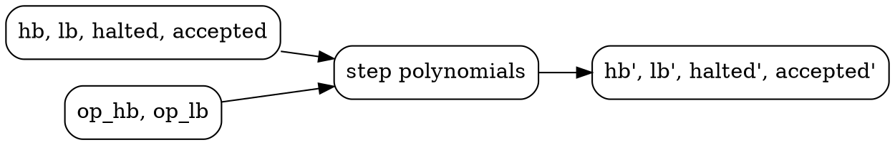
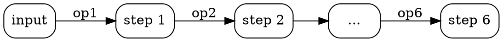
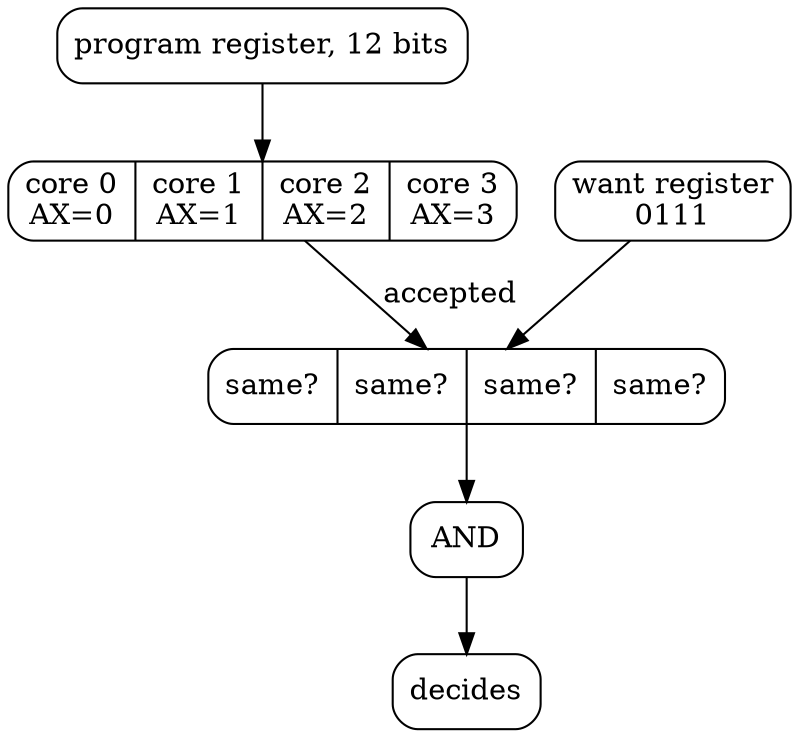
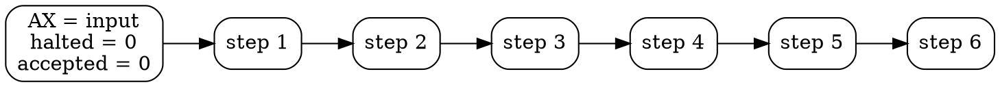
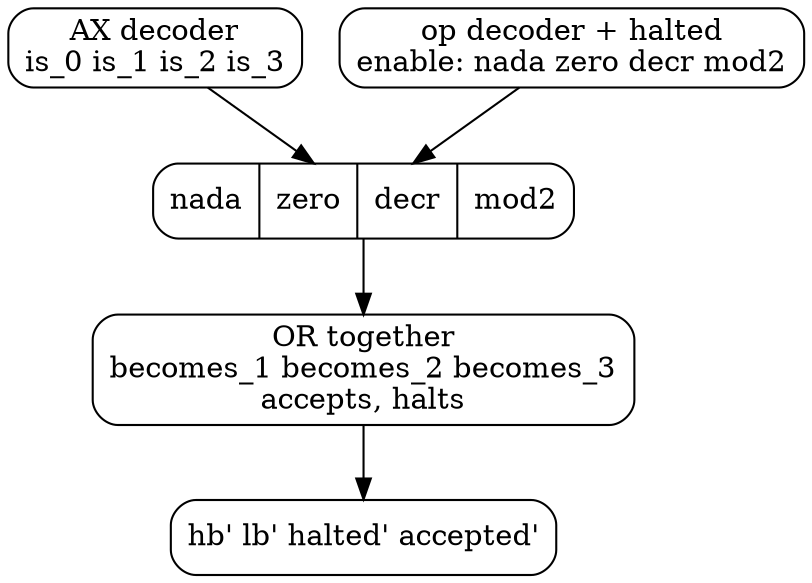
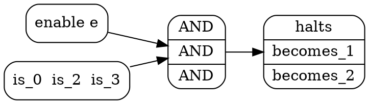
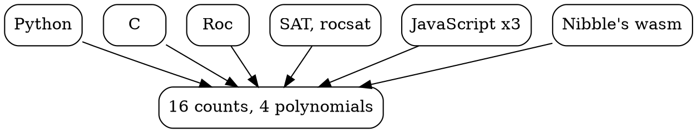

# A riff on Cook-Levin

A small book about [cook-levin-riff](https://github.com/showell/cook-levin-riff): a toy machine whose every program is a polynomial and a Boolean formula, the six-step composition that took three years to arrive, and six independent ways of computing the same answers that all agree.

## Introduction

The machine in this book has one 2-bit register and four instructions, and every program is six instructions long. It is small enough that every program, every input and every step can be listed, so every claim about it can be checked by running all of them.

Steve Howell wrote the first version by hand in Python, in [virtual-machine](https://github.com/showell/virtual-machine): the machine (`virtual_machine.py`), a general polynomial library (`poly.py`) and a stepper that writes one step of the machine as polynomials (`stepper.py`). In the cook-levin-riff repository, the code was written by AI coding agents (Claude), with human supervision, as its `README.md` says in its second line.

### What the book covers

{{chapter The machine}} sets out the machine, and {{chapter Languages and machines}} gives the computer science behind the word "language", back to Turing. {{chapter Programs as languages}} is the search over all 4,096 programs, and {{chapter Nibble, the puzzle page}} turns its 16 languages into puzzles. {{chapter Arithmetization}} turns one step into polynomials. {{chapter Why composing blew up}} and {{chapter Six steps composed}} take the step through a whole program, and {{chapter The polynomials, in full}} prints every one of those polynomials whole, the Python's among them. {{chapter Cook-Levin as SAT}} turns the same machine into a formula for a SAT solver. {{chapter The oracles}} lines up every implementation that computes the answers, and {{chapter The Roc port}} reads the mathematics in Roc.

### Why the name fits

The Cook-Levin theorem says that satisfiability of Boolean formulas is NP-complete: any problem whose answers a machine can check in polynomial time reduces to it. The proof unrolls the checking machine, step by step, into one formula. This repository does that unrolling on a toy instrument. It makes no claim about NP, and it reduces one machine's questions, never an arbitrary verifier's. It also goes one step past the formula, into arithmetic: the whole program becomes four polynomials with integer coefficients. "A riff" is the honest word for that.

### Where the numbers come from

Each number here comes from the repository: a commit, cited by its short hash, the `README.md`, a golden file, or a program run while the book was written, named where it is used. Code is quoted from the repository as it stands when the book is built. The Python repository's history is cited by links to its commits.

## How it got here

This chapter is the short history, as two git logs record it.

### The Python, 2023

The virtual-machine log opens on 2023-03-11 with [f01c1c3](https://github.com/showell/virtual-machine/commit/f01c1c3) and runs through 158 commits to 2023-04-08, all under Steve's address. The stepper arrived on its first day ([ba9388a](https://github.com/showell/virtual-machine/commit/ba9388a)), the polynomial library from 2023-03-12 ([6bb7429](https://github.com/showell/virtual-machine/commit/6bb7429)), and the step polynomials on 2023-03-14 ([a4e4765](https://github.com/showell/virtual-machine/commit/a4e4765)), the same day as `MAX_STEPS` of 6. The last 2023 commits, on 2023-04-08, begin with "Eliminate most poly-related stuff" ([72bf4c4](https://github.com/showell/virtual-machine/commit/72bf4c4)).

### The composition that stalled, 2026

Five commits marked "wip" followed on 2026-01-28. On 2026-04-16 a measuring harness, `compose.py`, was added with Claude as co-author ([1a5f6fa](https://github.com/showell/virtual-machine/commit/1a5f6fa)). Its message says that step 1 composed in about 0.9 s and that step 2 ran past 30 s in Python, and that those numbers motivated a port to Go. The same afternoon `compose.py` was removed, "porting six-step composition to Go instead" ([a2406b5](https://github.com/showell/virtual-machine/commit/a2406b5)). The next day an essay Claude had written about the project was parked as `DEEP_READ.md` ([94c3d31](https://github.com/showell/virtual-machine/commit/94c3d31)); it lists the six-step composition as the step the project stops before.

The Go port lives in a repository of its own, outside this record. By Steve's account it drowned in big integers; that account is unchecked here.

### The finish, 2026-11-25

The cook-levin-riff log covers one day. The C port of the machine and the search came first (`8051ce2`), then the general polynomial (`ccde4f8`) and the stepper (`5b14d74`). The Boolean ring came at 15:59 (`0c233e3`), and all six steps composed, proved on all 2^14 points, at 16:23 (`1146d43`). The Nibble page (`b1fe11f`), the Roc port (`6206236`), the SAT encoding (`8de51b7`), rocsat as an oracle (`f977bcc`) and the JavaScript port (`e996749`, `c251895`) followed. The first commit is stamped 15:32 and the last 19:21.

## The machine

The machine holds one register, `AX`, of 2 bits, so `AX` is 0, 1, 2 or 3. A run starts with `AX` set to the input. Its program is six instructions, each one of four opcodes, and the machine's assembly language is called Nibble.

### Four opcodes

`src/vm.c` holds the rule, as `run_progam` and its one-step helper:

{{lines src/vm.c from "Machine vm_step(Machine m, Op op) {" to "m.ax = m.ax % 2;"}}

- **`nada`** leaves the state as it is.
- **`zero`** accepts when `AX` is 0, and the run ends; at any other value the run goes on.
- **`decr`** takes 1 from `AX`, and rejects when `AX` is already 0.
- **`mod2`** takes 2 from `AX` when it is 2 or 3, leaving its last bit.

A run that reaches the end of its six instructions rejects. So a program accepts some of the four inputs and rejects the rest, and the set it accepts is its language.

### Counting

Each instruction is one of 4 opcodes, so there are 4^6 = 4,096 programs. Each language is a subset of {0, 1, 2, 3}, so there are 2^4 = 16 languages. Each program is a 12-bit number, two bits an instruction, and `assemble` and `disassemble` in `src/vm.c` convert between the two forms.

## Languages and machines

In computer science a *language* is a set of strings. Pick an alphabet, say the digits 0 to 9, and any set of strings over it is a language: the decimal numerals of the primes, the palindromes, the strings that are valid Roc programs. A language is the cleanest way to state a decision question. "Is 91 prime?" becomes "is the string `91` in the language of primes?"

### Machines that decide

A machine *decides* a language when, given any string, it halts, accepting the strings in the language and rejecting the rest. A program that decides the primes is a primality test; a compiler's parser decides the language of well-formed programs, and rejects the rest with an error.

### Turing's machine

In 1936 Alan Turing described a machine with a finite set of states and an unbounded tape, in "On Computable Numbers, with an Application to the Entscheidungsproblem". It reads and writes the tape one cell at a time, and every algorithm anyone has written since can be carried out by such a machine; that claim is the Church-Turing thesis. Turing also showed that some languages are undecidable: whatever machine one builds for them, some string defeats it. The best known is the halting problem, the language of programs that halt on their input. A machine can *recognize* it, accepting every member by running it, but for some strings outside the language it runs forever, still waiting to answer.

### A simple example

Take the alphabet {a, b} and the language of strings with an even count of a's: `aba` and `bb` are in it, `ab` and `aaab` are out. A Turing machine decides it with two working states, `even` and `odd`, and a head that reads the tape left to right. The input is written on the tape, with blank cells after it, and the machine starts in `even` on the first symbol.

| state | reads | writes | moves | next state |
|---|---|---|---|---|
| `even` | a | a | right | `odd` |
| `even` | b | b | right | `even` |
| `even` | blank | blank | stays | accept |
| `odd` | a | a | right | `even` |
| `odd` | b | b | right | `odd` |
| `odd` | blank | blank | stays | reject |

Each row is one rule: in this state, reading this symbol, write this, move, and go to that state. The state remembers the one fact that matters, whether the a's seen so far are even, and the blank after the input is where the machine answers.

A run on `aba`:

| step | state | reading | tape, head in brackets |
|---|---|---|---|
| 1 | `even` | a | [a] b a _ |
| 2 | `odd` | b | a [b] a _ |
| 3 | `odd` | a | a b [a] _ |
| 4 | `even` | blank | a b a [_] |
|   | accept | | |

And on `ab`: `even` reads a and moves to `odd`, `odd` reads b and stays `odd`, `odd` reads the blank and rejects. Every run takes one step per symbol and then halts, so the machine decides the language: it accepts exactly the strings with an even count of a's.

This machine only reads and moves right, so it is also a finite automaton; Turing's machines earn their tape on harder languages, such as the strings of a's followed by the same number of b's, where the machine writes marks on the tape to pair each a with a b. The idea carries over unchanged: states, a rule table, a run that ends in accept or reject, and a language made of the strings accepted.

### When deciding is cheap, and when checking is

Decidable languages differ in cost. P is the class decided in time polynomial in the input's length. NP is the class whose members have short certificates that a machine can check in polynomial time: a formula is in SAT, the language of satisfiable Boolean formulas, when an assignment makes it true, and checking an assignment is quick. In 1971 Stephen Cook, in "The Complexity of Theorem-Proving Procedures", and independently Leonid Levin, published in 1973, showed that SAT is as hard as anything in NP. Their proof takes the checking machine, which runs for a polynomial number of steps, and writes each step of its run as clauses: the whole run becomes one formula, satisfiable exactly when a certificate exists.

### This book's machine

The machine here is Turing's idea at its smallest. Its tape is one 2-bit register, its inputs are the four strings 0, 1, 2 and 3, and every run halts within six steps, so every question about it is decidable by trying everything. A language is a subset of {0, 1, 2, 3}, and there are 16. A program decides exactly one of them, the set of inputs it accepts. {{chapter Programs as languages}} asks which programs decide which languages, by running all of them. {{chapter Cook-Levin as SAT}} does what Cook and Levin did: it writes the machine's six steps as clauses, so a puzzle's answer becomes a satisfying assignment.

## Programs as languages

`find_solutions` runs every program on every input and groups the programs by the language each accepts. Its report is the Python's output, and the C prints it byte for byte: `tests/golden/find_solutions.txt` holds it, and `tests/test_golden.c` holds `src/main.c` to it.

### The 16 counts

The counts below come from that golden file, and the shortest lengths from `out/tcc/sat facts` (`src/sat_main.c`), run for this book. The language's code is its inputs as bits: input i accepted sets bit i.

| code | language | programs | shortest |
|---|---|---|---|
| 0 | { } | 844 | 0 |
| 1 | {0} | 681 | 1 |
| 2 | {1} | 303 | 2 |
| 3 | {0, 1} | 172 | 3 |
| 4 | {2} | 248 | 3 |
| 5 | {0, 2} | 883 | 2 |
| 6 | {1, 2} | 74 | 4 |
| 7 | {0, 1, 2} | 13 | 5 |
| 8 | {3} | 63 | 4 |
| 9 | {0, 3} | 12 | 5 |
| 10 | {1, 3} | 520 | 3 |
| 11 | {0, 1, 3} | 150 | 4 |
| 12 | {2, 3} | 13 | 5 |
| 13 | {0, 2, 3} | 1 | 6 |
| 14 | {1, 2, 3} | 15 | 5 |
| 15 | {0, 1, 2, 3} | 104 | 4 |

The counts sum to 4,096, so every program lands in exactly one language, and every language has a program. The search is a proof by construction that the machine recognizes all 16.

### The rare one

{0, 2, 3} has a single program, and it uses all six lines:

```text
zero
decr
decr
zero
decr
zero
```

Input 0 is accepted on line 1. Input 1 drops to 0 on line 2 and is rejected by the `decr` on line 3. Input 2 reaches 0 on line 3 and is accepted on line 4. Input 3 reaches 0 on line 5 and is accepted on line 6. The language skips 1, and the only way past it is to count down past it.

### The common ones

The empty language has 844 programs, since any program that rejects every input will do, and {0, 2} has 883: `mod2` then `zero` is two lines, and many longer programs reach the same verdicts.

## Nibble, the puzzle page

[Nibble](https://roc.lynrummy.com/nibble/) is a puzzle page with one puzzle for each of the 16 languages: pick instructions until the program accepts exactly the puzzle's inputs and rejects the rest. The search of {{chapter Programs as languages}} says every puzzle has an answer, and how many programs are answers.

### What runs in the page

The page runs the Roc port's machine. `roc/NibbleWasm.roc` exports three functions built on `roc/Machine.roc`, compiled to a 9.5 KB wasm module by the pinned Roc with a small Zig host (`web/platform/`), and the puzzle table is printed by the C's `web/puzzles.c`, which counts every program's language and finds each puzzle's shortest program (`README.md`, "Playground"). The JavaScript in the page draws; the machine's verdicts are Roc's. The page's check, `web/page_check.mjs`, holds the Roc wasm to the C on all 4,096 programs and all four inputs, so every build of the page is also a cross-check of the two ports, then plays every puzzle in headless Chromium by clicks.

### Playing a puzzle

Every pick runs the program at once on all four inputs, so the trace always shows the program as it stands. A trace shows each input's `AX` after every step, then how each run ended, what the puzzle wants, and a row marking each input correct or wrong. A wrong program's verdict names every way it is wrong, as in "Your program falsely accepts 0. It falsely rejects 1 and 3." When the program is right, the page says so above the program, folds the instruction buttons away so the whole trace shows, and says how many of the 4,096 programs solve the puzzle. Beside the buttons, the program's machine code shows its twelve bits, two a line, and its number. Each opcode button's tip says what it does to each `AX`: `decr` is "0->R, 1->0, 2->1, 3->2". A reload starts fresh at puzzle 1.

### The lessons

The first four puzzles are lessons, one opcode each:

- **`is_tiny`** ({0}): one line, `zero`.
- **`is_one`** ({1}): line 1 is given as `decr`, and the player picks line 2.
- **`is_even`** ({0, 2}): line 1 is given as `mod2`, and the player picks line 2.
- **`grumpy`** ({ }), "Reject all inputs": one line that opens as `zero`. Any of `nada`, `decr` or `mod2` solves it, since only `zero` ever accepts.

A given line is drawn locked, in light blue, and the hint names it: "Line 1 is already fixed as decr. Your job: fix line 2."

### The ramp

The other twelve ramp by effort: the length of the shortest program, with each `mod2` in it counted as one line more, since `mod2` takes more thought. A tie goes to the puzzle free of `mod2`, then to fewer `zero`s, then to more solutions. The table that `web/puzzles.c` prints puts them in this order:

| # | puzzle | language | shortest | programs |
|---|---|---|---|---|
| 5 | `is_two` | {2} | 3 | 248 |
| 6 | `is_small` | {0, 1} | 3 | 172 |
| 7 | `is_huge` | {3} | 4 | 63 |
| 8 | `is_middling` | {1, 2} | 4 | 74 |
| 9 | `is_odd` | {1, 3} | 3 | 520 |
| 10 | `is_big` | {2, 3} | 5 | 13 |
| 11 | `is_extreme` | {0, 3} | 5 | 12 |
| 12 | `is_not_huge` | {0, 1, 2} | 5 | 13 |
| 13 | `is_not_two` | {0, 1, 3} | 4 | 150 |
| 14 | `always_true` | {0, 1, 2, 3} | 4 | 104 |
| 15 | `is_not_one` | {0, 2, 3} | 6 | 1 |
| 16 | `is_not_tiny` | {1, 2, 3} | 5 | 15 |

A program's length is its instructions before its trailing `nada`s. Each puzzle says how short its best program is, and the lines past that are locked to `nada`. Past the lessons, every puzzle's last open line is fixed as `zero`, because an instruction after a program's last `zero` can only reject, as running off the end does, so every shortest program ends in `zero`. The last puzzle, `is_not_tiny`, also gives its `mod2` on line 2, the line where the solution folds 2 onto 0; the player still picks the `decr` on line 1.

### Help for a newcomer

The page's intro, behind a Help link after puzzle 1, says what a language is here, how the machine runs a program four times to find the language it recognizes, and works `decr, zero` through to {1}; the page's check holds that example to the machine.

## Arithmetization

The stepper writes one step of the machine as polynomials. Each bit of the state is a variable that is only ever 0 or 1, and logic becomes arithmetic:

- NOT x is 1 - x;
- x AND y is x·y;
- x OR y is x + y - x·y.

On 0/1 values each of these gives 0 or 1, and the right one. In Roc (`roc/Stepper.roc`) the first and third read as they are written:

{{function roc/Stepper.roc complement}}

{{function roc/Stepper.roc either}}

### One step

A step reads six bits: `AX`'s high and low bits (`hb`, `lb`), the flags `halted` and `accepted`, and the instruction's two bits (`op_hb`, `op_lb`). It writes four: the next `hb`, `lb`, `halted` and `accepted`.

One step of the machine


The construction names each fact about the state with an indicator, a polynomial that is 1 when the fact holds: `AX` is 0, the instruction is `decr` and the machine is still running, and so on. The new state is what any of the four instructions would make of the old one:

{{function roc/Stepper.roc next_state}}

### The step's sizes

In Python's general polynomial ring, where x·x is x², the four polynomials come out large: hb' has 786 terms and lb' 2,979 (`README.md`, its layout's `src/stepper.c`). The C port prints them exactly as `stepper.py` does, held to `tests/golden/step_hb.txt` and its three siblings. In the Boolean ring of {{chapter Why composing blew up}} the same four have 7, 13, 17 and 33 terms, every coefficient 1 or -1, as an expect in `roc/Stepper.roc` holds. {{chapter The polynomials, in full}} prints all eight whole.

Here is `halted'` in that ring. It says: halted already, or a `decr` at `AX` = 0 on a running machine.

```text
halted+op_hb+(-1)*hb*op_hb+(-1)*lb*op_hb+(-1)*halted*op_hb+(-1)*op_hb*op_lb
+hb*lb*op_hb+hb*halted*op_hb+hb*op_hb*op_lb+lb*halted*op_hb+lb*op_hb*op_lb
+halted*op_hb*op_lb+(-1)*hb*lb*halted*op_hb+(-1)*hb*lb*op_hb*op_lb
+(-1)*hb*halted*op_hb*op_lb+(-1)*lb*halted*op_hb*op_lb+hb*lb*halted*op_hb*op_lb
```

### The stepper as a second machine

Evaluated at the bits of a state and an instruction, the four polynomials give the next state's bits. So the stepper is a second implementation of the machine, written as algebra. `find_solutions` runs each example program on the stepper too, as the Python does, and `tests/test_stepper.c` holds the stepper to the interpreter on all 4,096 programs and all 4 inputs (`0921ec4`), where the Python checks the 16 examples.

## Why composing blew up

A whole program is six steps. Composing them means substituting: step 1's four polynomials go in for the state variables of step 2, and so on, until the final state is four polynomials in 14 variables, the input's two bits and each instruction's two. One polynomial would then hold the whole machine.

### The general ring

In the general ring each substitution multiplies polynomials together, and every product raises powers: x·x is x², x²·x is x³. Terms of a state that will only ever see 0 and 1 are kept apart because their exponents differ, and products of sums of them multiply their coefficients. The Python harness measured it: step 1 in about 0.9 s, and step 2 past its 30 s cap ([1a5f6fa](https://github.com/showell/virtual-machine/commit/1a5f6fa)'s message). The general polynomial in this repository's C, `src/poly.c`, checks every coefficient's add and multiply in `src/ring_int.c` and stops the program on an int64 overflow, since Python's integers grow as large as they need and C's stop at 64 bits.

### The Boolean ring

The fix is one identity. Every variable here is only ever 0 or 1, and on those values x² = x. A ring where every x² is x is a Boolean ring: every polynomial in it is multilinear, each variable to the first power at most. A monomial is then a set of variables, kept as a bit mask, and the product of two monomials is the union of their sets, the OR of their masks.

`roc/BoolPoly.roc` is that ring. Its product, with like terms summed in a table indexed by mask:

{{function roc/BoolPoly.roc times}}

`src/boolring.c` is the C's version (`0c233e3`), with a 32-bit mask and checked int64 coefficients.

### Why it is exact

The Boolean ring keeps every value the machine can see. Two polynomials that agree on every 0/1 point reduce to the same multilinear polynomial, and a multilinear polynomial is fixed by its values on {0, 1}^n. So reducing by x² = x keeps every value the machine can see, and the canonical form makes `==` equality of functions (`roc/BoolPoly.roc`'s header).

With the identity in place the step polynomials shrink from 786 and 2,979 terms to 7 and 13, and the composition of {{chapter Six steps composed}} takes a fraction of a second. {{chapter The polynomials, in full}} shows the step both ways, Python's 147,274 characters of lb' beside its 230 in the Boolean ring.

## Six steps composed

`src/compose.c` substitutes the step polynomials into themselves six times (`1146d43`). The Roc port's step, from `roc/Compose.roc`:

{{function roc/Compose.roc after_step}}

Six steps, one substitution each


### The sizes

Each step's term counts, from `roc/golden/composition.txt` and `out/tcc/compose_main` run for this book:

| step | hb | lb | halted | accepted |
|---|---|---|---|---|
| 1 | 4 | 7 | 8 | 8 |
| 2 | 11 | 25 | 30 | 40 |
| 3 | 27 | 79 | 92 | 162 |
| 4 | 63 | 241 | 282 | 642 |
| 5 | 143 | 727 | 878 | 2,568 |
| 6 | 319 | 2,185 | 2,732 | 10,324 |

The final `hb` has degree 9 and its largest coefficient is 6; `lb` has degree 14 and 21; `halted` 14 and 20; `accepted` 14 and 63. Sixty-three is the largest coefficient of the four final polynomials, so int64 holds each with room to spare. {{chapter The polynomials, in full}} prints the four. Built with `gcc -O2` for this book, `compose_main` composed all six in 233 ms, 199 of them in step 6, at a peak of 4,224 KiB resident.

### The proof

Fourteen 0/1 variables make 2^14 = 16,384 points, and each point is one input with one program. `tests/test_compose.c` evaluates the four final polynomials at every point and holds them to the machine. The Roc port's proof prints the same verdict (`roc/golden/composition.txt`):

```text
proof: 16384 points, 0 differ, 5596 accepted, 2891 accepted with no halt
```

The last count is the Python's own reading of `halted`, kept as it is: a `zero` that accepts leaves the stepper's `halted` at 0, so 2,891 accepting runs end with it unset. The verdict is `accepted`, and it agrees with the machine at every point.

The proof is exhaustive: it checks every input with every program. And since a multilinear polynomial is fixed by its values on {0, 1}^14, any implementation whose four polynomials pass it has exactly these four.

## The polynomials, in full

This chapter prints the polynomials of the last three chapters whole, every term of each. Over each box is what the book's app (`book/app/Polynomials.roc`) counts in the text it shows: terms, degree, the largest coefficient and characters. The chapter states each term count again in its source, and the build stops if a box's text has any other.

### What the sizes mean

Each final polynomial is a function of 14 bits: the input's two, `h0` and `l0`, and two for each instruction, `op1_hb` and `op1_lb` through `op6_hb` and `op6_lb`. Set them to one input and one program, and `accepted` evaluates to 1 when that program accepts that input and to 0 when it rejects it. Its 10,324 terms are all 4,096 programs run on all four inputs, written as one sum. `tests/test_compose.c` evaluates it at all 16,384 points and holds every value to the machine.

### One step, as the Python printed it

These are the step polynomials of {{chapter Arithmetization}} in the general ring, where x·x is x², as Steve's `stepper.py` prints them. `tests/golden/step_hb.txt` and its three siblings hold Python's own `str` of each, and `tests/test_stepper.c` holds the C's printing to them byte for byte (`5b14d74`). For this book `stepper.py` was run again, at virtual-machine's [94c3d31](https://github.com/showell/virtual-machine/commit/94c3d31), and its four strings matched the goldens byte for byte.

```polynomial tests/golden/step_hb.txt
hb', one step in the general ring, as Python's stepper.py prints it
786
```

```polynomial tests/golden/step_lb.txt
lb', one step in the general ring, as Python's stepper.py prints it
2979
```

```polynomial tests/golden/step_halted.txt
halted', one step in the general ring, as Python's stepper.py prints it
25
```

```polynomial tests/golden/step_accepted.txt
accepted', one step in the general ring, as Python's stepper.py prints it
33
```

### The same step, with x² = x

In the Boolean ring of {{chapter Why composing blew up}} each power folds to its variable, and like terms meet:

| polynomial | general ring | Boolean ring |
|---|---|---|
| hb' | 786 terms, 36,547 characters | 7 terms, 116 characters |
| lb' | 2,979 terms, 147,274 characters | 13 terms, 230 characters |
| halted' | 25 terms, 514 characters | 17 terms, 294 characters |
| accepted' | 33 terms, 728 characters | 33 terms, 728 characters |

`accepted'` is already multilinear in the general ring, so the identity keeps its 33 terms; the two printers order them differently. The four below are the C's `bp_str`, as `roc/golden/step_polynomials.txt` holds them, and the Roc port's gate, `roc/check.shale`, prints the same file.

```polynomial roc/golden/step_polynomials.txt hb'
hb', one step in the Boolean ring, printed by the C's bp_str
7
```

```polynomial roc/golden/step_polynomials.txt lb'
lb', one step in the Boolean ring, printed by the C's bp_str
13
```

```polynomial roc/golden/step_polynomials.txt halted'
halted', one step in the Boolean ring, printed by the C's bp_str
17
```

```polynomial roc/golden/step_polynomials.txt accepted'
accepted', one step in the Boolean ring, printed by the C's bp_str
33
```

### The whole program

The four final polynomials come from `src/compose_main.c` (`1146d43`). `book/book.shale` builds it with `gcc -O2` and runs it each time the book is built, and holds what it prints, each step's term counts and each final polynomial's terms, degree and largest coefficient, to `roc/golden/composition.txt`, which the Roc and JavaScript ports print too. Then the app reads the four files it writes. `accepted` is the largest, at 510,387 characters.

```polynomial book/build/out/hb.txt
hb after six steps, composed by the C's compose_main at the book's build
319
```

```polynomial book/build/out/lb.txt
lb after six steps, composed by the C's compose_main at the book's build
2185
```

```polynomial book/build/out/halted.txt
halted after six steps, composed by the C's compose_main at the book's build
2732
```

```polynomial book/build/out/accepted.txt
accepted after six steps, composed by the C's compose_main at the book's build
10324
```

## The machine as a circuit

The polynomials say that a run of the machine is arithmetic. The same fact can be drawn as hardware: a circuit that takes a language and a program and lights one wire, "decides", exactly when the program decides the language. It is combinational: the whole run is laid out in space, and every wire settles at once.

### The whole circuit

The circuit has two registers on its left. The *want* register holds four bits, one per input, saying which inputs the language accepts: {1, 2, 3} is `0111`, input 0's bit first. The *program* register holds the twelve bits of a program, two per line. The program goes to four cores side by side, one per input, and each core answers whether its input is accepted. Four comparators check each answer against its want bit, and a final AND joins them.

The circuit, end to end


### One core

A core is the machine itself, unrolled. Its `AX` register is wired to its input's number, and six step units sit in a chain, each fed by the one before it and by its own line's two bits from the program register. What leaves the sixth unit's `accepted` wire is the core's answer.

One core: six step units in a chain


Each step unit is the step of {{chapter Arithmetization}} built from gates: six wires in (`hb`, `lb`, `halted`, `accepted` and the line's `op_hb`, `op_lb`), four wires out, and between them the gates for complement, AND and OR that the step polynomials spell as 1 - x, xy and x + y - xy. Four cores of six units make 24 step units in all, every one the same.

### Inside a step unit

A step unit is built from two-input AND and OR gates and inverters, and its layout is a classic one: decode, compute every opcode at once, select. Its gates are exactly `sat_step` in `src/sat.c`, and `tests/test_sat.c` holds them to the machine's step on all 64 settings of the unit's six input wires.

One step unit


- **The AX decoder** turns the two bits `hb`, `lb` into four one-hot wires, one per value: `is_0` is (complement of `hb`) AND (complement of `lb`), and so on, four AND gates.
- **The op decoder** does the same to the line's two bits, giving one wire per opcode (`nada` 00, `zero` 01, `decr` 10, `mod2` 11). It then gates them with `halted`: a halted machine acts as `nada`, so `nada`'s enable is its wire OR `halted`, and each other opcode's enable is its wire AND the complement of `halted`.
- **The four opcode modules** each say, for their own opcode, which value `AX` becomes, and whether the step accepts or halts. Value 0 is what remains when `becomes_1`, `becomes_2` and `becomes_3` are all 0, so it takes care of itself.
- **The output stage** ORs the four modules' wires together, since only one module is enabled, then folds the one-hot value back into two bits: `hb'` is `becomes_2` OR `becomes_3`, and `lb'` is `becomes_1` OR `becomes_3`. The flags only ever turn on: `accepted'` is `accepted` OR the step's accept, and `halted'` likewise.

### Each opcode as gates

With `e` for the module's enable wire, every opcode is a handful of AND gates on the decoder's wires:

| opcode | becomes_1 | becomes_2 | becomes_3 | accepts | halts |
|---|---|---|---|---|---|
| `nada` | `is_1` AND e | `is_2` AND e | `is_3` AND e | 0 | 0 |
| `zero` | `is_1` AND e | `is_2` AND e | `is_3` AND e | `is_0` AND e | 0 |
| `decr` | `is_2` AND e | `is_3` AND e | 0 | 0 | `is_0` AND e |
| `mod2` | (`is_1` OR `is_3`) AND e | 0 | 0 | 0 | 0 |

Read across a row and the opcode's rule appears. `nada` passes the value through. `zero` passes it through too and adds one gate that fires on 0. `decr` shifts each wire down one place, 2 to 1 and 3 to 2, lets 1 fall to 0, and turns 0 into a halt. `mod2` sends both odd values to 1 and lets 2 fall to 0. The whole unit is 34 two-input gates as written, and the four cores' constants (`AX` fixed per core, `halted` and `accepted` 0 at the start) fold many of them away: the full circuit of 24 units comes to the 404 gates that {{chapter Cook-Levin as SAT}} counts.

`decr`, the busiest module, drawn alone


The gates in the code, as the SAT encoding builds them:

{{lines src/sat.c from "    Lit is_3 = AND(hb, lb);" to "    Lit lb_set = OR(becomes_3, becomes_1);"}}

### A program through it

Load the want register with `0111` and the program register with `decr, mod2, zero, decr, zero, nada`, the five-line answer to `is_not_tiny`, whose bits are `10 11 01 10 01 00`. The four cores settle like this:

| core | the run | accepted | want | same? |
|---|---|---|---|---|
| 0 | `decr` finds `AX` at 0: reject | 0 | 0 | yes |
| 1 | `decr` to 0, `mod2` keeps 0, `zero`: accept | 1 | 1 | yes |
| 2 | `decr` to 1, `mod2` keeps 1, `zero` passes, `decr` to 0, `zero`: accept | 1 | 1 | yes |
| 3 | `decr` to 2, `mod2` folds 2 to 0, `zero`: accept | 1 | 1 | yes |

All four comparators say yes, so the AND lights "decides". Change one program bit and some core's answer flips, its comparator reports a mismatch, and the light goes out.

### Why the circuit matters

Fix the want register and leave the program register's twelve bits free, and the circuit asks a question: is there a setting of these twelve inputs that lights the output? That is circuit satisfiability, and {{chapter Cook-Levin as SAT}} writes this very circuit as clauses, gate by gate, for a SAT solver to answer.

## Cook-Levin as SAT

`src/sat.c` writes each puzzle as a Boolean formula in DIMACS CNF, the input format of SAT solvers (`8de51b7`). This is the Cook-Levin construction itself: the question "which six-instruction programs accept exactly this language?" becomes one formula whose satisfying assignments are exactly those programs.

### The unrolling

The formula's first 12 variables are the program's bits, two an instruction, so a solver's model reads straight off as a program. The machine is then unrolled: each of the six steps, on each of the four inputs, is a copy of the step's logic, wired to the state the step before left. The logic is the stepper's, gate for gate, NOT, AND and OR as in {{chapter Arithmetization}}.

Each AND and OR becomes a Tseitin variable, tied to its inputs by three clauses, and a NOT is a literal's sign:

{{lines src/sat.c from "Lit sat_and(Cnf *c, Lit x, Lit y) {" to "Lit c3[3] = {out, -a, -b};"}}

A gate on a constant is folded, and a gate already built from the same inputs is reused, so every puzzle's formula has 416 variables and 1,216 clauses. `out/tcc/sat facts`, run for this book, prints those two numbers for all 16. The last four clauses ask that each input's final `accepted` be what the language wants. `len=N` forces the lines past N to `nada`, and `fix=K:OP` fixes line K, as the puzzle page does.

### The proof by propagation

`tests/test_sat.c` proves the encoding by itself. For every puzzle it sets the program bits to each of the 4,096 programs and unit-propagates them through the formula. Each gate's inputs come before it, so propagation alone decides every Tseitin variable. The assignments that survive are exactly the programs the machine says solve the puzzle, 4,096 over the 16 languages. With lines past N forced to `nada`, the formula is satisfiable exactly when N is at least the puzzle's shortest length.

### rocsat as an oracle

`sat/oracle.shale` hands the formulas to [rocsat](https://github.com/mpizenberg/rocsat), Matt Pizenberg's CDCL SAT solver, written in Roc (`f977bcc`). For each puzzle it solves the formula and runs the model's program on the machine. It counts the solutions by adding a clause that blocks each model and solving again until rocsat says UNSAT, and holds that count to the machine's. Then it proves the shortest length: one line shorter is UNSAT, and the shortest length itself is SAT.

An UNSAT answer claims that the formula is unsatisfiable, and rocsat backs each one with a DRAT proof, a list of clause additions and deletions that a separate checker can replay. Here an UNSAT at length N - 1 says that every program of N - 1 lines fails the puzzle, and the oracle checks its proof with the repository's own checker, `src/drat.c`, as {{chapter The solver's work, in full}} shows. The oracle starts rocsat 4,143 times, so it takes about a minute and runs as its own script, `sat/oracle.shale`, beside `build.shale`'s quicker tiers. Its last run for this book, on 2026-11-25, spent 62.6 s in its programs and ended "rocsat agrees with the machine on all 16 puzzles": 4,096 models in all, and every shortest length confirmed by an UNSAT one line shorter, with all 15 proofs verified.

## The solver's work, in full

This chapter prints what rocsat was given and what it answered for two puzzles, whole, the way {{chapter The polynomials, in full}} prints the polynomials. Over each box are the counts that the book's app (`book/app/SatFiles.roc`) makes from the text it shows. The chapter states one count for each box again in its source, and the build stops if the text has another.

### Where the files come from

The formulas come from the repository's C: `book/book.shale` builds `src/sat_main.c` at each build of the book and writes them to `book/build/sat/`. rocsat's answers and proofs are data files in `sat/proofs/`, which `sat/oracle.shale` writes on every run (`19bff9e`). Two runs of the oracle on 2026-11-25 wrote the same bytes, and the 15 proofs match an earlier run's byte for byte, so rocsat's search is deterministic, and the book builds from the committed files alone. Before it shows them, the build checks each one again: every proof with the repository's DRAT checker, `src/drat.c`, against the formula it has just written, and every answer against its formula's clauses and, as a program, on the machine.

### The checker

A DRAT proof is a list of lines, each a clause added, a lemma, or a clause deleted, after a `d`. `src/drat.c` replays it forward. Each lemma has to follow by reverse unit propagation: set all its literals false, propagate over the formula and the lemmas so far, and some clause must come out with every literal false. Each deletion has to name a clause the database holds, and it is applied. The proof ends at the empty clause, which follows when propagation over the database alone reaches a conflict. A lemma that fails this test may still pass as a RAT on its first literal; all 15 of rocsat's proofs pass by the first test alone.

`tests/test_drat.c` holds the checker both ways in 12 tests: hand-made proofs that pass, planted ones that fail (a lemma the formula leaves open, a proof that stops short of the empty clause, a deletion of a clause a later lemma needs), and each committed proof, which verifies against its formula and fails against the formula one line longer.

### {0, 2, 3}, the puzzle with one answer

`is_not_one` accepts exactly {0, 2, 3} (code 13), and one program of the 4,096 solves it (`tests/golden/find_solutions.txt`). Here is its formula, `sat 13`, in full. The `c` lines at its top name the variables: the program's 12 bits, then each input's state after each step as the literals that carry it, `T` and `F` where folding left a constant.

```dimacs book/build/sat/13-len6.cnf
the CNF of {0, 2, 3}, written by src/sat_main.c at the book's build
1216
```

rocsat's answer is its statistics line, its verdict and a value for every variable:

```dimacs sat/proofs/13-len6.model
rocsat's answer to that CNF, as sat/oracle.shale kept it
416
```

Instruction i is 2·v[2i − 1] + v[2i], so the first 12 values read as `zero, decr, decr, zero, decr, zero`. The build decodes the program from the answer and holds this sentence to it, and `sat solves 13` confirms on the machine that the program accepts exactly {0, 2, 3}.

### Five lines are too few

With line 6 forced to `nada` (`sat 13 len=5`), the formula is the one above with two unit clauses at its top, `-11 0` and `-12 0`, 1,218 clauses in all. rocsat answers UNSAT and writes this proof:

```dimacs sat/proofs/13-len5.drat
rocsat's DRAT proof that the CNF of {0, 2, 3} at length 5 is unsatisfiable
286
```

The checker, run on it at the book's build, says `verified: 286 lemmas (0 by RAT), 387 deletions, over 416 variables and 1218 clauses; the empty clause at line 673`. A program of fewer than five lines has its line 6 at `nada` too, so the formula covers every program of five lines or fewer, and the proof shows that each one fails the puzzle. No program of five or fewer lines decides {0, 2, 3}. Its shortest program is the six-line one above.

### The largest proof

Of the 15 proofs, the largest by bytes is that of `is_big`, {2, 3} (code 12). Its shortest program has five lines, and this proof shows that four are too few:

```dimacs sat/proofs/12-len4.drat
rocsat's DRAT proof that the CNF of {2, 3} at length 4 is unsatisfiable
490
```

The checker says `verified: 490 lemmas (0 by RAT), 788 deletions, over 416 variables and 1220 clauses; the empty clause at line 1278`.

### All 15 proofs

Each puzzle whose shortest program has a line or more has one proof; `grumpy`, {} (code 0), is solved by the empty program. The build checks each proof again and holds each row to what it finds. By size:

| code | puzzle | language | shortest | proof bytes | lemmas | verified |
|---|---|---|---|---|---|---|
| 12 | `is_big` | {2, 3} | 5 | 14,698 | 490 | yes |
| 14 | `is_not_tiny` | {1, 2, 3} | 5 | 13,743 | 463 | yes |
| 15 | `always_true` | {0, 1, 2, 3} | 4 | 12,170 | 485 | yes |
| 8 | `is_huge` | {3} | 4 | 10,992 | 452 | yes |
| 6 | `is_middling` | {1, 2} | 4 | 10,892 | 449 | yes |
| 1 | `is_tiny` | {0} | 1 | 10,847 | 821 | yes |
| 11 | `is_not_two` | {0, 1, 3} | 4 | 10,805 | 446 | yes |
| 9 | `is_extreme` | {0, 3} | 5 | 10,474 | 378 | yes |
| 5 | `is_even` | {0, 2} | 2 | 9,876 | 744 | yes |
| 7 | `is_not_huge` | {0, 1, 2} | 5 | 9,171 | 347 | yes |
| 13 | `is_not_one` | {0, 2, 3} | 6 | 9,012 | 286 | yes |
| 3 | `is_small` | {0, 1} | 3 | 8,890 | 691 | yes |
| 10 | `is_odd` | {1, 3} | 3 | 8,862 | 693 | yes |
| 2 | `is_one` | {1} | 2 | 8,731 | 566 | yes |
| 4 | `is_two` | {2} | 3 | 7,440 | 477 | yes |

The proofs run from 7,440 to 14,698 bytes and from 286 to 821 lemmas. The largest by bytes has fewer lemmas than five others, since its lemmas are longer.

## The oracles

Every implementation in this repository computes the same answers in its own way, and each is held to the others. The spine of the project is that they all agree.

Six ways to the same answers


### What each one checks

- **Python**, the original, is the source of `tests/golden/find_solutions.txt` and of the step polynomials' strings, `tests/golden/step_*.txt`.
- **C** prints that report byte for byte (`tests/test_golden.c`), checks the stepper against the interpreter on all 4,096 × 4 runs, and proves the composition at all 2^14 points (`tests/test_compose.c`). `shale build.shale` ran its fast tier for this book: eleven test files and the golden check, all passing.
- **Roc** prints the same report, the four step polynomials as the C's `bp_str` prints them (`roc/golden/step_polynomials.txt`) and the composition's counts and proof (`roc/golden/composition.txt`). `roc/check.shale` is its gate.
- **SAT** reaches the 16 counts through `tests/test_sat.c`'s propagation and again through rocsat's blocked models, and each shortest length through an UNSAT, with a DRAT proof that `src/drat.c` verifies, and a SAT.
- **JavaScript**, `js/cook_levin.js`, prints the report and then the composition, byte for byte the two goldens, under three runners.
- **Nibble's wasm** is `src/vm.c` itself, and `web/page_check.mjs` holds it to the C on all 4,096 × 4 runs and to the 16-puzzle table.

### One program, three runners

`js/oracle.shale` runs the JavaScript port three ways (`c251895`), each held to the goldens. The runners are node, and two of [roc-js-interpreter](https://github.com/showell/roc-js-interpreter)'s, both written in Roc: its bytecode VM and its compiler to x86-64. The port is written in the subset of JavaScript that roc-js-interpreter runs, which leaves out the bitwise operators, so the OR and AND of two masks come from tables of their 7-bit halves.

By `README.md`'s timings on this box, 2026-11-25: node takes about 0.3 s, the VM about 80 s, in about 15 million of its steps, and the compiled executable, 111,698 bytes, 0.6 to 1.0 s, at a peak of 33 MB. The compiled program is slower than node here, and that is unprofiled. These runs were left unrepeated for this book.

### Why so many

Each pair shares only the machine's rule. The interpreter branches on opcodes, the stepper evaluates polynomials, the composition substitutes them, the SAT encoding propagates clauses, and rocsat searches. A bug would have to land the same way in all of them to pass.

## The Roc port

`roc/` is the same machine and the same mathematics in Roc, at the compiler that `roc/roc-version` pins (`6206236`). Its point is that the mathematics reads like mathematics.

### The ring as operators

`BoolPoly` is an opaque type over a canonical list of terms, and its `plus`, `minus`, `times` and `negate` are what Roc's `+`, `-`, `*` and unary `-` call. So OR is written `x + y - x * y`, as the algebra writes it. Roc's I64 arithmetic crashes on overflow, so every coefficient is exact or the program stops.

### Substitution

A substitution replaces each variable by a polynomial. The product of the replacements over each monomial is made once, from the product of its monomial less its highest variable, which other terms often share:

{{function roc/BoolPoly.roc substitute}}

### Every point at once

The proof wants each final polynomial's value at all 16,384 points. `values` gets them all at once by the zeta transform: each coefficient is summed into every point above its mask, one variable at a time, so the cost is 2^14 × 14 additions, whatever the terms:

{{function roc/BoolPoly.roc values}}

### The speed, honestly

On this box, the release build of `composition 6` composes all six steps and runs the proof in about 30 ms, and the C's `compose_main` at -O2, which only composes, takes about 260 ms (`README.md`, "The Roc port"). The gap is the data structure, and the language has little to do with it: the C sums like terms in a hash table it grows and then sorts, while the Roc sums them in a dense table indexed by mask, a straight array write that reads back already in order. The C could use the same table, and it has yet to be tried (`9e0c86c`).

## What comes next

A few steps stand open, each small:

- **The C's dense table.** The C composition could sum like terms in the Roc port's dense table, and its time would then measure the language.
- **The compiled JavaScript.** Its slowness is unprofiled. `README.md` guesses that an array's items are values of unknown kind to the compiler, so each read and write passes the runtime's tag checks.
- **Nondeterminism.** The machine is deterministic. The SAT encoding already treats the program as the unknown, which is the theorem's "a certificate exists"; a machine with choice instructions would make the riff closer to the theorem.
