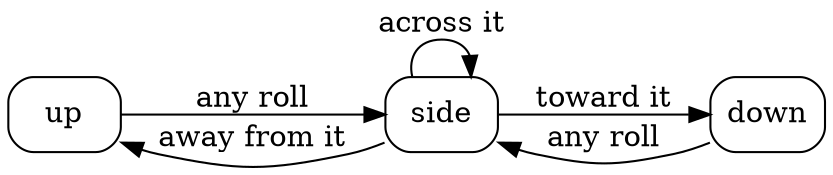

# Rolling a Cube to Cook-Levin

This book teaches P versus NP, SAT and the Cook-Levin theorem through one toy: a cube that rolls across a board of tiles and lights the tiles it lands on with its painted face. You can roll it yourself in the [playground](https://roc.lynrummy.com/nibble/cube.html) as you read.

Each chapter opens with a paragraph that says what it is about, so the book can be skimmed from here.

- {{chapter Easy to check, hard to find}}: the gap between checking an answer and finding one, and the toy we study it on.
- {{chapter A programming language with four words}}: the cube's four instructions, its one rule, and the rules as a short Roc program.
- {{chapter Your first programs}}: ten challenges on the 3 × 3 board, each with its par and a shortest program.
- {{chapter A board where nothing ever happens}}: the first theorem, proved with an invariant: on a 2 × 2 board the paint stays off the bottom.
- {{chapter Code golf and proving lower bounds}}: why m lit tiles take at least 3m − 1 rolls, and why that bound is the best possible.
- {{chapter Same state, same future}}: a breadth-first search over states that finds every shortest program on the 3 × 3 board.

## Easy to check, hard to find

Some answers take seconds to check and ages to find. This book is about that gap, which sits behind the most famous open question in computer science, P versus NP. We won't settle that question; nobody has. Instead you'll study the gap on a toy small enough to hold in your head: a cube that rolls across a board and lights the tiles it lands on. Small boards are easy on purpose, so you can see everything; the hardness shows up as the board grows. By the end you'll have proved the cube's puzzle is as hard as any problem in NP, and watched the Cook-Levin theorem turn it into one logic formula that a SAT solver can attack.

### The gap in miniature

Here is the toy in one paragraph. A board of square tiles starts dark. A cube the size of one tile sits in the corner, and one of its six faces is painted. A program is a string of the letters N, E, S and W, and each letter tips the cube over one of its edges into the next cell. Whenever the cube lands with its painted face down, the tile under it flips between dark and lit. A puzzle names a pattern of lit tiles, and asks for a short program that leaves exactly that pattern lit.

Suppose someone hands you a program and claims that it lights every tile of a 3 × 3 board. You can check the claim by rolling the cube through the program once and looking at the board. Finding such a program is another matter. The shortest program that lights every tile takes 26 rolls, and there are 4,503,599,627,370,496 programs of 26 rolls. Checking one of them costs 26 rolls of the cube; trying them all, one after another, would take far longer than anyone would wait.

That lopsidedness is the subject of the whole book. A program is a short certificate: it is easy to check and can be hard to find. Computer science gives problems with that shape a name, NP, and asks whether every one of them could secretly be solved as fast as it is checked. That is the P versus NP question.

### The route

This first part teaches the cube itself. You'll learn its programming language, write your first programs, prove your first theorems about programs, and write a search that finds the shortest program for every pattern on a small board.

After that the book defines P and NP precisely, on the cube, and proves that the cube's puzzle is NP-complete: as hard as any problem in NP. Then the Cook-Levin theorem turns the cube into a formula, one roll at a time, and a SAT solver answers questions about it, with proofs of its answers that a small program checks. The last chapters look at where the solver struggles, where a short human argument beats it, and what is still open.

### How the book keeps its numbers honest

Every number in this book is printed by a program that runs when the book is built. The build holds each table and each number in the prose to the output of its program, and it stops when they disagree. The programs share only the rules, so when two of them print the same number, they agree for independent reasons.

Any programmer can follow along. The rules are written in Roc, a small functional programming language, and the search that finds shortest programs is written in Python. Each is short, and the chapters explain what is unusual in them.

## A programming language with four words

The cube's programming language has four instructions, north, east, south and west, and one rule: when the painted face lands down, the tile under it flips. You'll learn the whole programming language here, including what happens when a program rolls off the edge, and you'll read the rules as a short Roc program. It is the same code that runs the playground, and its tests hold it to the other programs in this book.

### The board and the cube

The rules fit in a table.

| | |
|---|---|
| the board | an n × n grid of tiles, all dark at the start |
| the cells | columns a, b, c, … from west to east, rows 1, 2, 3, … from north to south, so a1 is the north-west corner |
| the cube | one cube the size of a tile, with one face painted |
| a roll | the cube tips over one of its bottom edges into the next cell: N, E, S or W |
| a landing | each time the cube lands with the painted face down, the tile under it flips, dark to lit or lit to dark |
| the start | the cube on a1 with the painted face up |
| the end | the tiles lit when the program ends are its result; the cube may end anywhere |
| off the board | a roll off the board halts the program: the cube stays where it was, and the rolls after it are skipped |

On the 3 × 3 board, which most of Part I uses, the cells are named like this, with north at the top:

```text
a1 b1 c1
a2 b2 c2
a3 b3 c3
```

### Where the paint goes

Everything interesting about a roll is what happens to the painted face. Picture the cube rolling north: it tips over its north bottom edge, so the face on top swings to point north, the north face goes down onto the board, the bottom face swings to point south, and the south face comes up on top. The east and west faces turn in place and keep pointing east and west. The other three rolls are the same, turned.

So the paint is always in one of six places: up, down, north, south, east or west. A roll moves it one step around a loop of four, up to ahead to down to behind and back to up, and paint pointing along the roll's axis stays where it is.

### A first run

Here is the program ESSWNN on the 3 × 3 board, one row a roll:

| Roll | The cube on | The paint points | Lit tiles |
|---|---|---|---|
| start | a1 | up | — |
| 1: E | b1 | east | — |
| 2: S | b2 | east | — |
| 3: S | b3 | east | — |
| 4: W | a3 | up | — |
| 5: N | a2 | north | — |
| 6: N | a1 | down | a1 |

The first roll east swings the paint to point east, and the two rolls south keep it there. Rolling west brings it back up, the first roll north swings it north, and the second roll north puts it face down on a1, which flips. The cube went around the board's west half to light the tile it started on.

### Rolling off the edge

A roll that would leave the board halts the program. The tiles lit at that moment are the program's result, and every roll after it is ignored. Here is ESENNSSS:

| Roll | The cube on | The paint points | Lit tiles |
|---|---|---|---|
| start | a1 | up | — |
| 1: E | b1 | east | — |
| 2: S | b2 | east | — |
| 3: E | c2 | down | c2 |
| 4: N | c1 | south | c2 |
| 5: N | off the board, so the program halts | | c2 |

The fifth roll would carry the cube north off c1, so the program halts with c2 lit, and the three rolls south are skipped. A halted program lights exactly what its rolls before the halt light, so halting can only end a program early.

### The rules in Roc

The rules live in `roc/Cube.roc`, and they are short enough to read whole. Roc is a functional programming language, so a function's answer depends only on its arguments. That suits a rulebook.

A state is the cube's cell, where the paint points, and the set of lit tiles. The cube can sit in many orientations, but only the painted face ever touches a tile, so the rules track that face alone.

{{lines roc/Cube.roc from "Roll : [N, E, S, W]" to "State : { cell"}}

`[N, E, S, W]` is a tag union, Roc's way of saying "exactly one of these". The lit tiles are one number, `lit`, with bit i set when tile i is lit. Cell numbers count across each row from the north-west corner.

The face a roll tips toward, and the one it tips away from:

{{function roc/Cube.roc ahead}}

{{function roc/Cube.roc behind}}

With those two, the loop of four is four cases:

{{function roc/Cube.roc face_after}}

A roll's new cell is the other half of the rule. In Roc a function that can fail says so in its type, and `Try(U64, [OffBoard])` means "a cell, or the news that the cube left the board".

{{function roc/Cube.roc cell_after}}

One roll puts the two together, and flips the tile when the paint lands down. The `?` after `cell_after(...)` hands an `OffBoard` straight back to the caller.

{{function roc/Cube.roc roll}}

A whole program is a loop over its letters. Roc allows a local variable to change inside a function when its name starts with `$`, and the loop uses that to keep the state, the frames it has passed through, and whether the program has halted:

{{function roc/Cube.roc play}}

The board in this file is 4 × 4, the playground's board:

{{function roc/Cube.roc max_length}}

So on that board a program has at most 45 rolls, and the programming language is finite. The boards of Part I stay well below that bound.

The same file ends with tests, written as `expect` lines, which roll shortest programs through `play` and compare what they light with the census, a search program we meet in {{chapter Same state, same future}}:

{{lines roc/Cube.roc from "# The census's levels" to "Ok(32)"}}

The [playground](https://roc.lynrummy.com/nibble/cube.html) is this code compiled to WebAssembly, so every roll you make there runs through the functions above.

## Your first programs

Now you write programs. Light the corner, then a tile beside it, then the centre of a 3 × 3 board alone, each in as few rolls as you can. The playground tells you the par for every pattern you make. You'll find that programs can undo their own work, and that the shortest program for a pattern is rarely the obvious one.

### The challenges

A pattern's par is the length of its shortest program. Try each challenge before you read its row; a pencil and the board's picture from {{chapter A programming language with four words}} are all you need.

| Challenge | Lit tiles | Par | A shortest program |
|---|---|---:|---|
| the corner you start on | a1 | 6 | `ESSWNN` |
| the tile beside it | b1 | 7 | `EESNSWN` |
| the centre | b2 | 8 | `ESENSNWS` |
| the far corner | c3 | 4 | `ESSE` |
| the other corner of the top row | c1 | 2 | `EE` |
| two tiles on a diagonal | a1, b2 | 14 | `ESENWSNESWSWNN` |
| the diagonal | a1, b2, c3 | 16 | `ESENWSNESWSENNWW` |
| the checkerboard | a1, c1, b2, a3, c3 | 22 | `EESSWWNEESNNWWESWNSNES` |
| the border | a1, b1, c1, a2, c2, a3, b3, c3 | 23 | `EESWNSWNESWESWNESNESWNE` |
| every tile | a1, b1, c1, a2, b2, c2, a3, b3, c3 | 26 | `EESWNESWNESWSENWSNWSENWENW` |

Each program is the first shortest one in a fixed order, so other programs of the same length may light the same tiles.

### Near is far, and far is near

The first two rows are the surprise. The tile the cube starts on costs 6 rolls, while c1, two cells away, costs 2: roll east twice, and the paint goes from up to east to down, landing on c1. To light a1, the paint has to leave the top, swing around and come down again, and every roll moves the cube too, so the cube must leave a1 and come back with the paint pointing the right way. The cheapest such trip is the six rolls of {{chapter A programming language with four words}}.

### A program that undoes its own work

The centre takes 8 rolls, and the shortest program lights an unwanted tile along the way:

| Roll | The cube on | The paint points | Lit tiles |
|---|---|---|---|
| start | a1 | up | — |
| 1: E | b1 | east | — |
| 2: S | b2 | east | — |
| 3: E | c2 | down | c2 |
| 4: N | c1 | south | c2 |
| 5: S | c2 | down | — |
| 6: N | c1 | south | — |
| 7: W | b1 | south | — |
| 8: S | b2 | down | b2 |

The third roll lights c2. Rolls 4 and 5 go north and straight back, landing on c2 face down a second time, and the second landing flips it dark again. The detour earns its two rolls: it turns the paint to point south, which is what the cube needs to drop it onto b2 two rolls later. A flip is its own undo, so a program may light a tile on the way and put it out again.

### The playground's board

The playground's board is 4 × 4, one row and one column bigger. For a single tile in its north-west 3 × 3 corner, the par is the same as on the 3 × 3 board. Here are the pars of each tile lit alone, on the 3 × 3 board and then the 4 × 4:

```text
the par of each tile lit alone
      6   7   2
      7   8   3
      2   3   4
```

```text
the par of each tile lit alone
      6   7   2   5
      7   8   3   6
      2   3   4   5
      5   6   5   8
```

For larger patterns the two boards can differ, since the bigger board gives the cube more room to turn. The playground shows the 4 × 4 par beside your program, so you can see how close your program is.

## A board where nothing ever happens

We prove our first theorem: on a 2 × 2 board, no program ever lights a tile. The proof follows the paint around the cube and shows it can never reach the bottom. You'll learn to argue with an invariant, a fact every step preserves, which is the same reasoning you use to prove a loop correct.

### The theorem

Theorem 1: on a 2 × 2 board, starting on a1 with the paint up, every program leaves every tile dark.

A program that tries every roll from every state it reaches agrees. On the 2 × 2 board it reaches 12 of the 384 states, every one of them with the board dark, and the other 15 patterns are out of reach. A search only shows what happens on one board, though. The proof says why.

### The invariant

Every cell of a 2 × 2 board is a corner, and each corner has two walls, the two sides of the board it touches. The cell a1 has walls to the north and the west; b2 has walls to the south and the east.

Here is the invariant: the paint points up, or toward one of the two walls of the cell the cube is on. The search's record of every place it found the paint fits it exactly:

| The cube on | The paint points |
|---|---|
| a1 | up, north, west |
| b1 | up, north, east |
| a2 | up, south, west |
| b2 | up, south, east |

The invariant leaves the paint three places in each cell: up and the cell's two walls. So if the invariant holds after every roll, the paint stays off the bottom, and every tile stays dark.

### The proof

The proof has the shape of a loop invariant's. Show that it holds at the start, and that each step preserves it.

At the start the paint points up, so the invariant holds.

Now take any roll, in some direction d, from a cell where the invariant holds. If d points at a wall, the roll would leave the board, so it halts the program with the cube where it stands. Otherwise d points into the board, and the cube rolls to the neighbouring cell on that side. On a 2 × 2 board that neighbour is the corner on the d side, so d points at one of its walls. Follow each place the paint can be:

| Before the roll | After the roll | Why the invariant still holds |
|---|---|---|
| up | ahead, toward d | d points at a wall of the new cell |
| toward the wall behind, opposite d | up | up is always allowed |
| toward the other wall, across the roll | the same way | the roll keeps the cube on the same side of the board in that direction, so that wall is still a wall |

Those are the three places the invariant allows, so the table covers every case. A roll in direction d brings the paint down only from the face pointing toward d, and that face points into the board, which the invariant rules out. So after the roll the invariant holds again, and by induction it holds after every roll of every program. That proves Theorem 1.

### Why the 3 × 3 board is different

The proof leans on one fact: on a 2 × 2 board, every roll that stays on the board lands in a corner, with a wall straight ahead. On a 3 × 3 board the cube can roll into an edge cell or the centre, where the way ahead is open. Rolling east from a1 puts the paint east at b1, where the way east is open, so a second roll east brings the paint down onto c1. That is the 2-roll program of {{chapter Your first programs}}, and the invariant fails at its first step.

An invariant is a claim about every reachable state, proved by one argument that covers them all. Here the list was small enough to print, but the same argument would work if the board had a million cells, as long as each one was a corner.

## Code golf and proving lower bounds

Writing a short program shows what's possible. Proving that nothing shorter exists is a different skill, and this chapter teaches it. We prove a theorem: lighting m tiles takes at least 3m − 1 rolls, because the paint needs three rolls to travel from one tile to the next. Then you'll see the bound is the best possible, since for every m some pattern meets it exactly.

### The floor

Code golfers compete to write the shortest program for a task, and the challenges of {{chapter Your first programs}} were code golf. A short program is a claim you can check by running it. A lower bound is a claim about every program at once, including every one yet to be written, so it needs a proof.

Theorem 2: on any board, a program that leaves m lit tiles, with m at least 1, has at least 3m − 1 rolls.

The proof counts how quickly the paint can travel. Ignore the cube's position for a moment and watch only where the paint points. Its six places fall into three kinds: up, down, and one of the four sides.

Where the paint can go in one roll


From up, every roll takes the paint to a side. From a side, only the roll toward the paint brings it down. From down, every roll takes it back to a side. So the paint reaches down at the earliest two rolls after it was up, and two rolls after it was last down.

### The proof

A tile ends lit only if it flipped an odd number of times, so each of the m lit tiles had at least one landing on it with the paint down. List the program's landings face down in order, and look at the rolls between them.

The first landing comes at roll 2 at the earliest, since the paint starts up.

Between two landings in a row there are at least two rolls, as the diagram shows. Exactly two means the paint went down to a side by some roll r, then back down by the one roll toward it. The paint went to the side behind r, so that second roll is the opposite of r, and it carries the cube straight back to the tile it just left. So two landings two rolls apart are on the same tile, and two landings on different tiles are at least three rolls apart.

The landings visit at least m different tiles, so the list of landings changes tile at least m − 1 times. The last landing therefore comes at roll 2 + 3(m − 1) = 3m − 1 at the earliest, and the program is at least that long. A program that halts lights only what its rolls before the halt light, so the same count applies to those rolls, and the whole program is longer still. That proves Theorem 2.

### The floor is met

A lower bound might be far from the truth. This one is exact.

Theorem 3: on the 3 × 3 and 4 × 4 boards, for every m from 1 to the number of tiles, some pattern of m lit tiles has par exactly 3m − 1.

The proof is a computation. A program that finds every pattern's par, the subject of {{chapter Same state, same future}}, searched all 27,648 states of the 3 × 3 board and all 6,291,456 states of the 4 × 4 board, and found these least pars:

| Lit tiles m | 3m − 1 | Least par on 3 × 3 | Least par on 4 × 4 |
|---:|---:|---:|---:|
| 1 | 2 | 2 | 2 |
| 2 | 5 | 5 | 5 |
| 3 | 8 | 8 | 8 |
| 4 | 11 | 11 | 11 |
| 5 | 14 | 14 | 14 |
| 6 | 17 | 17 | 17 |
| 7 | 20 | 20 | 20 |
| 8 | 23 | 23 | 23 |
| 9 | 26 | 26 | 26 |
| 10 | 29 |  | 29 |
| 11 | 32 |  | 32 |
| 12 | 35 |  | 35 |
| 13 | 38 |  | 38 |
| 14 | 41 |  | 41 |
| 15 | 44 |  | 44 |
| 16 | 47 |  | 47 |

For the 3 × 3 rows you can check the search yourself. Here is a pattern at the floor for each m, with a program you can roll yourself:

| Lit tiles m | 3m − 1 | A pattern at the floor | Its program |
|---:|---:|---|---|
| 1 | 2 | c1 | `EE` |
| 2 | 5 | b1, c1 | `EESWN` |
| 3 | 8 | a1, b1, c1 | `EESWNSWN` |
| 4 | 11 | a1, b1, c1, a2 | `EESWNSWNESW` |
| 5 | 14 | a1, b1, c1, a2, b2 | `EESWNESWNWSENW` |
| 6 | 17 | a1, b1, c1, a2, b2, c2 | `EESWNSWNESWNESNES` |
| 7 | 20 | a1, b1, c1, a2, b2, c2, a3 | `EEWSENWSENWSWNESWESW` |
| 8 | 23 | a1, b1, c1, a2, b2, c2, a3, b3 | `EESWNSWNESWESWNESENWNES` |
| 9 | 26 | a1, b1, c1, a2, b2, c2, a3, b3, c3 | `EESWNESWNESWSENWSNWSENWENW` |

Each program has exactly 3m − 1 rolls, and Theorem 2 says no program for its pattern is shorter, so each is a par. Two proofs meet here: the program is the upper bound and the theorem is the lower one, and together they settle the par.

Most patterns sit above the floor, and how far above is the puzzle. The two diagonal tiles a1 and b2 of {{chapter Your first programs}} cost 14 rolls against a floor of 5. Explaining that excess is a much harder problem, and later chapters show why.

The Cook-Levin theorem, which this book builds toward, works from the other side: translating a problem into SAT puts an upper bound on how hard the problem is, where this chapter put a lower bound on how short a program can be.

## Same state, same future

Even a 3 × 3 board has quadrillions of programs, far too many to try. But two programs that leave the cube in the same state behave the same forever after, and the board has only 27,648 states. You'll learn breadth-first search over states, a form of dynamic programming, and write it yourself in a few dozen lines. It finds the shortest program for every one of the 512 patterns in a blink.

### Too many programs

{{chapter Easy to check, hard to find}} counted 4,503,599,627,370,496 programs of 26 rolls, the length that lights every tile. Trying them one by one is hopeless, and most of the work would be repeated. For instance, the programs `EW` and `SN` both bring the cube back to the start, so every program that begins with either of them carries on exactly as the program after it would on its own.

### Same state, same future

Theorem 4: if two programs leave the cube in the same state, the same cell, the paint pointing the same way and the same tiles lit, then any rolls added after them leave the two in the same state again.

The proof is one line of the rules. A roll's result is computed from the state alone, as `roll` in {{chapter A programming language with four words}} shows: it reads the cell, the face and the lit tiles, and those alone. So the same state and the same next roll give the same next state, and by induction the same state after any number of rolls.

So a search needs to look at each state only once. Once it knows a shortest program to some state, every other way of getting there is at best a tie, and everything that can happen afterwards has already been seen. The question changes from "which of the quadrillions of programs light this pattern?" to "how far is each state from the start?"

### Breadth-first search

Breadth-first search answers that question one distance at a time. It starts from the start state, at distance 0. It rolls each of the four ways from every state at distance 0 and records the new states it reaches at distance 1, then rolls from those to find distance 2, and so on. A queue keeps the states in the order they were found, so the search finishes each distance before starting the next. When a state is first reached, the program that reached it is a shortest one.

This is dynamic programming: each state's distance is one more than the least distance of a state that rolls into it, and the search computes those distances in an order where each answer is ready before it is needed. A pattern's par is then the distance of the nearest state with that pattern lit, wherever the cube stands.

Here is the whole search, in Python:

{{file cube_book/shortest.py}}

The dictionary `program` is both the record of states seen and the answer: it maps each state to the first shortest program that reached it. Python keeps a dictionary's keys in the order they went in, so `shortest` walks the states nearest first and keeps the first program it meets for each pattern.

### What it finds

Run it on the 3 × 3 board:

```text
$ python3 cube_book/shortest.py 3
3x3: 27648 states reached, 512 patterns lit
par  patterns
  0         1
  1         0
  2         2
  3         2
  4         1
  5         4
  6        10
  7         8
  8        12
  9        27
 10        22
 11        30
 12        38
 13        48
 14        39
 15        64
 16        40
 17        44
 18        44
 19        25
 20        24
 21         9
 22         8
 23         5
 24         4
 25         0
 26         1
```

The search reaches every one of the 27,648 states, so every pattern has a program. The one pattern at par 26 is every tile lit. Par 1 is empty, since the paint needs two rolls to reach the bottom, and so is par 25.

The census, a C program in this repository, runs the same search with each state's distance kept in an array indexed by the state itself, and the book's build holds this table to the census's, line for line.

### How far the search goes

The count of states grows with the board:

| Board | Tiles | Patterns | States |
|---|---:|---:|---:|
| 2 × 2 | 4 | 16 | 384 |
| 3 × 3 | 9 | 512 | 27,648 |
| 4 × 4 | 16 | 65,536 | 6,291,456 |
| 5 × 5 | 25 | 33,554,432 | 5,033,164,800 |

A state is a cell, one of six faces and a pattern, so the count is the tiles times six times the patterns. Python's dictionary handles the 3 × 3 board easily, and the census's arrays handle the 4 × 4 board. The 5 × 5 board has five billion states, which is where searching every state runs out of road, and where later chapters bring in a SAT solver instead.
