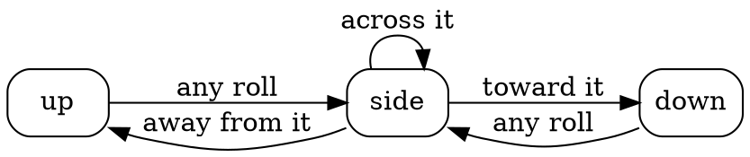

# Rolling a Cube to Cook-Levin

This book teaches P versus NP, SAT and the Cook-Levin theorem through one toy: a cube that rolls across a board of tiles and lights the tiles it lands on with its painted face. You can roll it yourself in the [playground](https://roc.lynrummy.com/nibble/cube.html) as you read.

## Easy to check, hard to find

Some answers take seconds to check and ages to find. This book is about that gap, which sits behind the most famous open question in computer science, P versus NP.

### A cube that paints

A board of 4 × 4 tiles starts dark, with a cube on its north-west corner, one of its six faces painted. A program is a string of the letters N, E, S and W, each tipping the cube over an edge onto the next tile. When the cube lands painted face down, the tile under it flips between dark and lit. The tiles lit at the end are the program's lit set, and a puzzle asks for a short program leaving a given one.

### Checking is quick, finding seems slow

Suppose someone hands you a program said to light every tile but d4 in 45 rolls. Checking it takes one run. The plainest way to find one, the blind tryout, runs every program of one roll, then of two, and so on, until one works. There are 4^45 = 1,237,940,039,285,380,274,899,124,224 programs of 45 rolls alone.

The state flood of {{chapter Same state, same future}} follows the cube's states instead of its programs and answers every 4 × 4 puzzle at once. The blind tryout's work grows with the 4^k programs, and the flood's with the board's 2^(n²) lit sets, so each tile a board gains doubles it. Both grow exponentially; whether some way grows polynomially is the open question.

### The question, exactly

The puzzle has three inputs: a board size n, a pattern of lit tiles, and a budget k. It asks whether some program of at most k rolls lights exactly that pattern. A program that does is a certificate, checked by rolling it once. A later part proves that every pattern some program lights has one of polynomially many rolls in n (polynomial in the input's size, about n² bits), so a yes answer has a short certificate.

Problems whose yes answers have such certificates, short and checkable in polynomial time, form the class NP. Problems solvable in polynomial time form the class P. P versus NP asks whether every problem in NP is in P, and nobody knows.

Hardness is about how the work grows with n: the playground's 4 × 4 board is a finite set of instances, settled by the lookup table it keeps.

Later parts prove the cube's puzzle NP-complete: in NP, and as hard as any problem in NP, meaning every problem in NP converts to it in polynomial time. The proof starts from a problem already known to be NP-complete; the first such problem, SAT, comes from the Cook-Levin theorem, whose construction also turns the cube into a formula for a SAT solver. A yes answer comes with a program to roll, and the other answer with a proof a small program checks, which can be exponentially long; whether it can always be short is the open question of NP versus coNP.

## A programming language with four words

RollScript, the cube's programming language, has four instructions and one rule, and its whole definition is a short Roc program.

### The rules

| Part | Rule |
|---|---|
| the board | 4 × 4 tiles, all dark at the start |
| the tiles | numbered 0 to 15, and named a1 to d4 as on a chessboard |
| a roll | N, E, S or W: the cube tips over a bottom edge onto the next tile |
| an opcode | a roll's 2 bits: N 00, E 01, S 10, W 11 |
| a landing | when the painted face lands down, the tile under it flips |
| the start | the cube on a1, the painted face up |
| the result | the lit set, the tiles lit at the end |
| off the board | a roll off the board halts the program, and the rolls after it are skipped |
| the length | at most 45 rolls |

```text
north is up
      a   b   c   d
  1   0   1   2   3
  2   4   5   6   7
  3   8   9  10  11
  4  12  13  14  15
```

Each roll is one instruction, and its opcode is its 2 bits, so a program of k rolls is 2k bits of machine code. You type the letters, and the playground shows each roll's opcode beside it. The cap of 45 rolls is the playground's, and the puzzle in general takes its budget k as an input.

A lit set is also a 16-bit number, in which tile i counts 2 to the power i, so the lit set of tiles 1, 2, 4 and 8 is 278 = 2 + 4 + 16 + 256. Those tiles are the powers of 2, so a program lighting them answers "is n a power of 2?" for every n from 0 to 15.

### Where the paint goes

A roll moves the paint one step around a loop of four, from up to ahead, ahead to down, down to behind and behind to up, where ahead is the way the cube rolls. The two faces across the roll stay where they point.

### A first run

ESSWNN runs like this:

| Roll | Opcode | The cube on | The paint | Lit tiles | Lit set |
|---|---|---|---|---|---:|
| start |  | a1, 0 | up | — | 0 |
| 1: E | 01 | b1, 1 | east | — | 0 |
| 2: S | 10 | b2, 5 | east | — | 0 |
| 3: S | 10 | b3, 9 | east | — | 0 |
| 4: W | 11 | a3, 8 | up | — | 0 |
| 5: N | 00 | a2, 4 | north | — | 0 |
| 6: N | 00 | a1, 0 | down | 0 | 1 |

The rolls east and south swing the paint east and keep it there. Rolling west brings it back up, and the rolls north swing it north and then down onto a1.

### Rolling off the edge

ESENNSSS rolls off the board at its fifth roll:

| Roll | Opcode | The cube on | The paint | Lit tiles | Lit set |
|---|---|---|---|---|---:|
| start |  | a1, 0 | up | — | 0 |
| 1: E | 01 | b1, 1 | east | — | 0 |
| 2: S | 10 | b2, 5 | east | — | 0 |
| 3: E | 01 | c2, 6 | down | 6 | 64 |
| 4: N | 00 | c1, 2 | south | 6 | 64 |
| 5: N | 00 | off the board | halted | 6 | 64 |

The fifth roll would carry the cube north off c1, so the program halts with c2 lit and skips the rolls south. A halted program lights exactly what its rolls before the halt light.

### The rules in Roc

The rules live in `roc/Cube.roc`, in the book's [repository](https://github.com/showell/cook-levin-riff), written in Roc, a functional programming language. A state is the tile the cube is on, which the code calls its `cell`, where the paint points, and the lit set.

{{lines roc/Cube.roc from "Roll : [N, E, S, W]" to "State : { cell"}}

`[N, E, S, W]` is a tag union, Roc's "exactly one of these". `ahead` and `behind` name the faces a roll tips toward and away from, and `face_after` moves the paint around the loop.

{{function roc/Cube.roc ahead}}

{{function roc/Cube.roc behind}}

{{function roc/Cube.roc face_after}}

`Try(U64, [OffBoard])` is a tile's number, or the news that the cube left the board:

{{function roc/Cube.roc cell_after}}

`roll` puts the two together, and its `?` hands an `OffBoard` back to the caller:

{{function roc/Cube.roc roll}}

`play` runs a whole program, a `roll` a letter, until the first roll off the board ({{chapter Appendix: how the book is built}}). The [playground](https://roc.lynrummy.com/nibble/cube.html) is this code compiled to WebAssembly.

## Your first programs

Each challenge here is a question about the numbers 0 to 15, and a program answers it by lighting tile n exactly when the answer for n is yes.

### Par

In golf, a hole's par is the number of strokes a good player needs. Here a lit set's par is the fewest rolls of any program that leaves exactly that set lit, wherever the cube ends. Par is measured over programs of any length, even past the cap of 45 rolls. The playground's pars come from the state flood, a C version of the program that {{chapter Same state, same future}} builds in Python, which finds the fewest rolls for each of the 65,536 lit sets.

### The challenges

Try each one in the playground before you read its row: roll until the playground names the question your lit set answers.

| Question | Lit tiles | Lit set | Par | A shortest program |
|---|---|---:|---:|---|
| is_zero | 0 | 1 | 6 | `ESSWNN` |
| is_one | 1 | 2 | 7 | `EEEWSWN` |
| is_two | 2 | 4 | 2 | `EE` |
| is_five | 5 | 32 | 8 | `ESENSNWS` |
| is_fifteen | 15 | 32,768 | 8 | `ESWSEEES` |
| is_tiny | 0, 1, 2, 3 | 15 | 12 | `EESENSWWNSWN` |
| is_small_even | 0, 2, 4, 6 | 85 | 12 | `EEESWNWWSENW` |
| is_power_of_2 | 1, 2, 4, 8 | 278 | 13 | `EESWNSESWWENW` |
| is_square | 0, 1, 4, 9 | 531 | 13 | `SESENNWSWNESW` |
| is_huge | 12, 13, 14, 15 | 61,440 | 14 | `ESWSSNESNESNES` |
| is_prime | 2, 3, 5, 7, 11, 13 | 10,412 | 20 | `EESENWSEWSENNWSWESSW` |
| is_small | 0, 1, 2, 3, 4, 5, 6, 7 | 255 | 23 | `EESENWSENWSNWSNWSENWSEN` |
| is_even | 0, 2, 4, 6, 8, 10, 12, 14 | 21,845 | 24 | `EEESWESWESWNWWSENWENWENW` |
| is_odd | 1, 3, 5, 7, 9, 11, 13, 15 | 43,690 | 26 | `SESENWENWSEENWSEWSEWSENWWS` |

Other programs of the same length may answer the same question. is_even and is_odd each light eight tiles and differ by two rolls, so where the tiles are matters as well as how many.

### Near is far, and far is near

Tile 0, where the cube starts, costs 6 rolls, while tile 2, two tiles east, costs 2: roll east twice, and the paint goes from up to east to down, landing on c1. To light a1, the paint has to leave the top, swing around and come down again, and every roll moves the cube too, so the cube must leave a1 and come back with the paint pointing the right way. The grid gives each tile's par when it is lit alone, laid out as the board is.

```text
      a   b   c   d
  1   6   7   2   5
  2   7   8   3   6
  3   2   3   4   5
  4   5   6   5   8
```

### A program that undoes its own work

is_five, b2 alone, takes 8 rolls, and its shortest program, `ESENSNWS`, lights an unwanted tile on the way. Its first four rolls are ESENNSSS's from {{chapter A programming language with four words}}: they light c2 and leave the cube on c1 with the paint south, the way it must point to come down on b2.

| Roll | Opcode | The cube on | The paint | Lit tiles | Lit set |
|---|---|---|---|---|---:|
| 1–4: ESEN |  | c1, 2 | south | 6 | 64 |
| 5: S | 10 | c2, 6 | down | — | 0 |
| 6: N | 00 | c1, 2 | south | — | 0 |
| 7: W | 11 | b1, 1 | south | — | 0 |
| 8: S | 10 | b2, 5 | down | 5 | 32 |

But c2 is still lit, and `ESENWS` lights b2 and c2 both. So roll 5 lands on c2 face down a second time to put it out, and roll 6 brings the paint back south on c1, ready for the walk west and south onto b2. A flip is its own undo, so a program may light a tile on the way and put it out again.

## A board where nothing ever happens

On a 2 × 2 board no program ever lights a tile. The proof is an invariant, a fact every roll preserves, the same reasoning that proves a loop correct.

### The theorem

Theorem 1: on a 2 × 2 board, starting on a1 with the paint up, every program leaves every tile dark.

The state flood, which {{chapter Same state, same future}} builds, lists every state the cube can reach from the start. On this board it reaches 12 of the 384 states (4 tiles × 6 directions for the paint × 16 lit sets), every one with the board dark, so the other 15 patterns are out of reach. That list covers one board, and the proof says why.

### The invariant

Every tile of a 2 × 2 board is a corner with two walls, the two sides of the board it touches: a1 has walls to the north and the west, and b2 to the south and the east. A corner's two open directions are the opposites of its walls.

The invariant is that the paint points up, or toward a wall of the tile the cube is on. The state flood's record of where it found the paint fits it exactly:

| The cube on | The paint points |
|---|---|
| a1 | up, north, west |
| b1 | up, north, east |
| a2 | up, south, west |
| b2 | up, south, east |

So while the invariant holds, the paint stays off the bottom and every tile stays dark.

### The proof

At the start the paint points up. Now take a roll in some direction d from a tile where the invariant holds. If d points at a wall, the roll halts the program. Otherwise d is open, so its opposite is a wall of this tile, and the cube rolls to the corner on the d side, where d points at a wall. The paint comes down only from the face pointing toward d, which is open, so the invariant rules that face out. The paint is in one of the three places the invariant allows, and each lands in an allowed place:

| Before the roll | After the roll | Why the invariant still holds |
|---|---|---|
| up | toward d | d points at a wall of the new tile |
| toward the wall opposite d | up | up is always allowed |
| toward the other wall, across the roll | the same way | the roll keeps the cube on that side of the board, so that wall is still a wall |

By induction the invariant holds after every roll of every program, which proves Theorem 1.

### Why bigger boards are different

The proof leans on one fact: on a 2 × 2 board, every roll that stays on the board lands in a corner, with a wall straight ahead. On a bigger board the way ahead can be open. Rolling east from a1 leaves the paint east at b1, so a second roll east brings it down onto c1. That is is_two's program from {{chapter Your first programs}}, and the invariant fails at its first roll.

## Code golf and proving lower bounds

Lighting m tiles takes at least 3m − 1 rolls, and on the 4 × 4 board that bound is met for every m.

### The floor

The challenges of {{chapter Your first programs}} were code golf, where players compete for the shortest program. A short program is a claim you check by running it, but a lower bound is a claim about every program, so it needs a proof.

Theorem 2: on any board, a program that leaves m lit tiles, with m at least 1, has at least 3m − 1 rolls.

The proof watches only where the paint points, which is one of three kinds of place: up, down, or one of the four sides.

Where the paint can go in one roll


From up or from down, every roll takes the paint to a side. From a side, only the roll toward the paint brings it down. So the paint reaches down at the earliest two rolls after it was up, and two rolls after it was last down.

### The proof

A tile ends lit only if it flipped an odd number of times, so each lit tile had at least one landing on it with the paint down. List the program's landings face down in order. The first comes at roll 2 at the earliest, since the paint starts up. Two landings in a row are at least two rolls apart, by the diagram. Exactly two means the paint went from down to a side by some roll r, then back down by the one roll toward it. That side is behind r, so the second roll is the opposite of r, and it carries the cube back to the tile it just left. So two landings on different tiles are at least three rolls apart.

The landings visit at least m tiles, so they change tile at least m − 1 times, and the last comes at roll 2 + 3(m − 1) = 3m − 1 at the earliest. A halted program lights only what its rolls before the halt light, so the count holds for those rolls. That proves Theorem 2.

### The floor is met

Theorem 3: on the 4 × 4 board, for every m from 1 to 16, some lit set of m tiles has par exactly 3m − 1.

The state flood's pars give such a set for each m, and the table shows the lowest-numbered one.

| m | 3m − 1 | Lit set | A shortest program |
|---:|---:|---:|---|
| 1 | 2 | 4 | `EE` |
| 2 | 5 | 6 | `EESWN` |
| 3 | 8 | 7 | `EESWNSWN` |
| 4 | 11 | 23 | `EESWNSWNESW` |
| 5 | 14 | 55 | `EESWNESWNWSENW` |
| 6 | 17 | 119 | `EEESWNWSNWSENWSEN` |
| 7 | 20 | 239 | `EESENWSENWSNWSENWSWN` |
| 8 | 23 | 255 | `EESENWSENWSNWSNWSENWSEN` |
| 9 | 26 | 511 | `EESENWSENWSNWSENWSWNESWESW` |
| 10 | 29 | 1,023 | `EESENWSENWSNWSENWSWNESWESWNES` |
| 11 | 32 | 2,047 | `EESENWSENWSNWSENWSWNESWESWNESNES` |
| 12 | 35 | 4,095 | `EEESWNWSENWSWNESWESWNESNESNESWNEWNE` |
| 13 | 38 | 12,287 | `EESENWSEWSENWSENWNWSENWSWNESWESWNESESW` |
| 14 | 41 | 16,383 | `EEESWNWSENWSWNESWESWESWNESENWNESNESWNEWNE` |
| 15 | 44 | 49,151 | `EESENWSENWSNWSENWSWNESWESWESWNESENWNESNESWSE` |
| 16 | 47 | 65,535 | `EEESWNWSENWSWNESWESWESWNESENWNESESWNESWNEWNEWNE` |

Each program has exactly 3m − 1 rolls, and Theorem 2 says nothing shorter lights its set, so each is a par.

Most lit sets sit above the floor, and how far above is the puzzle. Tiles 0 and 5, a1 and b2, cost 14 rolls against a floor of 5, and `ESENWSNESWSWNN` lights them. Computing the excess exactly is the cube's puzzle itself, which a later part shows NP-complete.

## Same state, same future

The state flood of {{chapter Your first programs}} rests on one theorem: a program's future on the board depends only on its state.

### The theorem

The blind tryout of {{chapter Easy to check, hard to find}} repeats most of its work: the programs `EW` and `SN` both bring the cube back to the start, so whatever follows either runs as it would alone.

Theorem 4: if two programs that stay on the board leave the cube in the same state (the same tile under the cube, the same paint direction and the same lit tiles), then the same rolls added to each leave them in the same state again, or halt both at the same roll.

For a program on the board, a roll's result is computed from the state alone, as `roll` in {{chapter A programming language with four words}} shows. So the same state and the same roll give the same next state or the same halt, and by induction the same after any number of rolls. The theorem leaves out halted programs. The empty program and `N` both leave the start state, but `N` has halted, so `NEE` leaves the board dark while `EE` lights c1.

### The state flood

The flood visits each reachable state once, starting from the start state at distance 0. It skips every roll off the board, since a halted program lights what its earlier rolls light, so no shortest program halts. This is breadth-first search, a form of dynamic programming: the distance of every state but the start is one more than the least distance of a state that rolls into it. A lit set's par is the distance of the nearest state with that set lit. The flood fits in a few dozen lines of Python.

{{file cube_book/shortest.py}}

### What it finds

On the 3 × 3 board the flood's whole table fits a page.

```text
$ python3 cube_book/shortest.py 3
3x3: 27648 states reached, 512 patterns lit
par  patterns
  0         1
  1         0
  2         2
  3         2
  4         1
  5         4
  6        10
  7         8
  8        12
  9        27
 10        22
 11        30
 12        38
 13        48
 14        39
 15        64
 16        40
 17        44
 18        44
 19        25
 20        24
 21         9
 22         8
 23         5
 24         4
 25         0
 26         1
```

The flood reaches every one of the 27,648 states, and the one pattern at par 26 is every tile lit. Par 1 is empty, since the paint needs two rolls to reach the bottom. Par 25 is empty because of where the sizes fall: every set of eight lit tiles has par 23 or 24, all nine take 26, and the smaller sets stay lower.

| Lit tiles | Least par | Greatest par |
|---:|---:|---:|
| 0 | 0 | 0 |
| 1 | 2 | 8 |
| 2 | 5 | 14 |
| 3 | 8 | 16 |
| 4 | 11 | 18 |
| 5 | 14 | 22 |
| 6 | 17 | 20 |
| 7 | 20 | 22 |
| 8 | 23 | 24 |
| 9 | 26 | 26 |

### How far the flood goes

| Board | Tiles | Lit sets | States in all (tiles × 6 × lit sets) |
|---|---:|---:|---:|
| 2 × 2 | 4 | 16 | 384 |
| 3 × 3 | 9 | 512 | 27,648 |
| 4 × 4 | 16 | 65,536 | 6,291,456 |
| 5 × 5 | 25 | 33,554,432 | 5,033,164,800 |

The flood reaches only 12 of the 384 states on 2 × 2, and every state on the bigger boards. The playground's pars come from a C version that keeps each state's distance in an array and reaches all 6,291,456 states of the 4 × 4 board. `python3 cube_book/shortest.py 4` prints the same pars in about half a minute, its dictionary of states holding about a gigabyte and a half. The 5 × 5 board's five billion states are where visiting every state runs out of road. Later chapters bring in a SAT solver there, which may be just as slow in the worst case, but is often fast on formulas with structure, like the cube's.

## Appendix: how the book is built

Every number in this book is printed by a program that runs when the book is built. The build holds each table and each number in the prose to that output, and it stops when they disagree. The programs implement the rules separately, in Roc, C and Python, and find their answers in different ways, so a number two of them print rests on both.

The programs live in the book's [repository](https://github.com/showell/cook-levin-riff):

| File | What it is |
|---|---|
| `roc/Cube.roc` | the rules in Roc, which the playground runs |
| `cube/cube.h`, `cube/cube.c` | the rules in C |
| `cube/census.c` | the state flood in C, which gives every par on the 4 × 4 board |
| `cube/golden/census4.txt` | the C flood's report on the 4 × 4 board, which the repository's tests hold |
| `cube_book/shortest.py` | the state flood in Python, from {{chapter Same state, same future}} |
| `cube_book/tables.py` | the book's tables and traces, from the C flood's pars |

### The rest of the rules in Roc

The board's side is `size`, and `start` is the state every program begins in.

{{function roc/Cube.roc size}}

{{function roc/Cube.roc start}}

`play` runs a whole program. Roc lets a local variable change inside a function when its name starts with `$`, and the loop uses that to keep the state, the frames (the state after each roll made), and whether the program has halted. A program longer than the cap is refused as `TooLong`. A run is its frames and how it ended:

{{lines roc/Cube.roc from "## How a run ended" to "Run : { frames"}}

{{function roc/Cube.roc play}}

It reads each letter with `roll_of`, which skips a space:

{{function roc/Cube.roc roll_of}}

The cap is `max_length`, the shortest length that reaches every lit set but one.

{{lines roc/Cube.roc from "max_length : U64" to "max_length = 45"}}

A program's result, its lit set, is `lit_by`:

{{function roc/Cube.roc lit_by}}

The file ends with tests, written as `expect` lines. These roll shortest programs from the C flood's report, which the code calls the census, through `play` and compare what they light:

{{lines roc/Cube.roc from "# The census's levels" to "Ok(32)"}}
