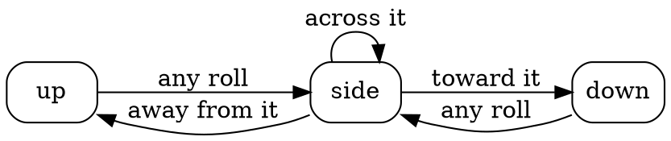

# Rolling a Cube to Cook-Levin

This book teaches P versus NP, SAT and the Cook-Levin theorem through one toy: a cube that rolls across a board of tiles and lights the tiles it lands on with its painted face. You can roll it yourself in the [playground](https://roc.lynrummy.com/nibble/cube.html) as you read.

- {{chapter Easy to check, hard to find}}
- {{chapter A programming language with four words}}
- {{chapter Your first programs}}
- {{chapter A board where nothing ever happens}}
- {{chapter Code golf and proving lower bounds}}
- {{chapter Same state, same future}}

## Easy to check, hard to find

Some answers take seconds to check and ages to find. This book is about that gap, which sits behind the most famous open question in computer science, P versus NP.

### A cube that paints

A board of 4 × 4 tiles starts dark. A cube the size of one tile sits on the north-west corner, with one of its six faces painted. A program is a string of the letters N, E, S and W, and each letter tips the cube over an edge into the next cell. Whenever the cube lands with its painted face down, the tile under it flips between dark and lit. The tiles lit at the end are the program's lit set, and a puzzle asks for a short program that leaves a given lit set.

### Checking is quick, finding is slow

Suppose someone hands you a program that, they say, lights every tile. You check it by rolling the cube through it once. Finding such a program is another matter, since lighting every tile takes 47 rolls. The plainest way to look is the blind tryout: run every program of one roll, then of two, and so on, until one works. There are 19,807,040,628,566,084,398,385,987,584 programs of 47 rolls alone. That lopsidedness is the subject of the whole book.

{{chapter Same state, same future}} finds every answer on this board faster, by following the cube's states instead of its programs. But each tile a board gains doubles its lit sets, so that way also grows exponentially with the board. Whether some way grows only polynomially is the open question.

### The question, exactly

The puzzle has three inputs: a board size n, a pattern of lit tiles, and a budget k. It asks whether some program of at most k rolls lights exactly that pattern. A program that does is a certificate, checked by rolling it once. A later chapter proves that the shortest program for any pattern grows at most polynomially with n, so a certificate is always short.

Problems whose yes answers have certificates like that, polynomially long and checkable in polynomial time, form the class NP. Problems solvable in polynomial time form the class P. P versus NP asks whether every problem in NP is in P, and nobody knows.

Hardness is about how the work grows with n. The playground's 4 × 4 board, with at most 45 rolls, is one finite instance, settled for good by the table of answers that the playground keeps.

### The route

After this part, which teaches the cube, the book defines P and NP precisely and proves that the cube's puzzle is NP-complete: in NP, and as hard as any problem in NP. Then the construction behind the Cook-Levin theorem turns the cube into a logic formula for a SAT solver to answer. Each answer comes with evidence: a program to roll when the answer is yes, and otherwise a proof that a small program checks, though that proof can be long.

## A programming language with four words

RollScript, the cube's programming language, has four instructions and one rule, and its whole definition is a short Roc program that also runs the playground.

### The rules

| | |
|---|---|
| the board | 4 × 4 tiles, all dark at the start |
| the cells | numbered 0 to 15, and named a1 to d4 as on a chessboard |
| a roll | N, E, S or W: the cube tips over a bottom edge into the next cell |
| a landing | when the painted face lands down, the tile under it flips |
| the start | the cube on a1, the painted face up |
| the result | the lit set, the tiles lit at the end |
| off the board | a roll off the board halts the program, and the rolls after it are skipped |
| the length | at most 45 rolls |

```text
north is up
      a   b   c   d
  1   0   1   2   3
  2   4   5   6   7
  3   8   9  10  11
  4  12  13  14  15
```

A lit set is also a 16-bit number, in which cell i counts 2 to the power i, so the lit set of cells 1, 2, 4 and 8 is 278 = 2 + 4 + 16 + 256. Those cells are the powers of 2, so a program lighting them answers "is n a power of 2?" for every n from 0 to 15.

### Where the paint goes

Rolling north tips the cube over its north bottom edge: the top swings north, the north face goes down, the bottom swings south, and the south face comes up, while the east and west faces turn in place. The other rolls are the same, turned, so a roll moves the paint one step around a loop of four, up to ahead to down to behind.

### A first run

ESSWNN runs like this:

```text
roll   the cube on  the paint  lit cells  lit set
start  a1, 0        up         —          0
1: E   b1, 1        east       —          0
2: S   b2, 5        east       —          0
3: S   b3, 9        east       —          0
4: W   a3, 8        up         —          0
5: N   a2, 4        north      —          0
6: N   a1, 0        down       0          1
```

The rolls east and south swing the paint east and keep it there. Rolling west brings it back up, and the rolls north swing it north and then down onto a1.

### Rolling off the edge

Here is ESENNSSS:

```text
roll   the cube on    the paint  lit cells  lit set
start  a1, 0          up         —          0
1: E   b1, 1          east       —          0
2: S   b2, 5          east       —          0
3: E   c2, 6          down       6          64
4: N   c1, 2          south      6          64
5: N   off the board  halted     6          64
```

The fifth roll would carry the cube north off c1, so the program halts with c2 lit and skips the rolls south. A halted program lights exactly what its rolls before the halt light.

### The rules in Roc

The rules live in `roc/Cube.roc`, in Roc, a functional programming language. A state is the cube's cell, where the paint points, and the lit set.

{{lines roc/Cube.roc from "Roll : [N, E, S, W]" to "State : { cell"}}

`[N, E, S, W]` is a tag union, Roc's "exactly one of these". The board's side and the start:

{{function roc/Cube.roc size}}

{{function roc/Cube.roc start}}

The loop of four, from the faces ahead of and behind a roll:

{{lines roc/Cube.roc from "ahead : Cube.Roll" to "W => East"}}

{{function roc/Cube.roc face_after}}

`Try(U64, [OffBoard])` is a cell, or the news that the cube left the board:

{{function roc/Cube.roc cell_after}}

`roll` puts the two together, and its `?` hands an `OffBoard` back to the caller:

{{function roc/Cube.roc roll}}

`play` runs a whole program, a `roll` a letter, until the first roll off the board ({{chapter Appendix: how the book is built}}). The [playground](https://roc.lynrummy.com/nibble/cube.html) is this code compiled to WebAssembly.

## Your first programs

Each challenge here is a question about the numbers 0 to 15, and a program answers it by lighting tile n exactly when the answer for n is yes.

### Par

In golf, a hole's par is the number of strokes a good player needs. Here a lit set's par is the fewest rolls of any program that leaves exactly that set lit, wherever the cube ends. Par is measured over programs of any length. RollScript's cap of 45 rolls is just long enough for every lit set but one: the playground's longest sample lights every tile but d4 in 45 rolls, and every tile takes 47 rolls. Type a program into the [playground](https://roc.lynrummy.com/nibble/cube.html) and it shows the lit set and its par.

The playground knows every par ahead of time, because a program worked out one thing for it: for each of the 65,536 lit sets, the fewest rolls that leave it. That program is the state flood. It begins at the start, rolls each of the four ways from everything reached so far, one distance at a time, and notes the distance at which each lit set first appears. {{chapter Same state, same future}} builds it and proves it right.

### The challenges

Try each one in the playground before you read its row.

```text
question       lit cells                  lit set  par  a shortest program
is_zero        0                          1        6    ESSWNN
is_one         1                          2        7    EEEWSWN
is_two         2                          4        2    EE
is_five        5                          32       8    ESENSNWS
is_fifteen     15                         32,768   8    ESWSEEES
is_tiny        0, 1, 2, 3                 15       12   EESENSWWNSWN
is_small_even  0, 2, 4, 6                 85       12   EEESWNWWSENW
is_power_of_2  1, 2, 4, 8                 278      13   EESWNSESWWENW
is_square      0, 1, 4, 9                 531      13   SESENNWSWNESW
is_huge        12, 13, 14, 15             61,440   14   ESWSSNESNESNES
is_prime       2, 3, 5, 7, 11, 13         10,412   20   EESENWSEWSENNWSWESSW
is_small       0, 1, 2, 3, 4, 5, 6, 7     255      23   EESENWSENWSNWSNWSENWSEN
is_even        0, 2, 4, 6, 8, 10, 12, 14  21,845   24   EEESWESWESWNWWSENWENWENW
is_odd         1, 3, 5, 7, 9, 11, 13, 15  43,690   26   SESENWENWSEENWSEWSEWSENWWS
```

Other programs of the same length may answer the same question. is_even and is_odd each light eight tiles and differ by two rolls, so where the tiles are matters as well as how many.

### Near is far, and far is near

The rows for is_zero and is_two hold the surprise. Cell 0, where the cube starts, costs 6 rolls, while cell 2, two cells east, costs 2: roll east twice, and the paint goes from up to east to down, landing on c1. To light a1, the paint has to leave the top, swing around and come down again, and every roll moves the cube too, so the cube must leave a1 and come back with the paint pointing the right way. Here is the par of each tile lit alone:

```text
the par of each tile lit alone
      6   7   2   5
      7   8   3   6
      2   3   4   5
      5   6   5   8
```

### A program that undoes its own work

is_five, b2 alone, takes 8 rolls, and its shortest program lights an unwanted tile on the way:

```text
roll   the cube on  the paint  lit cells  lit set
start  a1, 0        up         —          0
1: E   b1, 1        east       —          0
2: S   b2, 5        east       —          0
3: E   c2, 6        down       6          64
4: N   c1, 2        south      6          64
5: S   c2, 6        down       —          0
6: N   c1, 2        south      —          0
7: W   b1, 1        south      —          0
8: S   b2, 5        down       5          32
```

The first three rolls put the paint down on c2, which lights. Roll 4, north to c1, turns the paint south, which is what the cube needs to drop it onto b2. But c2 is still lit, and `ESENWS` lights b2 and c2 both. So roll 5 goes back south and lands on c2 face down a second time, which puts it out, and roll 6 returns to c1 with the paint south again. Rolls 7 and 8 carry the cube west and south onto b2, paint down. A flip is its own undo, so a program may light a tile on the way and put it out again.

## A board where nothing ever happens

On a 2 × 2 board no program ever lights a tile. The proof is an invariant, a fact every roll preserves, the same reasoning that proves a loop correct.

### The theorem

Theorem 1: on a 2 × 2 board, starting on a1 with the paint up, every program leaves every tile dark.

The state flood of {{chapter Your first programs}}, run on this board, finds every state the cube can reach: 12 of the 384 states, every one with the board dark, so the other 15 patterns are out of reach. That list covers one board, and the proof says why.

### The invariant

Every cell of a 2 × 2 board is a corner with two walls, the two sides of the board it touches: a1 has walls to the north and the west, and b2 to the south and the east. A corner's two open directions are the opposites of its walls.

The invariant is that the paint points up, or toward a wall of the cell the cube is on. The state flood's record of where it found the paint fits it exactly:

| The cube on | The paint points |
|---|---|
| a1 | up, north, west |
| b1 | up, north, east |
| a2 | up, south, west |
| b2 | up, south, east |

So while the invariant holds, the paint stays off the bottom and every tile stays dark.

### The proof

At the start the paint points up. Now take a roll in some direction d from a cell where the invariant holds. If d points at a wall, the roll halts the program. Otherwise d is open, so its opposite is a wall of this cell, and the cube rolls to the corner on the d side, where d points at a wall. The paint is in one of the three places the invariant allows, and each lands in an allowed place:

| Before the roll | After the roll | Why the invariant still holds |
|---|---|---|
| up | toward d | d points at a wall of the new cell |
| toward the wall opposite d | up | up is always allowed |
| toward the other wall, across the roll | the same way | the roll keeps the cube on that side of the board, so that wall is still a wall |

The paint comes down only from the face pointing toward d, which is open, so the invariant rules that face out. By induction the invariant holds after every roll of every program, which proves Theorem 1.

### Why bigger boards are different

The proof leans on one fact: on a 2 × 2 board, every roll that stays on the board lands in a corner, with a wall straight ahead. On a bigger board the way ahead can be open. Rolling east from a1 leaves the paint east at b1, so a second roll east brings it down onto c1. That is is_two's program from {{chapter Your first programs}}, and the invariant fails at its first roll.

## Code golf and proving lower bounds

Lighting m tiles takes at least 3m − 1 rolls, and on the 4 × 4 board that bound is met for every m.

### The floor

The challenges of {{chapter Your first programs}} were code golf, where players compete for the shortest program. A short program is a claim you check by running it, but a lower bound is a claim about every program, so it needs a proof.

Theorem 2: on any board, a program that leaves m lit tiles, with m at least 1, has at least 3m − 1 rolls.

The proof watches only where the paint points, which is one of three kinds of place: up, down, or one of the four sides.

Where the paint can go in one roll


From up or from down, every roll takes the paint to a side. From a side, only the roll toward the paint brings it down. So the paint reaches down at the earliest two rolls after it was up, and two rolls after it was last down.

### The proof

A tile ends lit only if it flipped an odd number of times, so each lit tile had at least one landing on it with the paint down. List the program's landings face down in order. The first comes at roll 2 at the earliest, since the paint starts up. Two landings in a row are at least two rolls apart, by the diagram. Exactly two means the paint went from down to a side by some roll r, then back down by the one roll toward it. That side is behind r, so the second roll is the opposite of r, and it carries the cube back to the tile it just left. So two landings on different tiles are at least three rolls apart.

The landings visit at least m tiles, so they change tile at least m − 1 times, and the last comes at roll 2 + 3(m − 1) = 3m − 1 at the earliest. A halted program lights only what its rolls before the halt light, so the count holds for those rolls. That proves Theorem 2.

### The floor is met

Theorem 3: on the 4 × 4 board, for every m from 1 to 16, some lit set of m tiles has par exactly 3m − 1.

What we look for is one lit set of each size m with par exactly 3m − 1. The state flood's pars hold it, and here is the lowest-numbered such set for each m:

```text
m   3m − 1  lit set  a shortest program
1   2       4        EE
2   5       6        EESWN
3   8       7        EESWNSWN
4   11      23       EESWNSWNESW
5   14      55       EESWNESWNWSENW
6   17      119      EEESWNWSNWSENWSEN
7   20      239      EESENWSENWSNWSENWSWN
8   23      255      EESENWSENWSNWSNWSENWSEN
9   26      511      EESENWSENWSNWSENWSWNESWESW
10  29      1,023    EESENWSENWSNWSENWSWNESWESWNES
11  32      2,047    EESENWSENWSNWSENWSWNESWESWNESNES
12  35      4,095    EEESWNWSENWSWNESWESWNESNESNESWNEWNE
13  38      12,287   EESENWSEWSENWSENWNWSENWSWNESWESWNESESW
14  41      16,383   EEESWNWSENWSWNESWESWESWNESENWNESNESWNEWNE
15  44      49,151   EESENWSENWSNWSENWSWNESWESWESWNESENWNESNESWSE
16  47      65,535   EEESWNWSENWSWNESWESWESWNESENWNESESWNESWNEWNEWNE
```

Each program has exactly 3m − 1 rolls, and Theorem 2 says nothing shorter lights its set, so each is a par. The last row, every tile lit, is two rolls past RollScript's cap of 45.

Most lit sets sit above the floor, and how far above is the puzzle. The tiles a1 and b2, cells 0 and 5, cost 14 rolls against a floor of 5. Predicting that excess as the board grows is a much harder problem.

## Same state, same future

The state flood of {{chapter Your first programs}} rests on one theorem: a program's future on the board depends only on its state.

### The theorem

The blind tryout of {{chapter Easy to check, hard to find}} repeats most of its work: the programs `EW` and `SN` both bring the cube back to the start, so whatever follows either runs as it would alone.

Theorem 4: if two programs that stay on the board leave the cube in the same state, the same cell, the paint pointing the same way and the same tiles lit, then the same rolls added to each leave them in the same state again, or halt both at the same roll.

For a program on the board, a roll's result is computed from the state alone, as `roll` in {{chapter A programming language with four words}} shows. So the same state and the same roll give the same next state or the same halt, and by induction the same after any number of rolls. A halted program ignores its later rolls, which is why the theorem leaves it out: `N` halts in the start state, the state the empty program leaves, but `EE` lights c1 only after the empty one.

### The state flood

So the flood visits each state once, asking how far it is from the start. Starting from the start state, at distance 0, it rolls each of the four ways from every state at one distance to find the new states at the next. It skips every roll off the board, since a halted program lights what its earlier rolls light. Because it finishes each distance before the next, the program that first reaches a state is a shortest one. This is breadth-first search, a form of dynamic programming: a state's distance is one more than the least distance of a state that rolls into it. A lit set's par is the distance of the nearest state with that set lit.

Here is the whole flood in Python:

{{file cube_book/shortest.py}}

### What it finds

On the 3 × 3 board, whose table fits a page:

```text
$ python3 cube_book/shortest.py 3
3x3: 27648 states reached, 512 patterns lit
par  patterns
  0         1
  1         0
  2         2
  3         2
  4         1
  5         4
  6        10
  7         8
  8        12
  9        27
 10        22
 11        30
 12        38
 13        48
 14        39
 15        64
 16        40
 17        44
 18        44
 19        25
 20        24
 21         9
 22         8
 23         5
 24         4
 25         0
 26         1
```

The flood reaches every one of the 27,648 states, and the one pattern at par 26 is every tile lit. Par 1 is empty, since the paint needs two rolls to reach the bottom. Par 25 is empty because the sets of eight lit tiles have par 23 or 24, the sets of seven or fewer have par at most 22, and all nine take 26.

### How far the flood goes

```text
board  tiles  lit sets    states
2 × 2  4      16          384
3 × 3  9      512         27,648
4 × 4  16     65,536      6,291,456
5 × 5  25     33,554,432  5,033,164,800
```

A C version of the flood, keeping each state's distance in an array, reaches all 6,291,456 states of the 4 × 4 board, and the playground's pars are its answers. The 5 × 5 board's five billion states are where visiting every state runs out of road. Later chapters bring in a SAT solver there, which may be just as slow in the worst case, but is often fast on formulas with structure, like the cube's.

## Appendix: how the book is built

Every number in this book is printed by a program that runs when the book is built. The build holds each table and each number in the prose to that output, and it stops when they disagree. The programs implement the rules separately, in Roc, C and Python, and find their answers in different ways, so a number two of them print rests on both.

The programs live in this repository:

| File | What it is |
|---|---|
| `roc/Cube.roc` | the rules in Roc, which the playground runs |
| `cube/cube.h`, `cube/cube.c` | the rules in C |
| `cube/census.c` | the census, the state flood in C, which gives every par on the 4 × 4 board |
| `cube/golden/census4.txt` | the census's report on the 4 × 4 board, which the repository's tests hold |
| `cube_book/shortest.py` | the state flood in Python, from {{chapter Same state, same future}} |
| `cube_book/tables.py` | the book's tables and traces, from the census's pars |

### The rest of the rules in Roc

`play` runs a whole program. Roc lets a local variable change inside a function when its name starts with `$`, and the loop uses that to keep the state, the frames (the state after each roll made), and whether the program has halted. A program longer than the cap is refused as `TooLong`.

{{function roc/Cube.roc play}}

It reads each letter with `roll_of`, which skips a space:

{{function roc/Cube.roc roll_of}}

The cap, the playground's 45 rolls:

{{function roc/Cube.roc max_length}}

A program's result, its lit set, is `lit_by`:

{{function roc/Cube.roc lit_by}}

The file ends with tests, written as `expect` lines. These roll shortest programs from the census's report through `play` and compare what they light:

{{lines roc/Cube.roc from "# The census's levels" to "Ok(32)"}}
